# AE系列篇-06.VAE的改进篇1-VQ-VAE

标准 VAE 使用连续潜在变量，其分布为高斯形式，对离散的、多模态的数据结构表达有限。VQ-VAE（Vector Quantized Variational Autoencoder）通过向量量化将连续潜在变量离散化，在保持 VAE 表达能力的同时获得离散表示的优势，并为 VQ-VAE-2、DALL-E 等自回归生成模型奠定基础。本章将介绍 VQ-VAE 的动机、理论、损失设计与代码实现。

## 1. VQ-VAE 的动机

### 1.1 回顾:原始 VAE 的局限

标准 VAE 使用**连续**隐变量 $z \in \mathbb{R}^d$，例如 $z \sim \mathcal{N}(\mu_\phi(x), \Sigma_\phi(x))$。

- **优点**:可微、易于优化（重参数化技巧），适合密度估计与平滑插值。
- **缺点**:隐空间是稠密且无结构的，难以自然表示**离散、符号化或高度多模态**的数据。

数学上仍写作:

$$q_\phi(z|x) = \mathcal{N}(z | \mu_\phi(x), \Sigma_\phi(x)) \tag{1}$$

具体局限包括:（1）连续潜在空间难以表达离散、多模态结构；（2）语言、类别等符号数据缺乏天然的连续表示；（3）连续表示的信息容量无界，不利于学习紧凑、有界的离散码。

### 1.2 为什么需要离散隐变量？

离散表示在许多场景中更自然、更有效:

| 应用场景 | 离散性的必要性 |
|----------|----------------|
| **多模态分布建模** | 一个输入可能对应多个合理输出（如“下雨”→“带伞”或“取消出行”），连续隐变量难以捕捉这种跳跃性 |
| **分类属性** | 社保号、邮政编码等:数字本身无序，不能用连续值插值 |
| **符号系统** | 语言（词/子词）、语音（音素）、规划（动作序列）——本质是离散符号 |

**离散隐变量 = 符号化表示（symbolic representation）**，更接近人类认知和传统 AI 的“符号主义”，也为与自回归模型、Transformer 等结合铺平道路。

### 1.3 离散 VAE 的核心挑战

我们仍希望最大化 ELBO:

$$\text{ELBO} = \underbrace{\mathbb{E}_{q_\phi(z|x)}[\log p_\theta(x|z)]}_{\text{重构损失}} - \underbrace{\text{KL}(q_\phi(z|x) \| p(z))}_{\text{正则化损失}} \tag{2}$$

<div align="center">

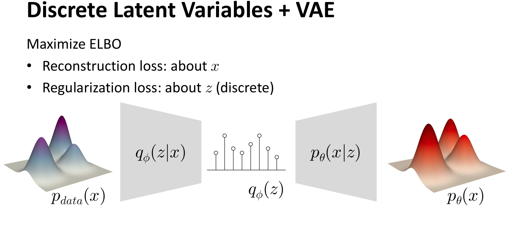

</div>

<small>**图1** VAE 离散化的结构图。</small>

- **重构损失**:只要能从 $z$ 解码出 $\hat{x}$，就可以计算（如 L2、交叉熵），离散 $z$ 下没问题。
- **正则化损失**:对离散 $z$ 也可定义（如分类 KL）。

<div align="center">

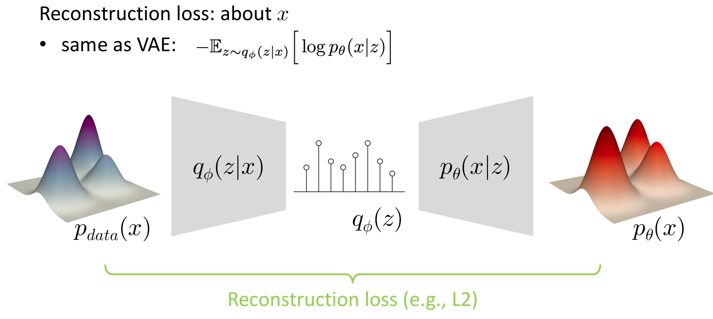

</div>

<small>**图2** 离散 VAE 的重构损失。</small>

<div align="center">

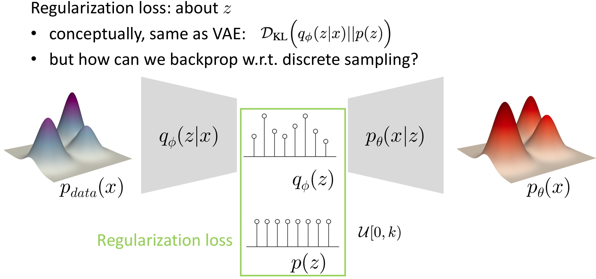

</div>

<small>**图3** 离散 VAE 的正则化损失。</small>

**关键问题**:若 $z$ 是离散的（如 one-hot 或 $\arg\max$ 得到的索引），采样过程不可导，梯度无法从解码器流回编码器，无法端到端训练。因此需要**可微的离散近似**或**梯度代理**。

### 1.4 启发:从 K-means 到可学习码本

K-means 虽简单，但提供了重要启示:

<div align="center">

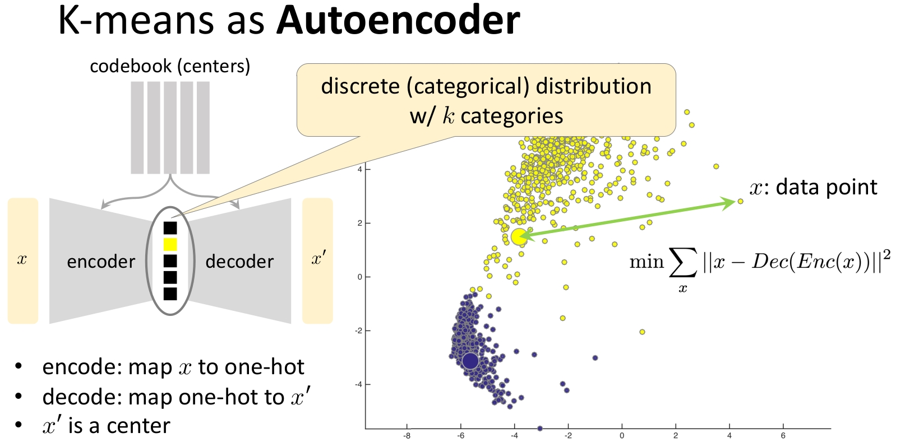

</div>

<small>**图4** K-means 作为自编码的结构图。</small>

- **自编码视角**:编码 $x \to \text{最近簇索引 } k$，解码 $k \to \mu_k$（码本中心）。
- **明确的重构目标**:最小化 $\|x - \mu_k\|^2$。
- **隐式鼓励码本均匀使用**:每个中心由其分配到的点更新，避免塌缩。

这启发我们:可以用类似“硬分配 + 码本更新”的方式处理离散隐变量，并用**直通估计器**解决不可微问题，从而得到可端到端训练的离散 VAE——即 VQ-VAE。

### 1.5 VQ-VAE 的改进目标

VQ-VAE 旨在:

- **离散潜在表示**:用 codebook 将编码器输出量化为离散索引，得到离散潜在变量。
- **保留表达能力**:编码器-解码器仍为连续映射，量化仅在中间一步完成。
- **可扩展生成**:离散码可交由自回归模型（如 PixelCNN、Transformer）建模，用于高质量生成。

<div align="center">

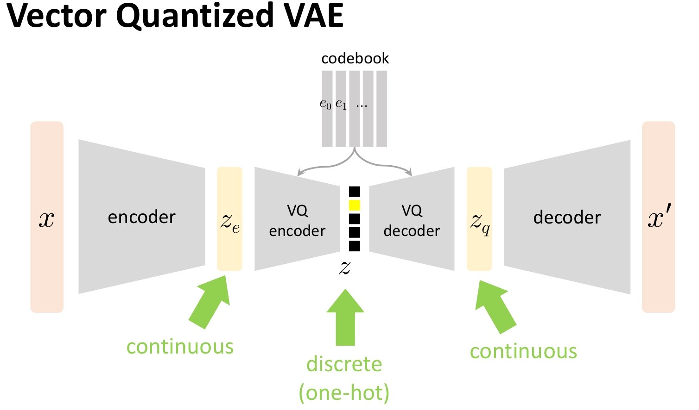

</div>

<small>**图5** VQ-VAE 架构图:输入经编码器得到连续表示 $z_e$，经向量量化得到离散码 $z_q$（对应 codebook 中的向量），再经解码器重构。量化通过最近邻查找实现，训练时用直通估计器保证梯度可传。</small>

## 2. VQ-VAE 的理论基础

### 2.1 整体结构

数据流为:

$$x \xrightarrow{\text{编码器 } E_\phi} z_e \xrightarrow{\text{向量量化 } Q} z_q \xrightarrow{\text{解码器 } D_\theta} \hat{x} \tag{3}$$

**组件说明**:

- **编码器** $E_\phi$:$x \to z_e$，将输入映射到连续潜在空间 $\mathbb{R}^d$。
- **Codebook** $\mathcal{E} = \{e_1, e_2, \ldots, e_K\}$:$K$ 个可学习的 $d$ 维向量。
- **向量量化** $Q$:$z_e \to z_q$，将 $z_e$ 映射到最近的 codebook 向量。
- **解码器** $D_\theta$:$z_q \to \hat{x}$，从量化向量重构输入。

### 2.2 数学表示

**编码**:

$$z_e = E_\phi(x) \in \mathbb{R}^d \tag{4}$$

**量化（最近邻）**:

$$k = \arg\min_{j \in \{1,\ldots,K\}} \|z_e - e_j\|^2, \qquad z_q = e_k \tag{5}$$

**解码**:

$$\hat{x} = D_\theta(z_q) \tag{6}$$

距离采用欧氏距离的平方:$\|z_e - e_j\|^2 = (z_e - e_j)^T(z_e - e_j)$，实现时可利用展开形式或预计算 $e_j^T e_j$ 以加速。

### 2.3 损失函数

总损失由三部分组成:

$$\mathcal{L}_{total} = \mathcal{L}_{recon} + \mathcal{L}_{codebook} + \beta\,\mathcal{L}_{commitment} \tag{7}$$

**重构损失**:衡量解码器重构质量。

$$\mathcal{L}_{recon} = \|x - D_\theta(z_q)\|^2 = \|x - \hat{x}\|^2 \tag{8}$$

<div align="center">

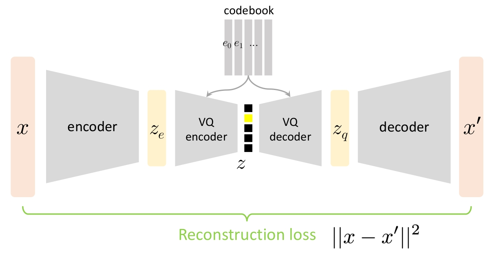

</div>

<small>**图6** VQ-VAE 的重构损失。</small>

**Codebook 损失（Embedding 损失）**:把被选中的 codebook 向量 $e_k$ 拉向编码器输出 $z_e$（更新 codebook）。

$$\mathcal{L}_{codebook} = \|z_e - \text{sg}(z_q)\|^2 \tag{9}$$

其中 $\text{sg}(\cdot)$ 表示停止梯度。梯度只更新 $e_k$，不经过 $z_e$。

**Commitment 损失**:把编码器输出 $z_e$ 拉向量化结果 $z_q$，避免编码器输出在 codebook 之间剧烈抖动。

$$\mathcal{L}_{commitment} = \|\text{sg}(z_q) - z_e\|^2 \tag{10}$$

$\beta$ 为 commitment 权重。

<div align="center">

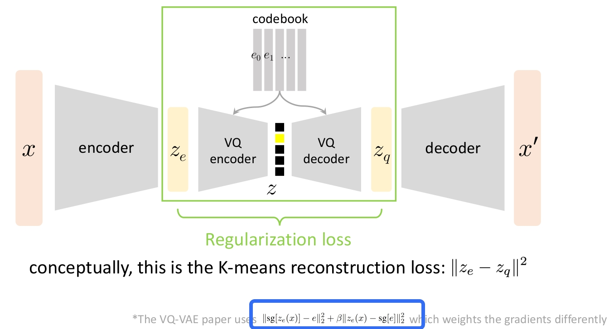

</div>

<small>**图7** 从 VAE 的正则化损失到 VQ-VAE 的 Codebook 损失与 Commitment 损失。</small>

**直观理解**:VQ-VAE 的损失设计本质上是**可微分的 K-means**——编码器和解码器是深度网络，码本通过“把 $e_k$ 拉向 $z_e$”（codebook 损失）和“把 $z_e$ 拉向 $z_q$”（commitment 损失）类似 K-means 的方式更新。

**梯度流向**:

- 解码器:只受 $\mathcal{L}_{recon}$ 影响
- 编码器:受 $\mathcal{L}_{recon}$（经直通）和 $\beta\,\mathcal{L}_{commitment}$ 影响
- Codebook:只受 $\mathcal{L}_{codebook}$ 影响

### 2.4 直通估计器（Straight-Through Estimator）

量化 $Q(z_e)=e_k$ 不可微（$\arg\min$ 为离散操作），无法直接对 $z_e$ 反传梯度。

**一般形式**（用于近似离散采样的梯度）:前向使用 **hardmax**（$\arg\max$ + one-hot）得到离散 $z$，反向时**假装**前向用的是 softmax，用 softmax 的梯度回传。实现技巧（PyTorch 风格）:令 $y = \text{encoder}(x)$（logits），$z_{\text{hard}} = \text{hardmax}(y)$，$z_{\text{soft}} = \text{softmax}(y)$，则
$$z = z_{\text{hard}} - z_{\text{soft}}.detach() + z_{\text{soft}} \tag{11}$$
前向取值等于 $z_{\text{hard}}$，反向梯度等于对 $z_{\text{soft}}$ 的梯度。这是一种**梯度代理（gradient surrogate）**，虽无严格理论保证，但在实践中有效（Gumbel-Softmax 等也基于类似思想）。

<div align="center">

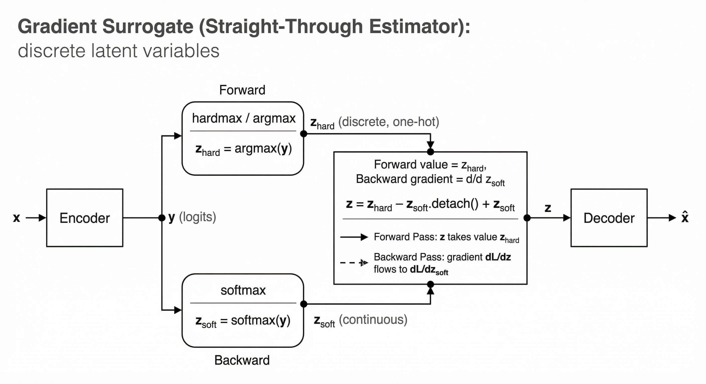

</div>

<small>**图8** 梯度代理（直通估计器一般形式）:前向使用 hardmax 得到离散 $z_{\text{hard}}$，反向用 softmax 的梯度回传；通过 $z = z_{\text{hard}} - z_{\text{soft}}.detach() + z_{\text{soft}}$ 实现前向离散、反向可微。</small>

**VQ-VAE 中的直通**:前向使用量化结果 $z_q$，反传时把损失对 $z_q$ 的梯度原样传给 $z_e$。实现可写为:

$$z_q^{ST} = z_e + (z_q - \text{sg}(z_e)) \tag{12}$$

前向:$z_q^{ST}$ 的取值等于 $z_q$；反向:$\frac{\partial z_q^{ST}}{\partial z_e} = I$，因此 $\frac{\partial \mathcal{L}}{\partial z_e} = \frac{\partial \mathcal{L}}{\partial z_q^{ST}}$，解码器传来的梯度得以穿过量化层更新编码器。

<div align="center">

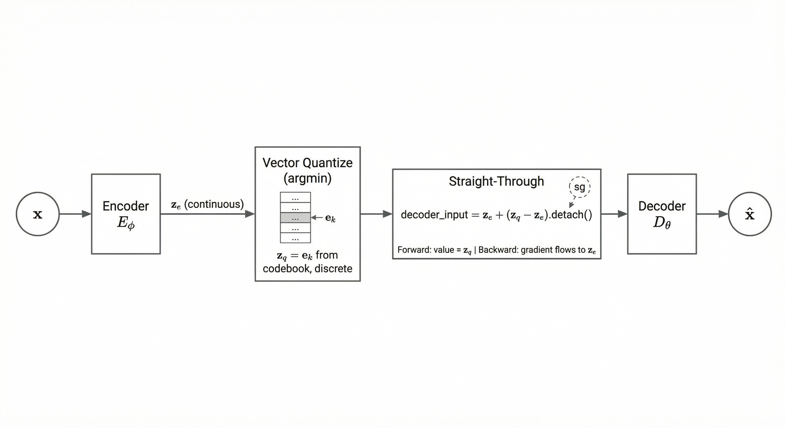

</div>

<small>**图9** VQ-VAE 的直通:编码器输出 $z_e$ 经向量量化得 $z_q$；解码器输入为 $z_e + (z_q - z_e).detach()$，前向取值 $z_q$、反向梯度传给 $z_e$，使量化层可端到端训练。</small>

## 3. 空间分词器与两阶段生成

### 3.1 为何需要多 token:单离散码的局限

整图仅用一个离散 token（如全局 K-means 的簇索引）时，表达能力不足，无法刻画内部结构与空间布局。故需**多 token、空间化**的离散表示。

### 3.2 空间分词器（Spatial Tokenizer）

<div align="center">

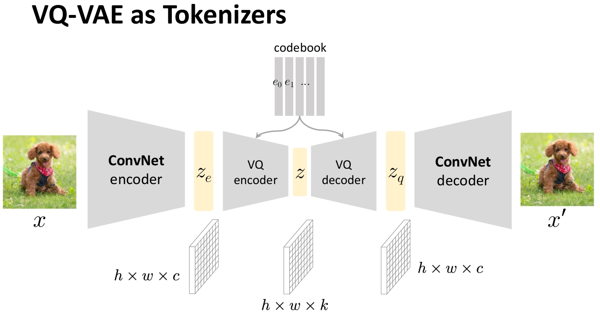

</div>

<small>**图10** VQ-VAE 作为分词器:图像 → 特征图 → 逐位置量化 → 离散 token 序列 → 解码重建。</small>

编码器输出特征图 $H \times W \times D$，对每个位置 $(i,j)$ 独立做向量量化，得到 $H \times W$ 个离散 token；解码器（ConvNet 或 Transformer）从该 token 网格重建图像。例如:$16\times 16$ 网格、码本大小 512，即 256 个 token 表示一图。

### 3.3 先验的局限:i.i.d. 与真实相关性的矛盾

空间隐表示（spatial latents）下，若假设先验为 i.i.d.，则与真实 token 的强空间/序列相关性不符，直接从前验采样难以得到可用样本:

| 问题 | 说明 |
|------|------|
| **先验 $p(z)$ 常取为 i.i.d.** | 如 $z_{ij} \sim \text{Categorical}(1/K)$，位置间独立 |
| **真实 token 高度相关** | 相邻 patch、词序等具有强依赖 |
| **i.i.d. 采样质量差** | 得到杂乱无章的图像 |

### 3.4 两阶段生成范式

**做法**:先训练 VQ-VAE 作为**分词器**；再在离散空间上用自回归模型（PixelCNN、Transformer）或扩散模型学习 $p(z_1, \ldots, z_N)$。生成时先采样得到结构化 token 序列，再经 VQ-VAE 解码器得到图像。即 **VQ-VAE-2**（VQ-VAE + PixelCNN）、**VQ-GAN** 等两阶段生成的基本范式。

## 4. 代码实现

本节基于项目 `code/dl/ae/vq_vae/` 说明关键模块。**训练流程**:$x$ → 编码得 $z_e$ → 最近邻得 $z_q$ → 直通得 $z_q^{ST}$ → 解码得 $\hat{x}$ → 计算三项损失并反传，更新 $E_\phi$、$D_\theta$ 与 codebook。**生成**:可均匀采样 codebook 索引再解码；实际多在此离散空间上另训自回归模型（如 PixelCNN）建模 $p(z)$ 后采样解码。

### 4.1 模型结构:VQVAE 类

Encoder:卷积下采样 + 残差块；Codebook:`nn.Embedding(n_embedding, dim)`；Decoder:转置卷积上采样。以 MNIST 为例:28×28 → 14×14 → 7×7，再解码回 28×28。

<div align="center">

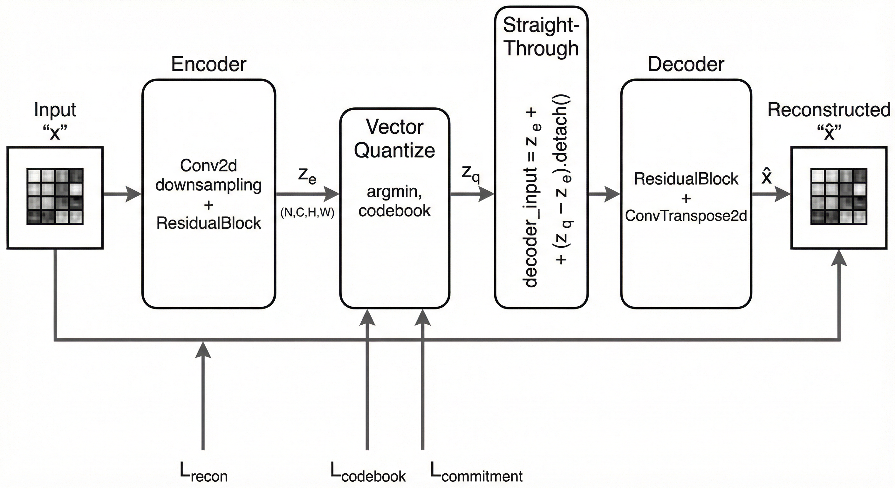

</div>

<small>**图11** VQ-VAE 代码实现的网络框架:Encoder → $z_e$ → VQ（最近邻 + 直通）→ Decoder → $\hat{x}$。</small>

```python
class VQVAE(nn.Module):
    """VQ-VAE 模型（CNN 架构）"""
    def __init__(self, input_dim, dim, n_embedding):
        super().__init__()
        # Encoder: 卷积下采样
        self.encoder = nn.Sequential(
            nn.Conv2d(input_dim, dim, 4, 2, 1),   # 28x28 -> 14x14
            nn.ReLU(),
            nn.Conv2d(dim, dim, 4, 2, 1),        # 14x14 -> 7x7
            nn.ReLU(),
            nn.Conv2d(dim, dim, 3, 1, 1),
            ResidualBlock(dim),
            ResidualBlock(dim)
        )
        # Codebook:可学习的嵌入表
        self.vq_embedding = nn.Embedding(n_embedding, dim)
        self.vq_embedding.weight.data.uniform_(-1.0 / n_embedding, 1.0 / n_embedding)

        # Decoder: 转置卷积上采样
        self.decoder = nn.Sequential(
            nn.Conv2d(dim, dim, 3, 1, 1),
            ResidualBlock(dim),
            ResidualBlock(dim),
            nn.ConvTranspose2d(dim, dim, 4, 2, 1),   # 7x7 -> 14x14
            nn.ReLU(),
            nn.ConvTranspose2d(dim, input_dim, 4, 2, 1)  # 14x14 -> 28x28
        )
        self.n_downsample = 2
```

### 4.2 前向传播:量化与直通

`forward`:编码 → 最近邻量化得 $z_q$ → 直通 `ze + (zq - ze).detach()` → 解码。

```python
def forward(self, x):
    # 编码: x -> z_e
    ze = self.encoder(x)  # (N, C, H, W)

    # 向量量化:最近邻查找
    embedding = self.vq_embedding.weight.data   # (K, C)
    N, C, H, W = ze.shape
    K, _ = embedding.shape
    embedding_broadcast = embedding.reshape(1, K, C, 1, 1)
    ze_broadcast = ze.reshape(N, 1, C, H, W)
    distance = torch.sum((embedding_broadcast - ze_broadcast) ** 2, 2)
    nearest_neighbor = torch.argmin(distance, 1)  # (N, H, W)

    # zq: (N, C, H, W)
    zq = self.vq_embedding(nearest_neighbor).permute(0, 3, 1, 2)

    # 直通估计器:前向用 zq，反向梯度传给 ze
    decoder_input = ze + (zq - ze).detach()

    x_hat = self.decoder(decoder_input)
    return x_hat, ze, zq
```

即 $z_q^{ST} = z_e + (z_q - \text{sg}(z_e))$，解码器输入为 `decoder_input`。

### 4.3 损失函数

重构:MSE($\hat{x}$, $x$)。Codebook 损失:MSE(`ze.detach()`, `zq`)（仅更新 codebook）。Commitment 损失:MSE(`ze`, `zq.detach()`)（仅更新编码器）。权重 $\beta=0.25$。

```python
def loss_function(x_hat, x, ze, zq, embedding_loss_weight=1.0, commitment_loss_weight=0.25):
    recon_loss = F.mse_loss(x_hat, x)
    # 将 codebook 向量拉向 ze
    embedding_loss = F.mse_loss(ze.detach(), zq)
    # 将 ze 拉向 codebook 向量
    commit_loss = F.mse_loss(ze, zq.detach())
    total_loss = recon_loss + embedding_loss_weight * embedding_loss + commitment_loss_weight * commit_loss
    return total_loss, recon_loss, embedding_loss, commit_loss
```

### 4.4 编码与解码接口（推理）

`encode(x)`:返回 codebook 索引 `(N, H, W)`，供自回归等使用。`decode(indices)`:由索引查 codebook 再解码为图像。二者均用 `@torch.no_grad()`。

```python
@torch.no_grad()
def encode(self, x):
    """编码为 codebook 索引 (N, H, W)，供自回归模型等使用"""
    ze = self.encoder(x)
    # 与 forward 中相同的最近邻查找
    embedding = self.vq_embedding.weight.data
    N, C, H, W = ze.shape
    K, _ = embedding.shape
    embedding_broadcast = embedding.reshape(1, K, C, 1, 1)
    ze_broadcast = ze.reshape(N, 1, C, H, W)
    distance = torch.sum((embedding_broadcast - ze_broadcast) ** 2, 2)
    nearest_neighbor = torch.argmin(distance, 1)
    return nearest_neighbor

@torch.no_grad()
def decode(self, discrete_latent):
    """从索引 (N, H, W) 解码为图像"""
    zq = self.vq_embedding(discrete_latent).permute(0, 3, 1, 2)
    return self.decoder(zq)
```

### 4.5 训练循环与配置

每 batch:`x_hat, ze, zq = model(x)` → `loss_function(...)` → `loss.backward()` → `optimizer.step()`。配置示例:`input_dim=1`，`dim=64`，`n_embedding=32`，`commitment_loss_weight=0.25`。

```python
for x, label in train_loader:
    x = x.to(device)
    x_hat, ze, zq = model(x)
    loss, recon_loss, embedding_loss, commit_loss = loss_function(
        x_hat, x, ze, zq, embedding_loss_weight, commitment_loss_weight)
    optimizer.zero_grad()
    loss.backward()
    optimizer.step()
```

### 4.6 推理:重构与生成

**重构**:`x_hat, ze, zq = model(x)`，对比 $x$ 与 $\hat{x}$。**从 codebook 生成**:`indices = model.encode(x)` → `model.decode(indices)` 可视化解码；若要从先验生成，需在离散空间上另训 PixelCNN 等（见 `train_pixelcnn.py`、`gen_with_pixelcnn.py`）。

## 5. 结果

### 5.1 推理1:重建能力（Reconstruction）

从测试集取样本，经 VQ-VAE 编码→量化→解码，得到重构图像:

```python
# 推理1 - 重建
model.eval()
with torch.no_grad():
    x, _ = next(iter(test_loader))
    x_test = x[:sample_size].to(device)
    x_hat, ze, zq = model(x_test)
    original_images = x_test.cpu()
    reconstructed_images = x_hat.cpu()
```

**说明**:输入 $x$ 经编码得 $z_e$，向量量化得 $z_q$，解码得 $\hat{x}$。对比原图与重构图可评估离散 codebook 对信息的保留程度。

<div align="center">

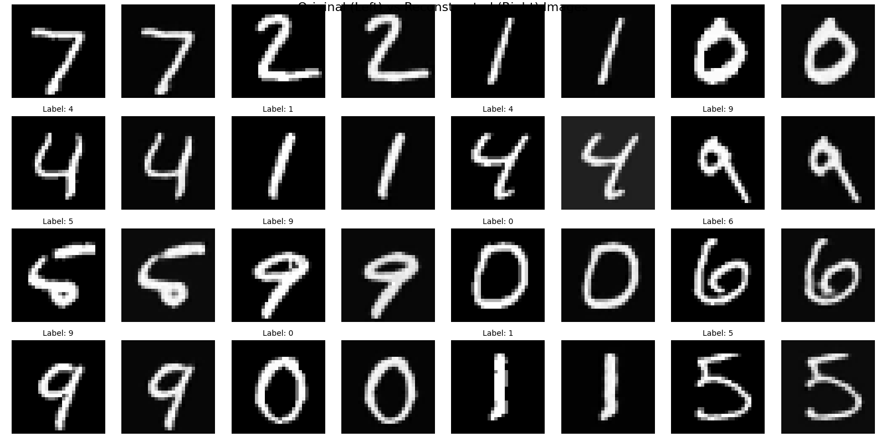

</div>

<small>**图12** VQ-VAE 的重建能力:左列为原始图像，右列为重构图像。</small>

### 5.2 推理2:生成能力（PixelCNN + VQ-VAE）

若仅从 codebook 均匀采样 token 再解码，生成质量差（i.i.d. 先验与真实 token 相关性不符）。**两阶段生成**:先在离散空间上训练 PixelCNN 建模 $p(z_{1:N})$，再从中采样 token 序列，经 VQ-VAE 解码器得到图像:

```python
# 推理2 - 生成（需先训练 PixelCNN 先验）
model.eval()
with torch.no_grad():
    # 从 PixelCNN 采样离散 token 序列 (N, H, W)
    indices = pixelcnn_model.sample(batch_size, shape=(h, w))
    generated_images = model.decode(indices).cpu()
```

<div align="center">

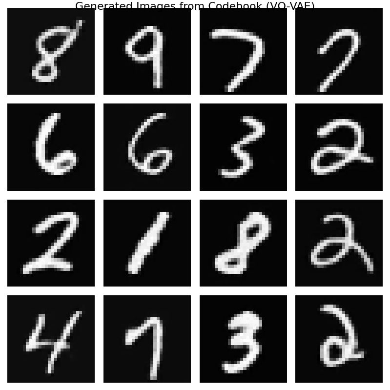

</div>

<small>**图13** PixelCNN + VQ-VAE 的生成能力:从学习到的离散先验采样 token，再解码为图像。</small>

## 6. 总结

### 6.1 VQ-VAE 与标准 VAE 的对比

| 特性     | 标准 VAE                  | VQ-VAE                                                                 |
|----------|---------------------------|------------------------------------------------------------------------|
| 潜在变量 | 连续 $z \sim q_\phi(z \mid x)$ | 离散 $z = e_k$，$k = \arg\min_j \lVert z_e - e_j \rVert^2$             |
| 正则化   | KL 散度                   | Codebook 损失 + Commitment 损失                                       |
| 先验     | $p(z)=\mathcal{N}(0,I)$   | 训练时可视为在 codebook 上均匀；生成时常另训自回归先验                 |
| 梯度传递 | 重参数化                 | 直通估计器穿过量化层                                                   |

### 6.2 要点回顾

1. **架构**:编码器 → 最近邻量化（codebook）→ 直通 → 解码器；损失为重构 + codebook + commitment。
2. **直通估计器**:量化不可微，用直通使梯度穿过量化层更新编码器（梯度代理）。
3. **双损失**:codebook 损失更新码本，commitment 损失约束编码器靠近码本，无需 KL 先验；本质为可微分的 K-means。
4. **实用形态**:空间分词器（每位置一离散 token），为两阶段生成提供离散潜像；高质量生成需在离散空间上另学 $p(z)$（自回归或扩散），而非 i.i.d. 采样。

**VQ-VAE 的真正价值**在于将高维数据（图像、语音等）压缩为**离散符号序列**，为符号化深度学习与大规模生成模型（如 DALL·E、Stable Diffusion 的 VQ-GAN 阶段）提供基础；而非作为单独的生成模型使用。

**复现**:项目内 `vq_vae/vq_vae.py`、`train_infer.py` 及配置文件可复现训练与重构；完整生成需再训离散先验（如 PixelCNN）。

---

## 参考文献

1. van den Oord, A., Vinyals, O., & Kavukcuoglu, K. (2017). Neural Discrete Representation Learning. *Advances in Neural Information Processing Systems*.
2. Kingma, D. P., & Welling, M. (2014). Auto-Encoding Variational Bayes. *International Conference on Learning Representations*.
3. Kaiming He, Deep Generative Models.
