# AR系列篇-01.AR理论篇: 自回归模型从条件分布到序列生成

## 1. 联合分布建模的动机与方法

### 1.1 联合分布（Joint Distribution）

使用独立分布来建模联合分布是很方便的:$p(x_1, x_2) = p(x_1) \cdot p(x_2)$，此时条件分布等于边缘分布:$p(x_2 \mid x_1) = p(x_2)$。

然而，现实世界的问题总是涉及相互依赖的变量 $p(x_1, x_2)$，此时条件分布不等于边缘分布:$p(x_2 \mid x_1) \neq p(x_2)$。

如图 1、图 2 所示:

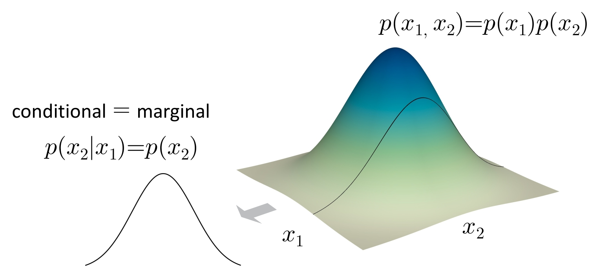

<small>**图1** 独立分布:$p(x_1, x_2) = p(x_1) \cdot p(x_2)$，条件分布等于边缘分布 $p(x_2 \mid x_1) = p(x_2)$</small>

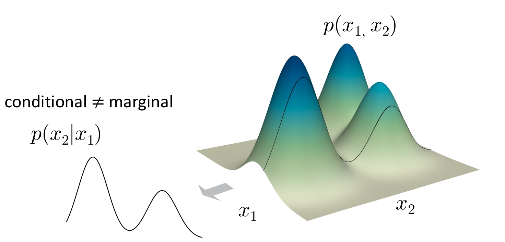

<small>**图2** 依赖分布:$p(x_1, x_2)$ 不可分解为独立乘积，条件分布不等于边缘分布 $p(x_2 \mid x_1) \neq p(x_2)$</small>

### 1.2 如何建模联合分布？

**方案 1:通过独立隐变量建模（例如 VAE）**

*   映射方式:独立隐变量 ⇒ 依赖的观测变量；
*   对高维数据（例如 32×32×3 像素的图像）来说，这是一个很强的假设；
*   通常使用低维隐变量；
*   是一个良好的构建模块，但往往不够充分（难以捕捉复杂依赖）。

**方案 2:通过条件分布建模**——即本文重点。

### 1.3 条件分布建模（Chain Rule）

**链式法则**:任何联合分布都可以写成条件分布的乘积，例如:

$$p(A, B, C) = p(A) \cdot p(B \mid A) \cdot p(C \mid A, B)$$

条件分布建模有两个重要特点:**1. 顺序是任意的**；**2. 分割是任意的**。如图 3～5 所示:

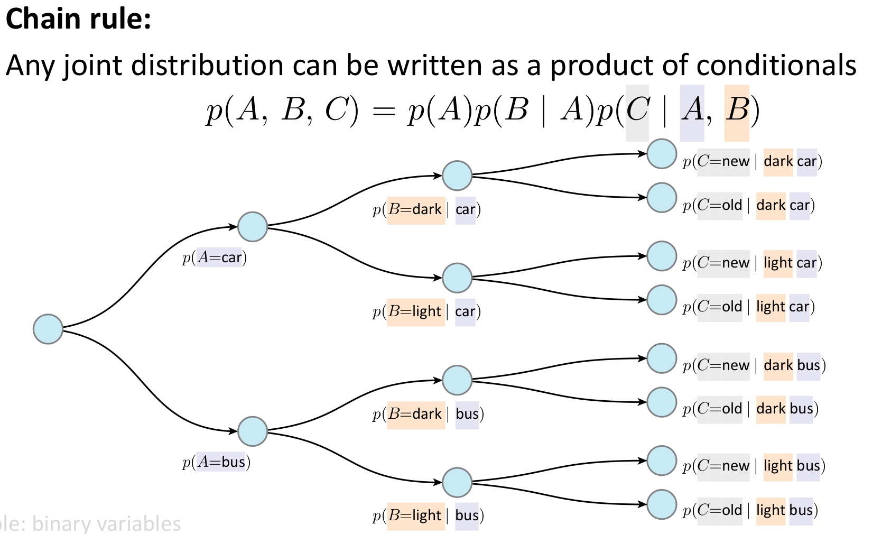

<small>**图3** 联合分布拆分为条件分布乘积的展开形式</small>

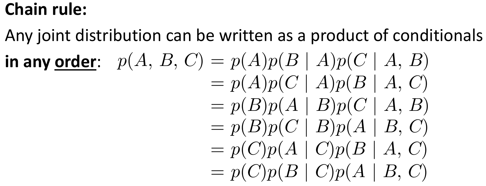

<small>**图4** 条件分布的顺序是任意的</small>

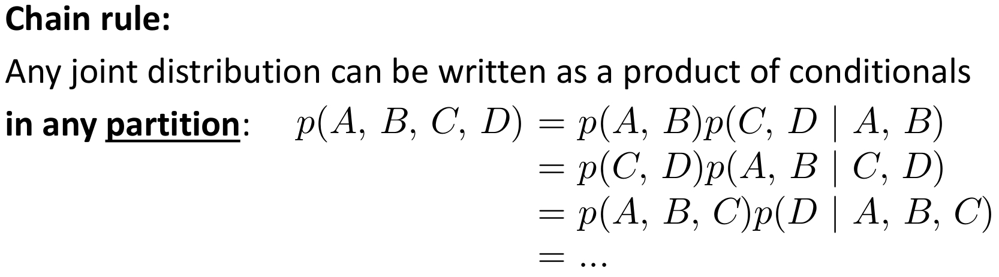

<small>**图5** 条件分布的划分（分割）是任意的</small>

## 2. 条件分布建模的核心思想

### 2.1 分而治之（Divide-and-Conquer）

与深度学习同源的精神:导数的链式法则用于反向传播，概率的链式法则用于联合分布分解。

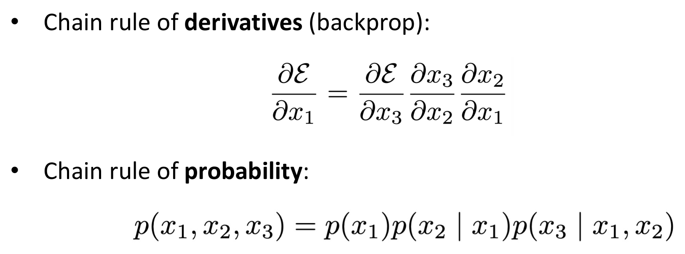

<small>**图6** 导数的链式法则 & 概率的链式法则</small>

### 2.2 使用神经网络建模

$$p(A, B, C) = p_\theta(A) \cdot p_\phi(B \mid A) \cdot p_\psi(C \mid A, B)$$

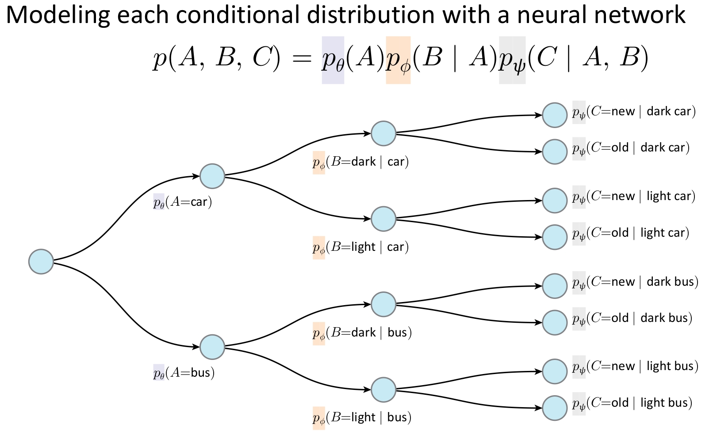

<small>**图7** 对条件分布使用神经网络建模</small>

**注意:**

*   对联合分布 $p(A, B, C)$ 建模涉及 3 个变量；对条件分布 $p(C \mid A, B)$ 建模只涉及 1 个输出变量，但有 2 个条件作为网络输入。

### 2.3 依赖图（Dependency Graphs）

将联合分布分解会诱导出依赖图，依赖图反映了先验知识。例如以下两种分解都是有效的:

$$p(A, B, C) = p(A) \cdot p(B \mid A) \cdot p(C \mid A, B)$$

$$p(A, B, C) = p(C) \cdot p(B \mid C) \cdot p(A \mid B, C)$$

某些分解方式可能导致更简单的分布（例如，若 C 是"原因"，则以 C 为根的分解可能更自然）。

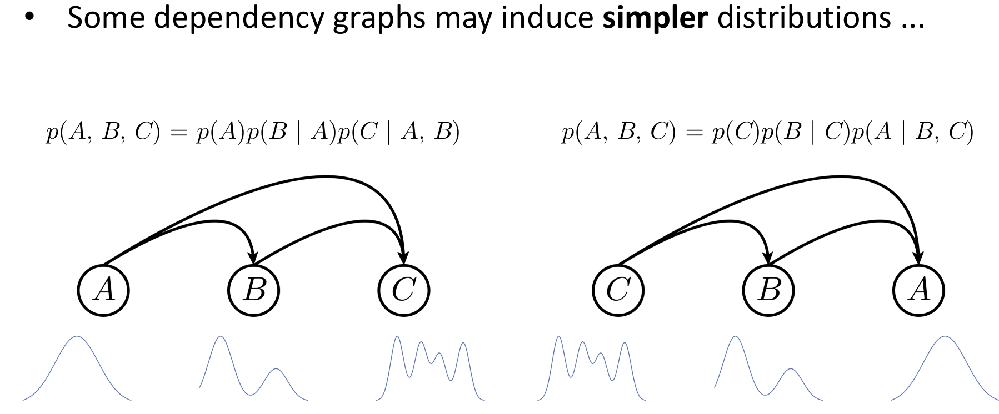

<small>**图8** 不同的分解方式可能导致更简单的分布</small>

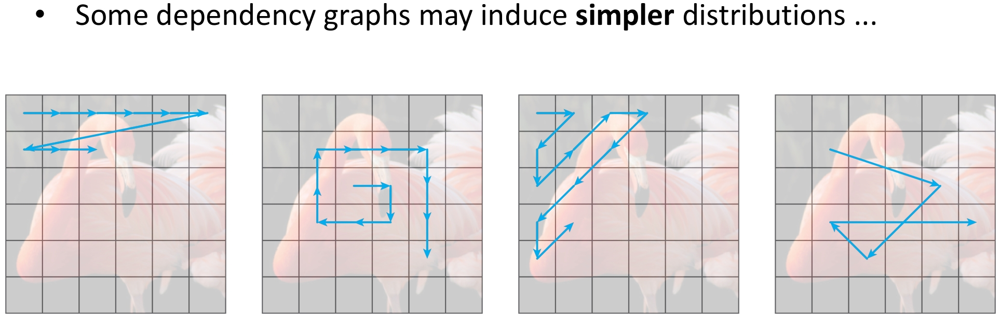

<small>**图9** 不同的分解方式可能导致更简单的分布（续）</small>

### 2.4 小结

*   联合分布 = 条件分布的乘积；
*   利用概率链式法则实现"分而治之"；
*   分解顺序和划分方式可以任意；
*   依赖图体现了建模时引入的先验知识。

以上思想并不仅限于自回归模型。

## 3. 什么是自回归（Autoregressive）？

### 3.1 Auto + Regression

*   **Auto（"自"）**:在预测时使用模型"自身"的输出作为下一步的输入。
*   **Regression（回归）**:估计变量之间的关系。

**注意**:"自回归"描述的是推理阶段（inference-time）的行为；训练阶段不一定采用自回归方式（如可使用"教师强制/teacher forcing"）。

### 3.2 自回归模型的形式

自回归通过条件分布的乘积来建模联合分布:

$$p(x_1, x_2, \ldots, x_T) = \prod_{t=1}^T p(x_t \mid x_{<t})$$

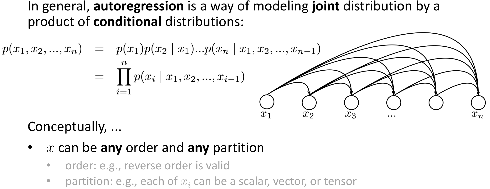

<small>**图10** 自回归建模的定义</small>

**从概念上讲:**

*   $x$ 可以是任意形式的表示，不一定是序列或时间数据（如向量的维度、2D/3D 图像、体素等）；
*   $x$ 的顺序和划分方式可以任意（逆序也合法；每个 $x_i$ 可以是标量、向量或张量）；
*   每个条件分布 $p(x_i \mid x_{<i})$ 可采用任意形式建模（查找表、决策树、神经网络等）；变量可离散可连续；
*   这种分解总是成立的（概率链式法则），无近似；但某些分解方式更容易建模——即"归纳偏置（inductive bias）"。

## 4. 归纳偏置（Inductive Bias）

### 4.1 为什么需要归纳偏置？

我们希望所选的分解方式能给出更简单的条件分布。例如以下两种分解都有效:

$$p(A, B, C) = p(A) \cdot p(B \mid A) \cdot p(C \mid A, B)$$

$$p(A, B, C) = p(C) \cdot p(B \mid C) \cdot p(A \mid B, C)$$

**例子**:手机键盘输入法就是一个自回归系统——之前的输出（已输入的词）能大幅缩小下一个可能输出（候选词）的范围，每个 $p$ 都是类别分布。

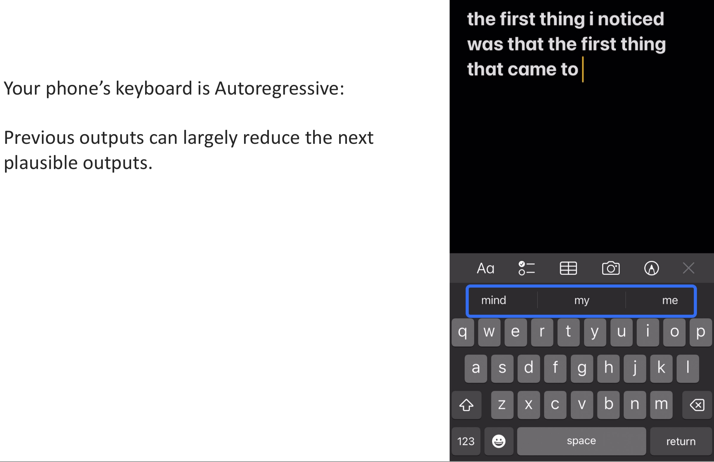

<small>**图11** 手机键盘输入法的自回归示例</small>

### 4.2 归纳偏置的来源

**时间/空间顺序**:如"下一个词元预测"（next token prediction），使用时间顺序本身就引入了一种归纳偏置。

**共享架构**:每个条件分布 $p(x_i \mid x_{<i})$ 概念上是不同的映射，但我们用共享的网络架构（RNN、CNN、Transformer 等）来建模它们。

**共享权重**:进一步地，不仅共享架构，还共享权重 $\theta$。这种权重共享是强归纳偏置——假设不同位置的条件生成过程具有相似的底层规律。

### 4.3 总结

联合分布的链式分解本身完全精确、无近似；但实际建模时引入的归纳偏置会带来近似，例如:共享网络架构、共享参数、特定的变量排序。这些选择限制了表达能力，但通常能提升泛化性和训练效率。

### 4.4 表示一个分布

*   **网络输入**:已观测到的上下文（如 $x_{<i}$）
*   **网络输出**:对下一个变量 $x_i$ 的概率分布

该分布可以是连续分布（高斯、混合密度等）或离散分布（类别分布）。当输出是离散分布时，网络行为类似分类器——"回归"一词在实践中常做分类；自回归同样可用于连续数据（如 WaveNet 生成音频波形）。

## 5. 推理与训练机制

### 5.1 推理:自回归（Inference）

网络建模 $p(x_6 \mid x_{1,2,3,4,5})$:输入前 5 个变量，输出 1 个分布；输入来源是前几步的模型自身输出。这是递归过程，但不一定用 RNN 实现——可用 CNN 或 Transformer 等任何架构。

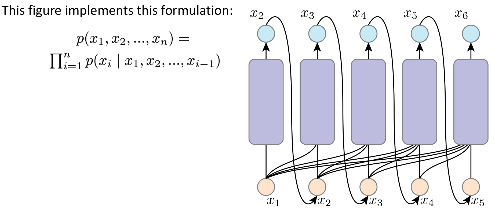

<small>**图12** 自回归模型的建模过程</small>

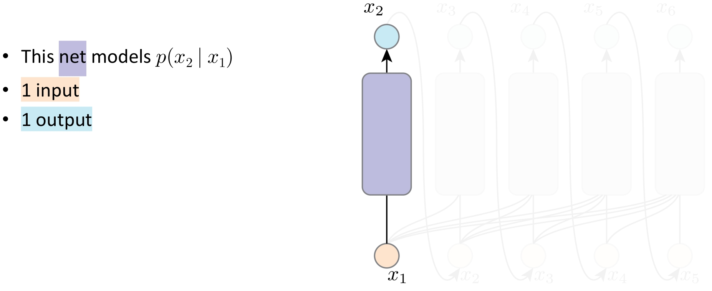

<small>**图13** 自回归模型的推理路径（一）</small>

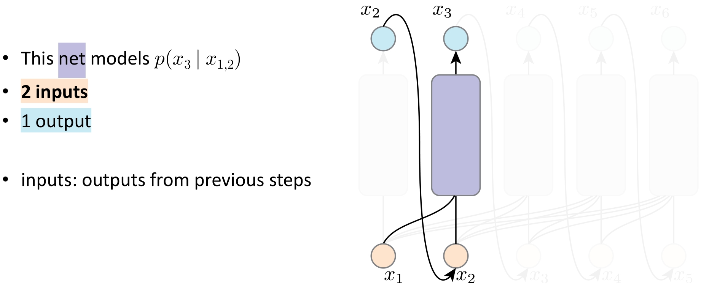

<small>**图14** 自回归模型的推理路径（二）</small>

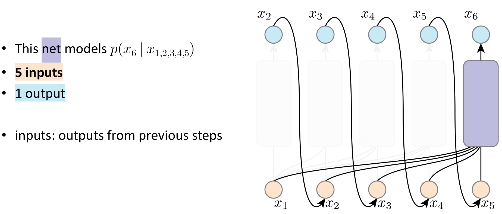

<small>**图15** 自回归模型的推理路径（三）</small>

### 5.2 为什么不能按推理图反向传播？

考虑 $x_6$ 的梯度路径需穿过所有之前的输出、采样操作、网络模块。**结果**:按推理时的计算图训练不可行（计算开销巨大，且采样操作通常不可导）。

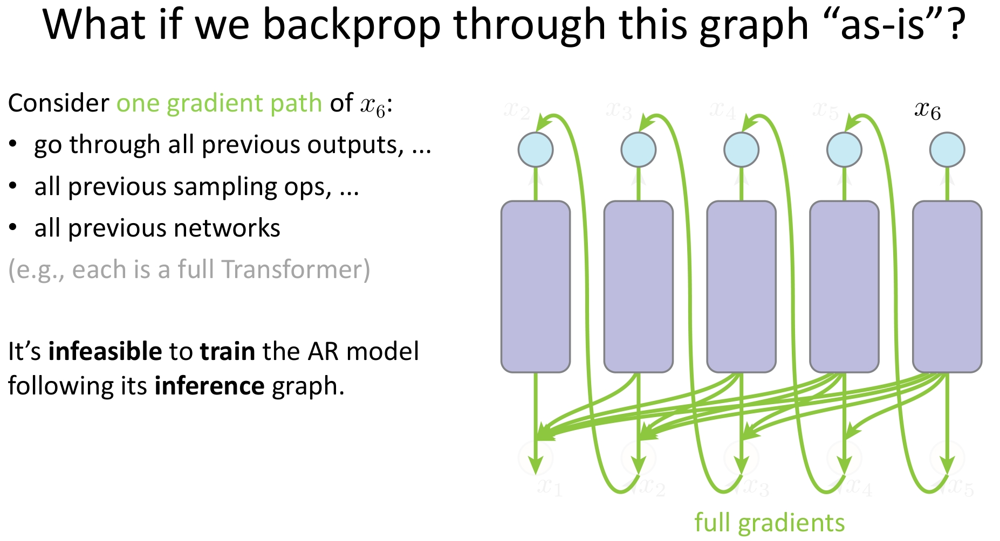

<small>**图16** 为什么不能按照推理图反向传播</small>

### 5.3 训练:教师强制（Teacher Forcing）

**教师强制**:输入直接来自真实数据（ground-truth），而非模型之前的输出。

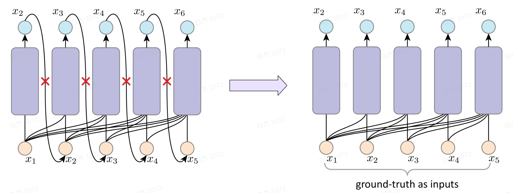

<small>**图17** 左侧:使用模型之前的输出；右侧:使用真实数据（Teacher Forcing）</small>

**优点**:反向传播路径大大缩短（每步独立计算梯度）；使用真实输入有助于训练稳定性。

**缺点**:训练与推理不一致（exposure bias）——训练看到"正确历史"，推理只能依赖"自己生成的历史"；分布偏移——模型从未见过自己犯错，推理出错时错误可能放大。

## 6. 运行示例:MNIST 上的自回归建模

### 6.1 设定

将一张图像视为像素序列，按光栅扫描顺序（raster order）逐行展开:从左到右、从上到下。

### 6.2 推理阶段（Autoregressive）

*   第一个像素 $x_1$ 从 $p(x_1)$ 中采样；
*   第二个像素 $x_2$ 从 $p(x_2 \mid x_1)$ 中采样，$x_1$ 是上一步输出、当前输入；网络结构:1 输入 → 1 输出（$x_2$ 的分布）。

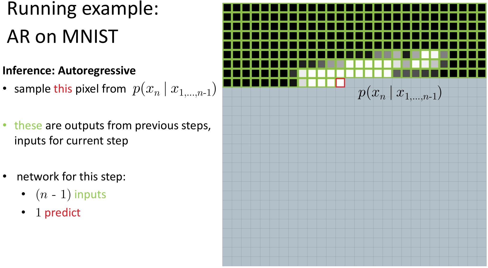

<small>**图18** MNIST 推理阶段:使用自回归方法</small>

### 6.3 训练阶段（Teacher Forcing）

对第 $n$ 个像素建模为 $p(x_n \mid x_1, \ldots, x_{n-1})$；$x_1, \ldots, x_{n-1}$ 来自真实图像（ground-truth）。网络结构:$n-1$ 个输入 → 1 个输出。

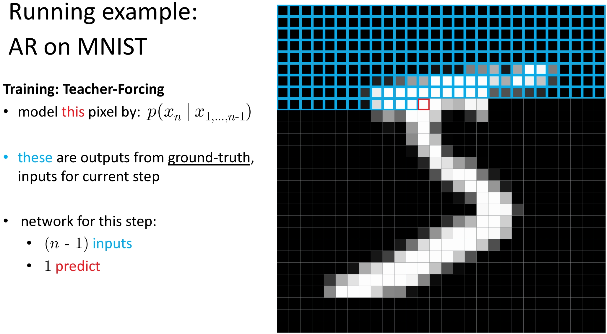

<small>**图19** MNIST 训练阶段:使用 Teacher Forcing 方法</small>

### 6.4 注意

上述描述不限定具体网络架构，适用于 RNN、CNN（如 PixelCNN）、Transformer（如 Image GPT）或任何能处理序列条件建模的架构。

## 7. 自回归与网络架构

### 7.1 自回归不依赖于特定架构

下图实现的是如下形式的分解:  
  
$$p(x_1, x_2, x_3, x_4, x_5) = p(x_1) \cdot p(x_2 \mid x_1) \cdot p(x_3 \mid x_1, x_2) \cdot p(x_4 \mid x_1, x_2, x_3) \cdot p(x_5 \mid x_1, x_2, x_3, x_4)$$

在本例中:
*   使用了 5 个独立的网络；
*   每个网络分别接收 1 到 5 个输入（即第 $i$ 个网络接收前 $i-1$ 个变量作为条件）。

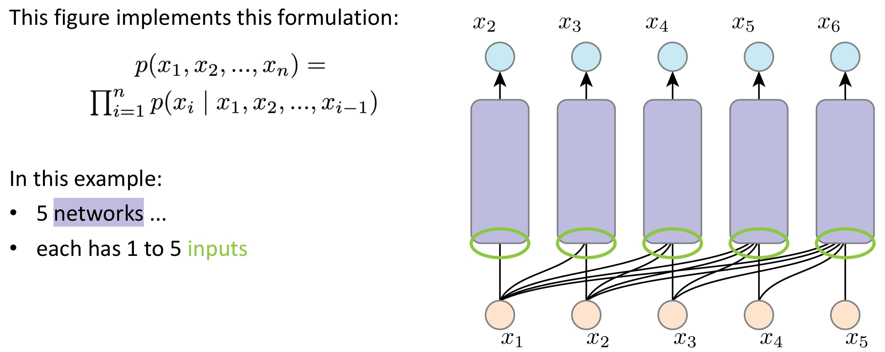

<small>**图20** 原始形式的自回归模型（多个独立网络）</small>

### 7.2 带共享计算的自回归

但我们能否更高效地实现它？

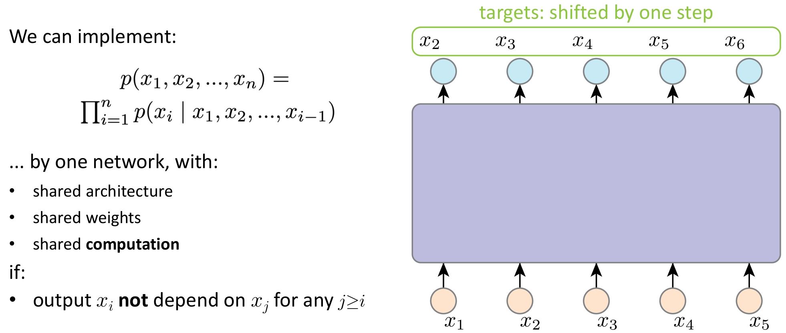

<small>**图21** 使用单个网络实现自回归（共享计算）</small>

我们可以用单个网络来实现整个自回归分解，前提是满足以下条件:

*   每个输出 $x_i$ 不依赖于任何 $x_j$（其中 $j \geq i$），即满足因果性（causality）或自回归顺序约束。

在此前提下，该单个网络可以实现:
*   共享架构（shared architecture）
*   共享参数（shared weights）
*   共享中间计算（shared computation）

## 8. 总结

**核心要点（Takeaways）:**

- **联合分布分解为条件分布的乘积**  
  
  $$p(x_1, x_2, \ldots, x_T) = \prod_{t=1}^T p(x_t \mid x_{<t})$$
    
  → 这是概率链式法则的直接应用，精确无近似。

- **归纳偏置（Inductive Bias）体现在:**
  *   共享的网络架构（shared architecture）
  *   共享的参数权重（shared weights）
  *   人为指定的生成顺序（induced order，如从左到右、光栅扫描等）

- **推理阶段（Inference）:**  
  → 自回归方式生成:每一步将前序生成的输出作为当前输入，逐步采样。

- **训练阶段（Training）:**  
  → 通常采用 **教师强制（Teacher Forcing）**:使用真实历史（ground-truth）作为输入，而非模型自身预测。

✅ **关键思想**:自回归是一种建模范式（如何分解和生成联合分布），而非某种特定模型。不同架构只是实现这一范式的不同工具。

---

## 📚 参考

*   Kaiming He, Deep Generative Models.