# AR系列篇-02.AR代码篇: 自回归模型从条件分布到序列生成

自回归建模不绑定特定神经网络结构，可由 RNN、CNN（因果卷积）、Transformer（因果注意力）等多种架构实现。本文详细介绍这三种常见架构的设计与特点。

---

## 1. 架构设计原则

自回归模型的网络架构需要满足以下核心要求:

1. **因果性（Causality）**:在位置 $t$ 的输出只能依赖于 $x_{\leq t}$，不能看到未来信息
2. **共享计算**:通过共享架构和参数，高效地建模所有条件分布

---

## 2. 架构一:基于 RNN 的自回归模型

### 2.1 RNN-based AR 推导

本节从 RNN 单元出发，逐步推导出基于 RNN 的自回归模型。核心思想是:**通过时间维度的展开实现因果性，通过参数共享实现高效建模**。

**第一步:RNN 单元**

RNN 的基本单元接收当前输入 $x_t$ 和上一时刻的隐藏状态 $h_{t-1}$，输出新的隐藏状态 $h_t$:
$$h_t = f(x_t, h_{t-1})$$

其中 $f$ 是递归函数（如 LSTM、GRU 的非线性变换）。单元内部不依赖未来输入，天然具有因果性。

<div align="center">
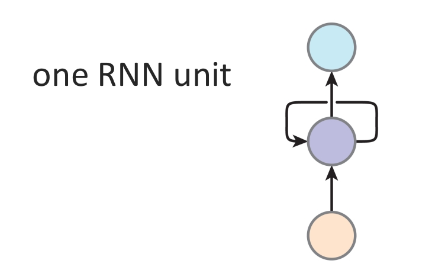
</div>

<small>**图 2.1** RNN 单元:接收当前输入 $x_t$ 与上一时刻隐藏状态 $h_{t-1}$，输出当前隐藏状态 $h_t$</small>

**第二步:沿时间维度展开**

将 RNN 单元按时间步展开，得到链式结构:$h_0 \rightarrow h_1 \rightarrow h_2 \rightarrow \cdots \rightarrow h_T$。每个 $h_t$ 只依赖 $x_t$ 和 $h_{t-1}$（从而间接依赖 $x_{\leq t}$），序列中任意位置的输出都不会“看到”未来信息。

<div align="center">
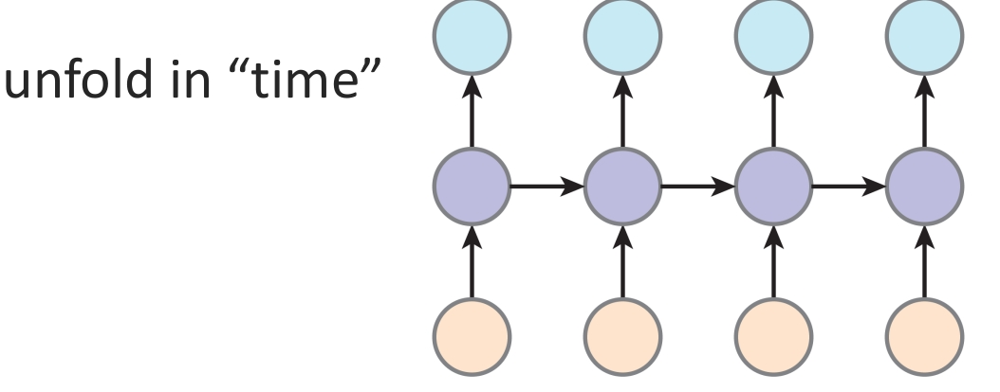
</div>

<small>**图 2.2** 时间维度展开:RNN 单元沿时间步展开为链式结构，信息从左向右单向流动</small>

**第三步:沿深度展开**

堆叠多层 RNN 单元，形成深度网络。第 $l$ 层的隐藏状态 $h_t^{(l)}$ 作为第 $l+1$ 层的输入，增强模型的表达能力。

<div align="center">
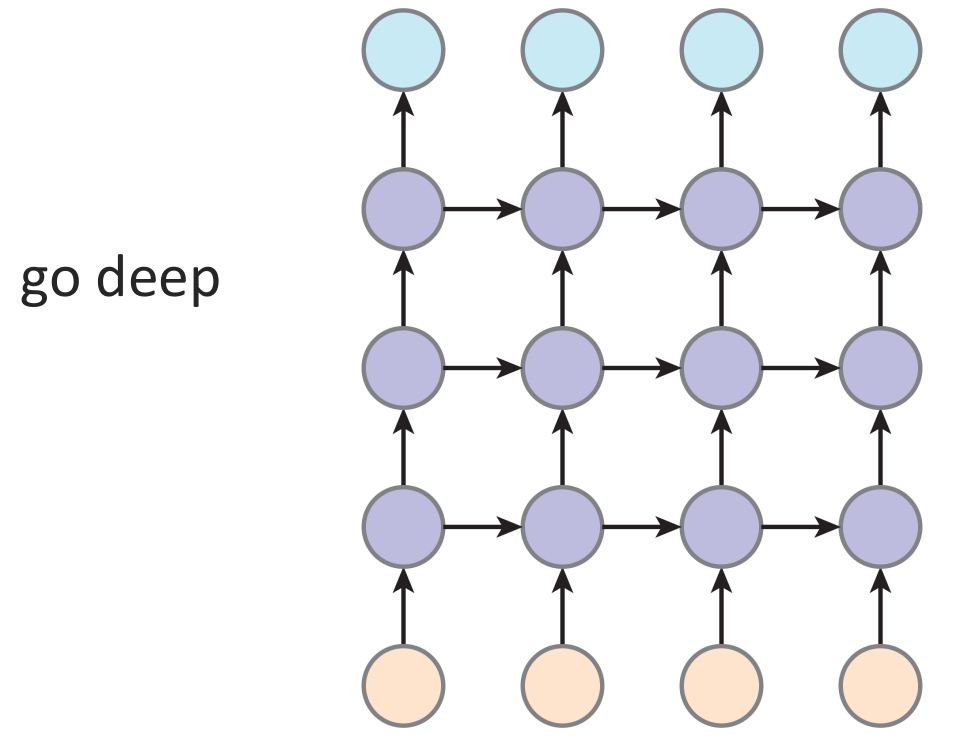
</div>

<small>**图 2.3** 深度展开:多层 RNN 堆叠，同一时刻不同层之间垂直连接，形成深度结构</small>

**第四步:期望平移一步（自回归目标）**

自回归建模的目标是预测下一个 token:$p(x_t \mid x_{<t})$。因此，我们希望模型在位置 $t$ 的输出对应的是 $x_{t+1}$ 的预测。这等价于将输入序列与目标序列**向后平移一步**:输入 $[x_1, \ldots, x_{T-1}]$，目标 $[x_2, \ldots, x_T]$。

<div align="center">
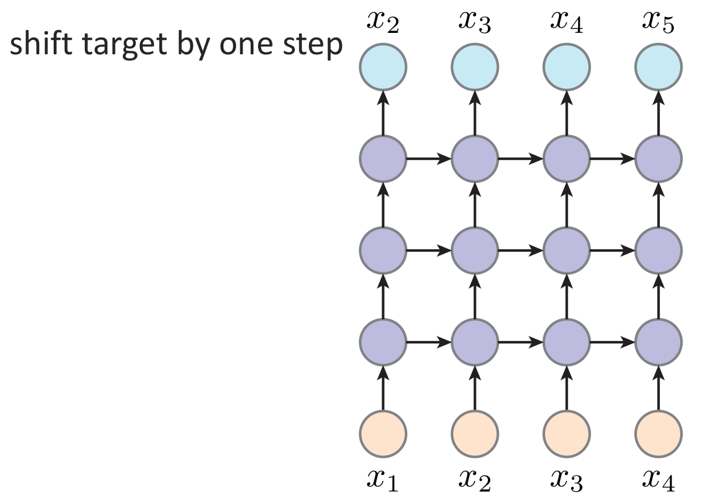
</div>

<small>**图 2.4** 平移一步:输入序列与目标序列错位一位，模型在位置 $t$ 预测的是 $x_{t+1}$</small>

**第五步:共享计算**

所有时间步复用同一组参数（同一个 RNN 单元），这就是“共享计算”。训练时，我们可以将整条序列一次性输入，并行计算所有位置的条件分布，计算高效且参数效率高。

<div align="center">
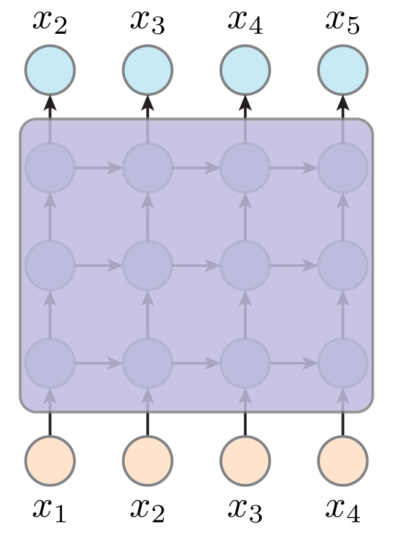
</div>

<small>**图 2.5** 参数共享:所有时间步使用相同的 RNN 单元（同一组参数），实现高效的序列建模</small>

**综上**，我们得到了 RNN-based 的 AR 模型:因果性由递归结构保证，共享计算由参数复用实现，训练采用 Teacher Forcing 并行计算各时间步。

**自回归推理路径**:推理时需逐步生成，每次将新生成的 token 作为下一步输入，并传递隐藏状态。路径示意如下。

<div align="center">
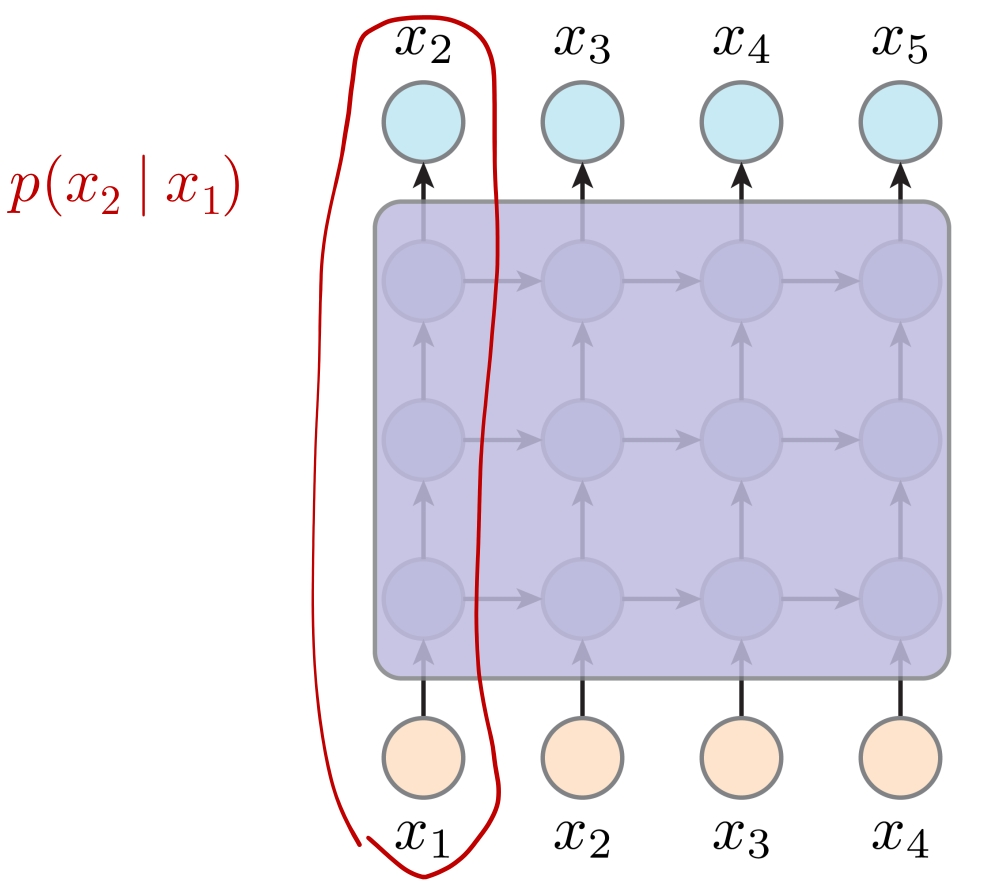
</div>

<small>**图 2.6** 自回归推理（步骤 1）:给定起始条件，生成第一个 token，并更新隐藏状态</small>

<div align="center">
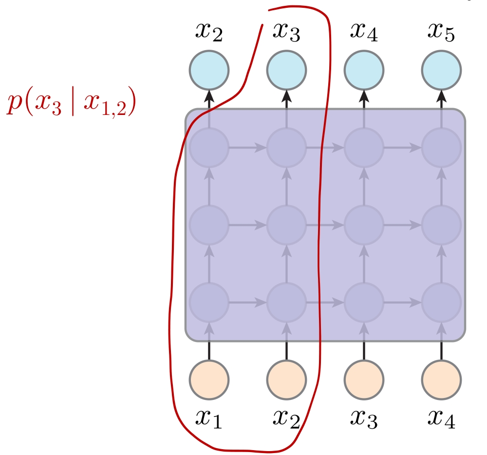
</div>

<small>**图 2.7** 自回归推理（步骤 2）:将上一步生成的 token 作为输入，继续生成下一个 token</small>

<div align="center">
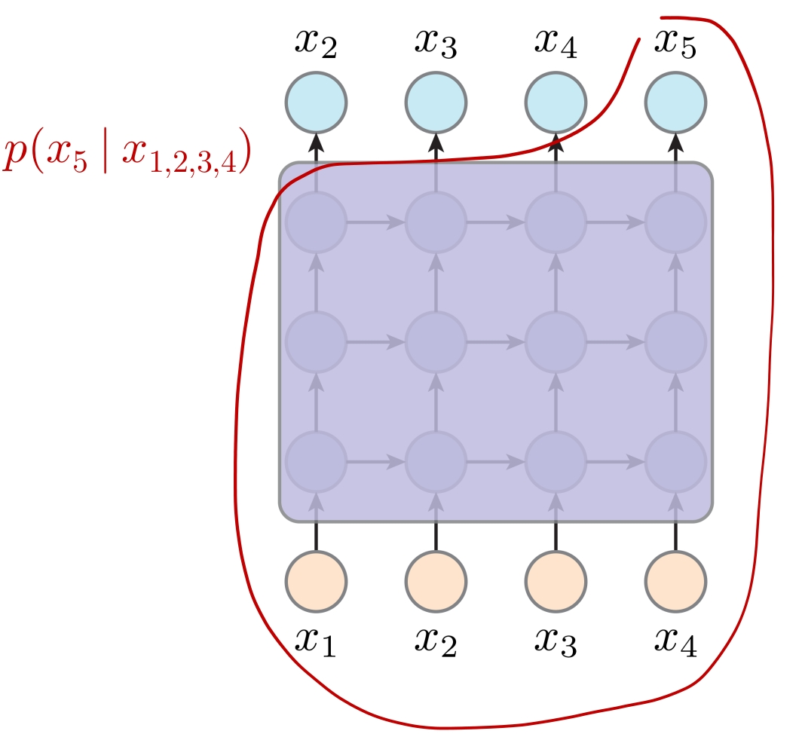
</div>

<small>**图 2.8** 自回归推理（完整路径）:重复上述过程直至生成完整序列，每步依赖前步输出与隐藏状态</small>


### 2.2 RNN-based AR 代码实现

下面以 MNIST 图像生成为例，给出基于 RNN 的自回归模型核心实现。图像展平为 784 维序列，每个像素二值化后建模为 Bernoulli 分布。

**1. 模型结构**

```python
class AR_RNN(nn.Module):
    def __init__(self, input_dim=1, hidden_dim=256, num_layers=2, dropout=0.2):
        self.input_proj = nn.Linear(input_dim, hidden_dim)      # 像素 → 特征
        self.lstm = nn.LSTM(hidden_dim, hidden_dim, num_layers=num_layers,
                            dropout=dropout if num_layers > 1 else 0, batch_first=True)
        self.output = nn.Sequential(
            nn.Linear(hidden_dim, hidden_dim), nn.ReLU(),
            nn.Linear(hidden_dim, input_dim)                     # 输出 Logits
        )
```

**2. 训练阶段（Teacher Forcing）**

整序列一次输入，LSTM 内部并行处理，输出每个位置的 logits:

```python
def forward(self, x):
    x_proj = self.input_proj(x)           # (B, T-1, H)
    lstm_out, _ = self.lstm(x_proj)       # 因果性由 LSTM 结构保证
    return self.output(lstm_out)          # (B, T-1, 1) Logits
```

**3. 推理阶段（自回归生成）**

逐步生成，每步只输入上一个 token，通过 `hidden_state` 传递历史:

```python
def generate(self, batch_size, seq_len=784, device='cpu', temperature=1.0):
    generated_seq = torch.zeros(batch_size, seq_len, self.input_dim, device=device)
    hidden_state = None
    for t in range(1, seq_len):
        last_pixel = generated_seq[:, t-1:t, :]                  # 上一步生成的像素
        current_feature = self.input_proj(last_pixel)
        lstm_out, hidden_state = self.lstm(current_feature, hidden_state)  # 传递 hidden
        logits = self.output(lstm_out[:, -1, :])
        next_pixel = torch.bernoulli(torch.sigmoid(logits / temperature))
        generated_seq[:, t, :] = next_pixel
    return generated_seq
```

**4. 损失函数**

二值像素使用 BCEWithLogits:

```python
def loss_function(pred, target):
    return F.binary_cross_entropy_with_logits(pred.reshape(-1), target.reshape(-1))
```

---


## 3. 架构二:基于 CNN 的自回归模型

### 3.1 CNN-based AR 推导

与 RNN 不同，CNN 在序列上沿时间维度展开时，需要显式保证因果性。普通卷积使用对称填充，会“看到”未来信息；因果卷积通过不对称填充，使输出只依赖当前及过去的输入。

**沿时间展开**

<div align="center">
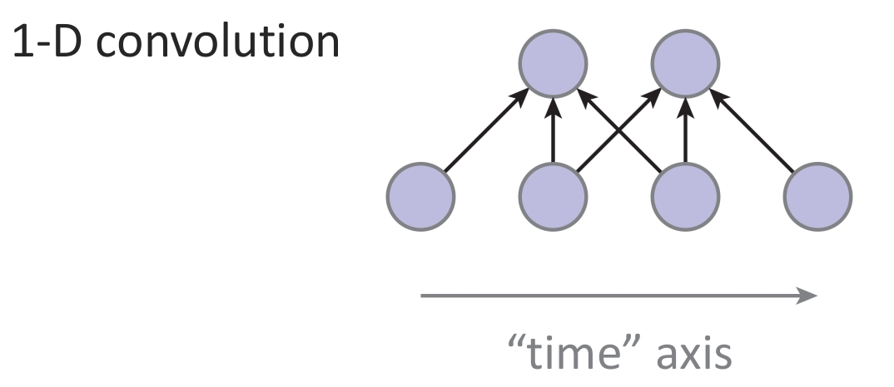
</div>

<small>**图 2.9** CNN 沿时间维度展开:卷积核沿序列滑动，处理序列各位置</small>

**填充**

<div align="center">
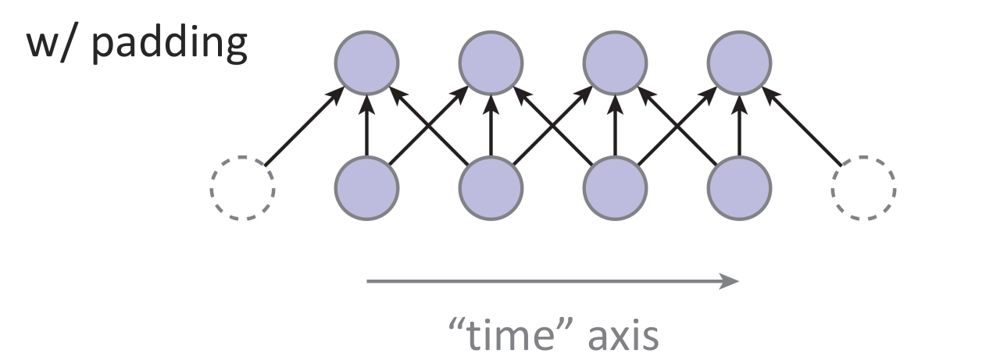
</div>

<small>**图 2.10** 填充:为保证输出长度，需在序列两端或单侧进行填充</small>

**因果卷积**

<div align="center">
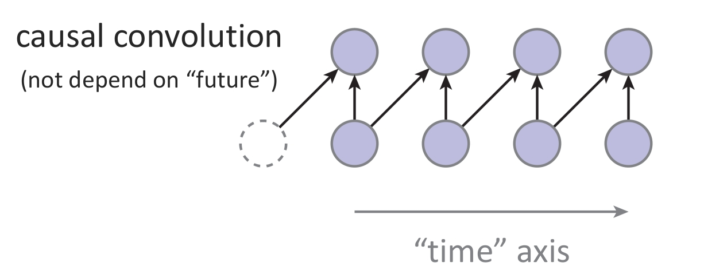
</div>

<small>**图 2.11** 因果卷积:仅在左侧填充，输出时移除右侧多余部分，确保输出只依赖 $x_{\leq t}$</small>

**膨胀卷积 / 空洞卷积（Dilated / Atrous Convolution）**

因果卷积保证因果性，但普通卷积（kernel_size=3，dilation=1）每层感受野仅 3 个位置，要覆盖长序列需要堆叠很多层。**膨胀卷积**通过增大**膨胀率（dilation）**，在**不增加参数量**的前提下扩大感受野。

- **dilation=1**:普通卷积，3×1 核覆盖相邻 3 个位置
- **dilation=2**:核元素间隔 1，实际覆盖 5 个位置（如位置 0, 2, 4）
- **dilation=4**:核元素间隔 3，实际覆盖 9 个位置

<div align="center">
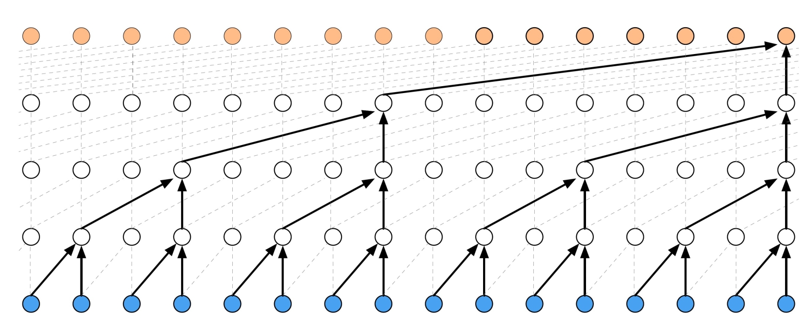
</div>

<small>**图 2.12** 空洞卷积示意图:dilation=4 时卷积核的覆盖范围</small>

堆叠多层时令 dilation 指数增长（1, 2, 4, 8, ...），可快速扩大感受野。例如 8 层、kernel=3、dilation=1,2,4,...,128 时，感受野约 $1 + 2(1+2+4+\cdots+128) = 511$，足以覆盖 MNIST 的 784 维序列。

增加深度（多层堆叠，结合膨胀卷积）、期望平移一步（输入/目标错位）、共享计算（同一卷积核沿时间复用）与 RNN 类似，此处不再赘述。

### 3.3 CNN-based AR 代码实现

<div align="center">
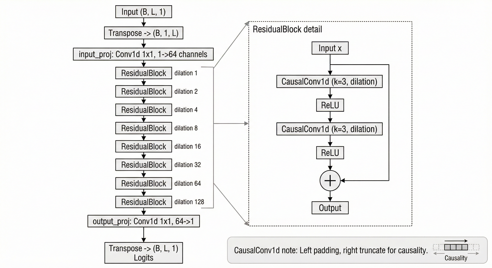
</div>

<small>**图 2.13** CNN-based AR 网络架构图</small>

**1. 因果卷积层（含膨胀卷积）**

```python
class CausalConv1d(nn.Module):
    """1D因果卷积层。确保输出只依赖于当前及之前的输入；使用膨胀卷积(Dilated Convolution)扩大感受野"""
    def __init__(self, in_channels, out_channels, kernel_size, dilation=1):
        super().__init__()
        # Padding放在左边，模拟因果性；PyTorch的Conv1d padding是两边都加，需要自定义
        self.padding = (kernel_size - 1) * dilation
        self.conv = nn.Conv1d(in_channels, out_channels, kernel_size,
                              padding=self.padding, dilation=dilation)

    def forward(self, x):
        out = self.conv(x)
        # 移除右侧多余的padding，只保留左侧的padding（历史信息），保持长度一致且具有因果性
        if self.padding > 0:
            out = out[:, :, :-self.padding]
        return out
```

**2. 残差块**

```python
class ResidualBlock(nn.Module):
    """残差块:包含两个因果卷积层和跳跃连接"""
    def __init__(self, channels, kernel_size, dilation):
        super().__init__()
        self.conv1 = CausalConv1d(channels, channels, kernel_size, dilation)
        self.conv2 = CausalConv1d(channels, channels, kernel_size, dilation)
        self.relu = nn.ReLU()

    def forward(self, x):
        residual = x
        out = self.relu(self.conv1(x))
        out = self.relu(self.conv2(out))
        return out + residual
```

**3. 模型结构与训练**

```python
# __init__ 中:堆叠残差块，dilation 指数增长 (1, 2, 4, 8, ...)
self.input_proj = nn.Conv1d(input_dim, hidden_dim, 1)
self.layers = nn.ModuleList()
for i in range(num_layers):
    dilation = 2 ** i
    self.layers.append(ResidualBlock(hidden_dim, kernel_size, dilation))
self.output_proj = nn.Conv1d(hidden_dim, input_dim, 1)

def forward(self, x):
    x = x.transpose(1, 2)                      # (B, L, C) -> (B, C, L)
    x = self.input_proj(x)
    for layer in self.layers:
        x = layer(x)
    return self.output_proj(x).transpose(1, 2) # (B, L, C) Logits
```

**4. 推理阶段（自回归生成）**

代码实现上:RNN 每步只取 `last_pixel = generated_seq[:, t-1:t, :]`（1 个 token）配合 hidden_state；CNN 每步取 `current_seq = generated_seq[:, :t, :]`（已生成整段）送入 forward。CNN 无 hidden state，预测 $x_t$ 必须以 $[x_0, \ldots, x_{t-1}]$ 为输入，因此每步对当前序列做一次前向传播:

```python
def generate(self, batch_size, seq_len=784, device='cpu', temperature=1.0):
    generated_seq = torch.zeros(batch_size, seq_len, self.input_dim, device=device)
    for t in range(1, seq_len):
        current_seq = generated_seq[:, :t, :]   # A: 获取当前已生成的序列（到位置t-1）
        output = self.forward(current_seq)      # B: 前向传播
        logits = output[:, -1, :]               # C: 取最后一个位置的预测 (Logits)
        probs = torch.sigmoid(logits / temperature)
        next_pixel = torch.bernoulli(probs)     # D: 采样
        generated_seq[:, t, :] = next_pixel     # E: 填入画布
    return generated_seq
```

损失函数与 RNN 相同，使用 BCEWithLogits。

---

## 4. 架构三:基于 Transformer 的自回归模型

### 4.1 Transformer-based AR 推导

与 RNN、CNN 不同，Transformer 通过**因果掩码（Causal Mask）**实现因果性。**位置编码**显式注入位置信息（Transformer 本身无位置感知）。增加深度（多层堆叠）、期望平移一步、共享计算与前述架构类似，此处不再赘述。

**完全注意力 vs 因果注意力**

完全注意力下每个位置可 attend 到所有位置，不满足因果性；因果注意力通过掩码将未来位置设为 $-\infty$，位置 $t$ 只能 attend 到 $x_{\leq t}$。

<div align="center">
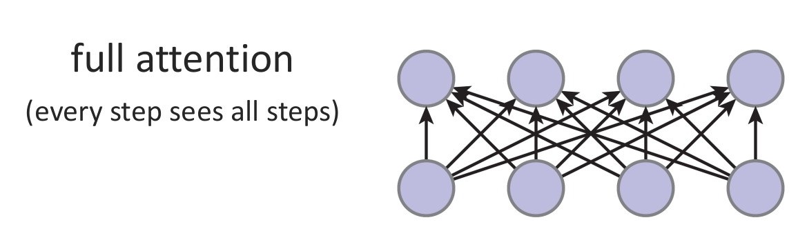
</div>

<small>**图 2.14** 完全注意力:每个位置可看到序列中所有位置</small>

<div align="center">
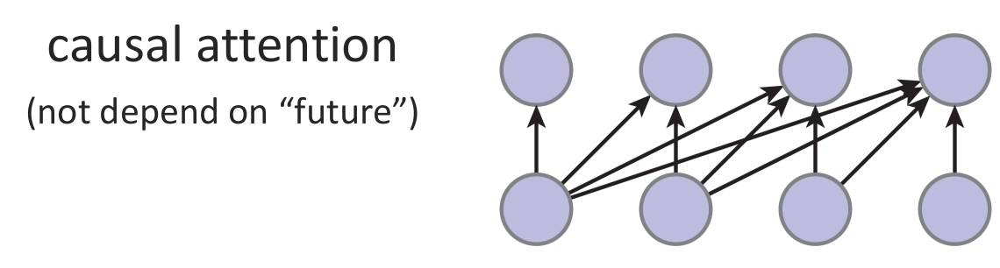
</div>

<small>**图 2.15** 因果注意力:每个位置只能看到当前及之前的位置</small>

### 4.2 网络结构

<div align="center">
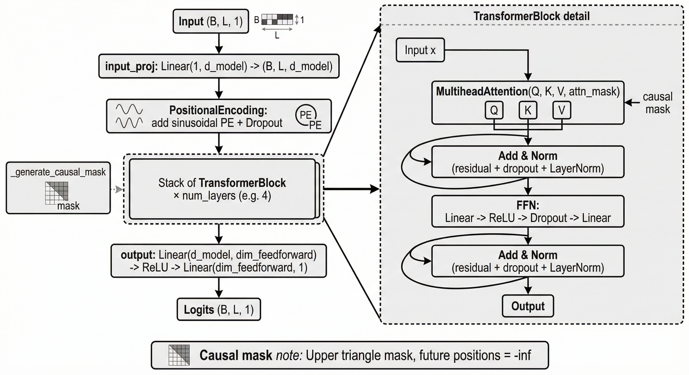
</div>

<small>**图 2.16** Transformer-based AR 网络架构图 </small>

### 4.3 Transformer-based AR 代码实现

**1. 位置编码**

```python
class PositionalEncoding(nn.Module):
    """位置编码，为序列添加位置信息"""
    def __init__(self, d_model, max_len=1000, dropout=0.1):
        super().__init__()
        self.dropout = nn.Dropout(p=dropout)
        pe = torch.zeros(max_len, d_model)
        position = torch.arange(0, max_len, dtype=torch.float).unsqueeze(1)
        div_term = torch.exp(torch.arange(0, d_model, 2).float() * (-math.log(10000.0) / d_model))
        pe[:, 0::2] = torch.sin(position * div_term)
        pe[:, 1::2] = torch.cos(position * div_term)
        pe = pe.unsqueeze(0)
        self.register_buffer('pe', pe)

    def forward(self, x):
        x = x + self.pe[:, :x.size(1), :]
        return self.dropout(x)
```

**2. TransformerBlock**

```python
class TransformerBlock(nn.Module):
    """Transformer编码器块"""
    def __init__(self, d_model, nhead, dim_feedforward, dropout=0.1):
        super().__init__()
        self.self_attn = nn.MultiheadAttention(d_model, nhead, dropout=dropout, batch_first=True)
        self.linear1 = nn.Linear(d_model, dim_feedforward)
        self.linear2 = nn.Linear(dim_feedforward, d_model)
        self.norm1 = nn.LayerNorm(d_model)
        self.norm2 = nn.LayerNorm(d_model)
        self.dropout = nn.Dropout(dropout)
        self.dropout1 = nn.Dropout(dropout)
        self.dropout2 = nn.Dropout(dropout)

    def forward(self, x, attn_mask=None):
        attn_out, _ = self.self_attn(x, x, x, attn_mask=attn_mask)
        x = x + self.dropout1(attn_out)
        x = self.norm1(x)
        ff_out = self.linear2(self.dropout(F.relu(self.linear1(x))))
        x = x + self.dropout2(ff_out)
        x = self.norm2(x)
        return x
```

**3. 因果掩码**

```python
def _generate_causal_mask(self, seq_len, device):
    """生成因果注意力掩码，防止看到未来信息"""
    mask = torch.triu(torch.ones(seq_len, seq_len, device=device), diagonal=1)
    mask = mask.masked_fill(mask == 1, float('-inf'))
    return mask
```

**4. 模型结构与训练**

```python
# __init__ 中
self.input_proj = nn.Linear(input_dim, d_model)
self.pos_encoder = PositionalEncoding(d_model, max_len, dropout)
self.transformer_blocks = nn.ModuleList([
    TransformerBlock(d_model, nhead, dim_feedforward, dropout)
    for _ in range(num_layers)
])
self.output = nn.Sequential(
    nn.Linear(d_model, dim_feedforward),
    nn.ReLU(),
    nn.Linear(dim_feedforward, input_dim)
)

def forward(self, x, use_causal_mask=True):
    x_proj = self.input_proj(x)                    # 投影到d_model空间 (B, L, d_model)
    x_proj = self.pos_encoder(x_proj)              # 位置编码
    attn_mask = None
    if use_causal_mask:
        attn_mask = self._generate_causal_mask(x.size(1), x.device)
    out = x_proj
    for transformer_block in self.transformer_blocks:
        out = transformer_block(out, attn_mask=attn_mask)
    return self.output(out)                        # (B, L, 1) Logits
```

**5. 推理阶段（自回归生成）**

与 CNN 类似，Transformer 无 hidden state，每步必须以已生成整段序列为输入:

```python
def generate(self, batch_size, seq_len=784, device='cpu', temperature=1.0):
    generated_seq = torch.zeros(batch_size, seq_len, self.input_dim, device=device)
    for t in range(1, seq_len):
        current_seq = generated_seq[:, :t, :]   # A: 获取当前已生成的序列（到位置t-1）
        output = self.forward(current_seq, use_causal_mask=True)  # B: 前向传播
        logits = output[:, -1, :]               # C: 取最后一个位置的预测 (Logits)
        probs = torch.sigmoid(logits / temperature)
        next_pixel = torch.bernoulli(probs)     # D: 采样
        generated_seq[:, t, :] = next_pixel     # E: 填入画布
    return generated_seq
```

损失函数与 RNN、CNN 相同，使用 BCEWithLogits。

---


## 5. 架构对比总结

| 特性 | RNN | CNN | Transformer |
|------|-----|-----|------------|
| **训练并行性** | ✅ 高（Teacher Forcing） | ✅ 高 | ✅ 高 |
| **推理并行性** | ❌ 低（逐步生成） | ⚠️ 中等 | ⚠️ 中等（KV Cache） |
| **长距离依赖** | ⚠️ 有限 | ⚠️ 受限于感受野 | ✅ 优秀 |
| **参数量** | ✅ 少 | ✅ 中等 | ❌ 大 |
| **计算复杂度** | $O(T \times D)$ | $O(T \times D)$ | $O(T^2 \times D)$ |
| **适用场景** | 小规模模型 | 中等规模，固定感受野 | 大规模，长序列 |

---

## 6. 损失函数设计（Loss Function Design）

### 6.1 自回归模型的损失函数

自回归模型的目标是最大化训练数据的对数似然（log-likelihood）。对于联合分布:

$$p(x_1, x_2, \ldots, x_T) = \prod_{t=1}^T p(x_t \mid x_{<t})$$

对数似然为:

$$\log p(x_1, x_2, \ldots, x_T) = \sum_{t=1}^T \log p(x_t \mid x_{<t})$$

### 6.2 离散数据:交叉熵（Cross-Entropy）

对于离散数据（如文本 token、量化像素值），每个条件分布 $p(x_t \mid x_{<t})$ 是一个类别分布（categorical distribution）。本文 MNIST 实验将像素二值化，使用 **BCEWithLogits**（二元交叉熵）建模 Bernoulli 分布；若为多类 token，则使用多类交叉熵。

**损失函数形式:**

$$\mathcal{L} = -\frac{1}{N} \sum_{i=1}^N \sum_{t=1}^T \log p_\theta(x_t^{(i)} \mid x_{<t}^{(i)})$$

其中:
*   $N$ 是批次大小（batch size）
*   $T$ 是序列长度
*   $x_t^{(i)}$ 是第 $i$ 个样本在时刻 $t$ 的真实值
*   $p_\theta$ 是模型参数化的条件分布

**实现细节:**

1. **输入准备**:
   *   输入序列:$[x_1, x_2, \ldots, x_{T-1}]$
   *   目标序列:$[x_2, x_3, \ldots, x_T]$（向后平移一步）

2. **模型输出**:
   *   模型输出 logits:$\text{logits} \in \mathbb{R}^{N \times T \times V}$，其中 $V$ 是词汇表大小（vocab size）
   *   每个位置的 logits 表示下一个 token 的未归一化概率

3. **损失计算**:
   ```python
   # 展平 logits 和 targets
   logits_flat = logits.reshape(-1, vocab_size)  # (N*T, V)
   targets_flat = targets.reshape(-1)  # (N*T)
   
   # 计算交叉熵损失
   loss = F.cross_entropy(logits_flat, targets_flat)
   ```

**交叉熵损失的优点:**
*   直接优化对数似然，与最大似然估计（MLE）目标一致
*   数值稳定（PyTorch 的 `cross_entropy` 内部使用 log-sum-exp trick）
*   计算高效，支持并行计算

### 6.3 连续数据

对于连续数据（如音频波形），条件分布可以是:
*   **高斯分布**:$p(x_t \mid x_{<t}) = \mathcal{N}(\mu_t, \sigma_t^2)$
*   **混合高斯分布**:多个高斯分量的混合
*   **其他参数化分布**:如逻辑分布（logistic distribution）

**高斯分布的损失函数:**

$$\mathcal{L} = -\frac{1}{N} \sum_{i=1}^N \sum_{t=1}^T \log \mathcal{N}(x_t^{(i)} \mid \mu_t^{(i)}, \sigma_t^2)$$

$$= \frac{1}{N} \sum_{i=1}^N \sum_{t=1}^T \left[ \frac{1}{2}\log(2\pi\sigma_t^2) + \frac{(x_t^{(i)} - \mu_t^{(i)})^2}{2\sigma_t^2} \right]$$

### 6.4 损失函数的特性

1. **序列级平均**:损失是对所有时间步的平均，每个位置贡献相等
2. **批次级平均**:损失是对所有样本的平均
3. **可并行计算**:由于使用 Teacher Forcing，所有时间步可以并行计算梯度
4. **与推理一致**:优化的是每个位置的条件分布，与自回归生成过程一致

---

## 7. 实验结果

在 MNIST 上训练 RNN、CNN、Transformer 三种 AR 架构，生成样本如下。

<div align="center">
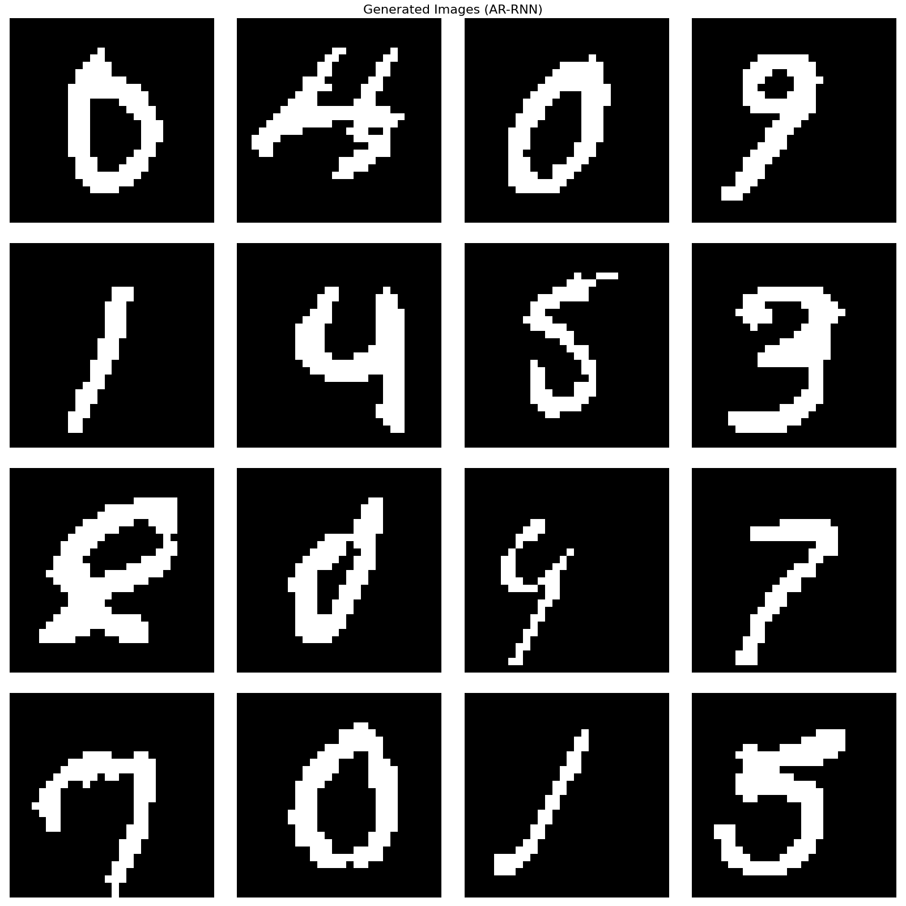
</div>

<small>**图 2.17** RNN-based AR 生成的 MNIST 样本</small>

<div align="center">
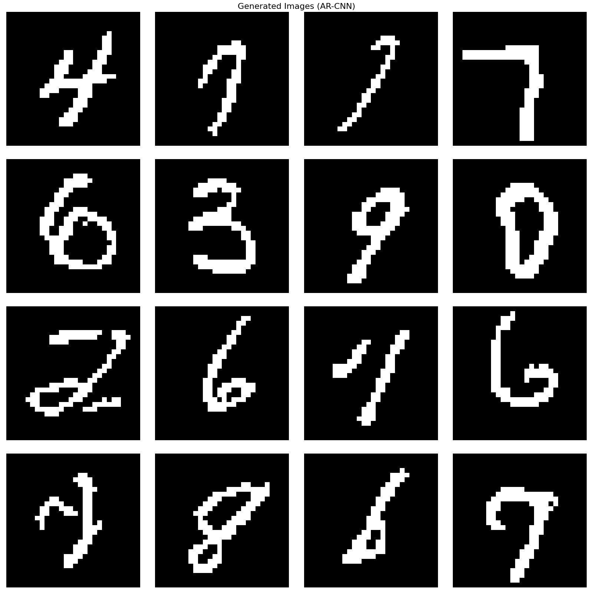
</div>

<small>**图 2.18** CNN-based AR 生成的 MNIST 样本</small>

<div align="center">
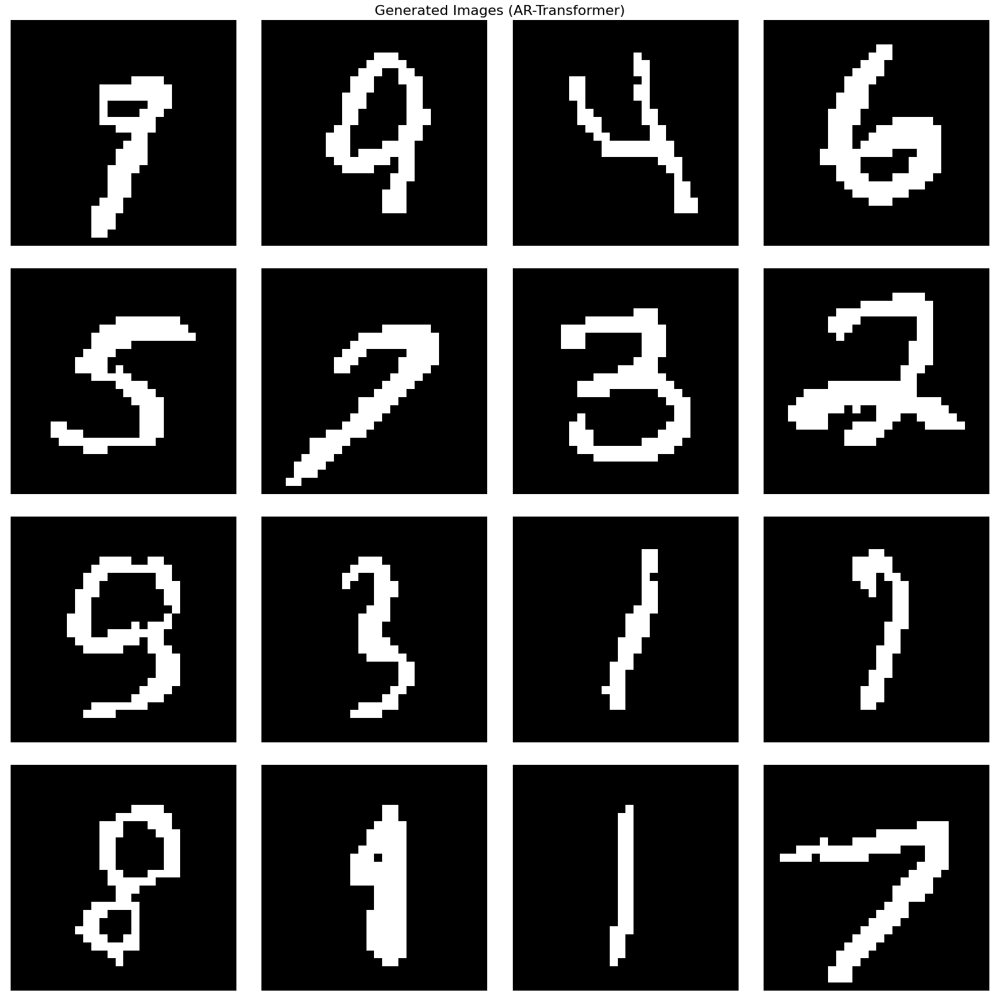
</div>

<small>**图 2.19** Transformer-based AR 生成的 MNIST 样本</small>

**简要结论**:三种架构均能生成可识别的数字。RNN 结构简单、参数少，但易受梯度消失影响，长程依赖建模较弱；CNN 通过因果卷积与膨胀卷积扩大感受野，训练与推理均可并行，样本质量中等；Transformer 凭借全局因果注意力，长程依赖建模最好，生成质量通常最高，但参数量更大，且注意力复杂度为 $O(T^2)$。在 MNIST 这类 784 维序列上，三者均可取得不错效果，实际选择需权衡质量、效率与资源。

---

## 📚 参考

*   Kaiming He, Deep Generative Models.
*   Van den Oord et al., *Pixel Recurrent Neural Networks*, ICML 2016.
*   Van den Oord et al., *WaveNet: A Generative Model for Raw Audio*, 2016.
*   Vaswani et al., *Attention Is All You Need*, NeurIPS 2017.
