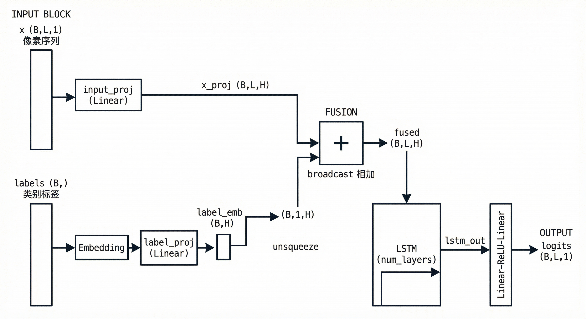
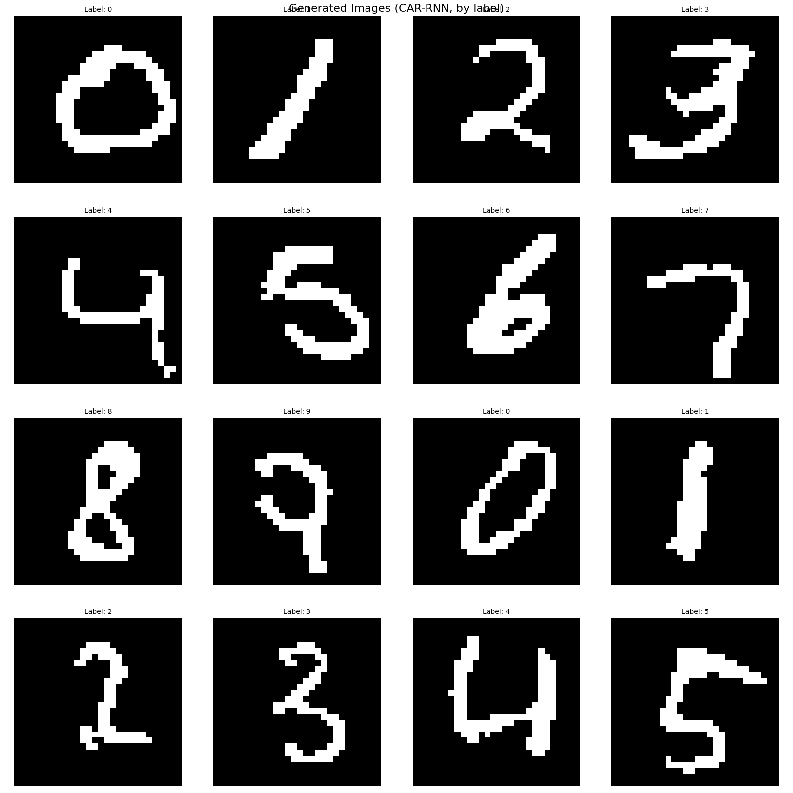

# AR系列篇-03.CAR: 从"无条件生成"到"条件生成"

## 1. AR 的问题与 CAR 的引入

### 1.1 无条件 AR 的局限性

自回归（AR）模型通过链式法则将联合分布分解为 $p(x) = \prod_{t=1}^T p(x_t \mid x_{<t})$，可结合 RNN、CNN、Transformer 等架构实现序列生成。标准 AR 模型从历史序列 $x_{<t}$ 预测下一个元素 $x_t$，生成的内容取决于模型学习到的数据分布。

然而，在需要**可控生成**的任务中，传统 AR 显得力不从心:

**无法控制生成内容**:标准 AR 从序列历史 $x_{<t}$ 预测 $x_t$，生成过程仅依赖已生成部分，无法指定生成特定类别的样本。例如，在 MNIST 上无法控制生成数字"7"的图像，只能随机生成任意数字。

### 1.2 CAR 的解决方案

为了增强 AR 的灵活性和可控性，提出了**条件自回归模型（Conditional Autoregressive Model, CAR）**。CAR 允许在生成过程中加入额外条件 $c$（如类别标签、文本前缀等），实现可控的序列生成。

**核心思想**:在 AR 的基础上引入条件变量 $c$，将目标从建模 $p(x)$ 改为建模 $p(x \mid c)$。通过指定条件 $c$ 来指导模型生成符合该条件的序列。

**无条件 AR**:
- 目标分布:$p(x)$
- 分解:$p(x) = \prod_{t=1}^T p(x_t \mid x_{<t})$
- 网络输入:$x_{<t}$

**条件 AR（CAR）**:
- 目标分布:$p(x \mid c)$
- 分解:$p(x \mid c) = \prod_{t=1}^T p(x_t \mid x_{<t}, c)$
- 网络输入:$x_{<t}$ 和 $c$

---

## 2. CAR 的核心问题

### 2.1 问题 1:条件 $c$ 如何加入模型？

在 CAR 中，条件 $c$ 需要加入到网络的每一步预测中，使 $p_\theta(x_t \mid x_{<t}, c)$ 同时依赖历史与条件。

**网络输入**:
- 历史序列:$x_{<t} = (x_1, \ldots, x_{t-1})$
- 条件:$c$（对所有时间步共享且不变）

**实现方式因架构而异**:
- **RNN**:将 $c$ 的嵌入加到每步的输入特征上，或作为初始隐藏状态
- **CNN**:将 $c$ 的嵌入 broadcast 并与中间特征相加（参考 cddpm）
- **Transformer**:将 $c$ 编码为前缀 token 或通过 cross-attention 引入

✅ **关键**:条件 $c$ 对所有时间步**共享**，不随时间变化，满足 $p(x_t \mid x_{<t}, c)$ 的建模形式。

### 2.2 问题 2:条件 $c$ 如何编码？

条件变量 $c$ 通常是离散标签（如 MNIST 的 0~9），需要转换为数值向量才能输入神经网络。与 CGAN、CVAE、CDDPM 等类似，常见方式有:

**方式 1:One-Hot 编码**
- 类别 $k$ → $[0, \ldots, 1, \ldots, 0]$（第 $k$ 位为 1）
- 优点:简单，无额外参数
- 缺点:维度等于类别数，无法学习类别语义

**方式 2:Embedding 编码**（本实现采用）
- 使用 `nn.Embedding(num_labels, label_embed_dim)` 将类别索引映射为可学习向量
- 优点:维度可自定义，可学习类别间的语义关系
- 缺点:需额外可学习参数

---

## 3. CAR 的损失函数与训练

### 3.1 条件对数似然

CAR 的目标是最大化条件对数似然:

$$\mathcal{L}(\theta) = \mathbb{E}_{(x, c) \sim \mathcal{D}} \left[ \log p_\theta(x \mid c) \right] = \mathbb{E}_{(x, c)} \left[ \sum_{t=1}^T \log p_\theta(x_t \mid x_{<t}, c) \right]$$

**训练（条件 Teacher Forcing）**:
- 使用真实历史 $x_{<t}$ 作为输入（非模型生成）
- 条件 $c$ 来自数据集（如类别标签）
- 梯度可并行计算（因输入已知）

### 3.2 与无条件 AR 的对比

| 项目       | 无条件 AR          | 条件 AR（CAR）            |
|------------|--------------------|---------------------------|
| 目标分布   | $p(x)$             | $p(x \mid c)$             |
| 分解形式   | $\prod_t p(x_t \mid x_{<t})$ | $\prod_t p(x_t \mid x_{<t}, c)$ |
| 网络输入   | $x_{<t}$           | $x_{<t}$ 和 $c$           |
| 应用场景   | 无监督生成         | 可控生成（指定类别等）    |

### 3.3 推理:条件自回归采样

生成过程为递归采样，每步依赖历史与固定条件 $c$:

```python
x = []
for t in range(1, T+1):
    p_xt = model(x[:t-1], c)   # p(x_t | x_{<t}, c)
    x_t = sample(p_xt)
    x.append(x_t)
```

---

## 4. CAR 代码实现（以 CAR_RNN 为例）

下面以 MNIST 条件生成为例，给出基于 RNN 的 CAR 实现。架构参考 cddpm 的条件注入方式:使用 `nn.Embedding` 将标签嵌入，再与特征相加。

<div align="center">

</div>

<small>**图 3.1** CAR_RNN 网络架构图:标签经 Embedding 后与序列特征相加，再经 LSTM 与输出层预测下一像素</small>

### 4.1 模型结构

```python
class CAR_RNN(nn.Module):
    """条件自回归 RNN 模型，用于条件生成 MNIST 图像

    在 AR_RNN (LSTM) 基础上增加标签条件:
    1. 使用 nn.Embedding 将类别标签嵌入为向量
    2. 将标签嵌入加到每步的输入特征上，实现条件控制
    """
    def __init__(self, input_dim=1, hidden_dim=256, num_layers=2, dropout=0.2,
                 num_labels=10, label_embed_dim=None):
        super().__init__()
        if label_embed_dim is None:
            label_embed_dim = hidden_dim

        self.label_emb = nn.Embedding(num_labels, label_embed_dim)
        if label_embed_dim != hidden_dim:
            self.label_proj = nn.Linear(label_embed_dim, hidden_dim)
        else:
            self.label_proj = nn.Identity()

        self.input_proj = nn.Linear(input_dim, hidden_dim)
        self.lstm = nn.LSTM(hidden_dim, hidden_dim, num_layers=num_layers,
                            dropout=dropout if num_layers > 1 else 0, batch_first=True)
        self.output = nn.Sequential(
            nn.Linear(hidden_dim, hidden_dim), nn.ReLU(),
            nn.Linear(hidden_dim, input_dim)
        )
```

### 4.2 训练阶段（forward）

标签嵌入 broadcast 到序列各位置，与输入特征相加:

```python
def forward(self, x, labels):
    x_proj = self.input_proj(x)                    # (B, L, hidden_dim)
    label_emb = self.label_emb(labels)             # (B, label_embed_dim)
    label_emb = self.label_proj(label_emb)         # (B, hidden_dim)
    label_emb = label_emb.unsqueeze(1)             # (B, 1, hidden_dim)
    x_proj = x_proj + label_emb                    # broadcast 到 (B, L, hidden_dim)
    lstm_out, _ = self.lstm(x_proj)
    return self.output(lstm_out)                   # (B, L, input_dim) Logits
```

### 4.3 推理阶段（generate）

每步将标签嵌入加到当前输入特征上，配合 hidden_state 传递历史:

```python
def generate(self, batch_size=1, seq_len=784, labels=None, device='cpu', temperature=1.0):
    if labels is None:
        labels = torch.randint(0, self.num_labels, (batch_size,), device=device)

    label_emb = self.label_emb(labels)
    label_emb = self.label_proj(label_emb)         # (B, hidden_dim)

    generated_seq = torch.zeros(batch_size, seq_len, self.input_dim, device=device)
    hidden_state = None

    for t in range(1, seq_len):
        last_pixel = generated_seq[:, t-1:t, :]
        current_feature = self.input_proj(last_pixel)
        current_feature = current_feature + label_emb.unsqueeze(1)   # 注入条件

        lstm_out, hidden_state = self.lstm(current_feature, hidden_state)
        logits = self.output(lstm_out[:, -1, :])
        next_pixel = torch.bernoulli(torch.sigmoid(logits / temperature))
        generated_seq[:, t, :] = next_pixel

    return generated_seq, labels
```

### 4.4 损失函数

与无条件 AR 相同，二值像素使用 BCEWithLogits:

```python
def loss_function(pred, target):
    return F.binary_cross_entropy_with_logits(pred.reshape(-1), target.reshape(-1))
```

训练时，`forward` 需传入 `(x, labels)`，其中 `labels` 来自数据集的类别标注。

---

## 5. CAR 的作用与本质

### 5.1 CAR 的作用

1. **控制生成内容**:通过指定条件 $c$（如数字标签 0~9），生成对应类别的样本
2. **有监督学习**:利用数据集中的 $(x, c)$ 对，学习条件分布 $p(x \mid c)$
3. **与无条件 AR 兼容**:若 $c$ 随机采样，可退化为近似无条件生成

### 5.2 CAR 的本质:条件分布建模

**核心思想**:CAR 将无条件自回归 $p(x) = \prod_t p(x_t \mid x_{<t})$ 拓展为条件自回归 $p(x \mid c) = \prod_t p(x_t \mid x_{<t}, c)$，通过引入外部条件 $c$ 实现可控生成。

条件 $c$ 将边缘分布 $p(x)$ 分解为条件分布 $p(x \mid c)$，使得生成过程可按需控制，广泛应用于 class-conditional Image GPT、prompt-based 文本生成、text-to-speech 等任务。

---

## 6. 条件生成结果

在 MNIST 数据集上训练 CAR_RNN 后，按指定标签 $c \in \{0, 1, \ldots, 9\}$ 生成数字图像。下图展示了条件生成的样例:每张图上方标注对应的 Label，可见模型能够根据标签生成相应类别的数字。

<div align="center">

</div>

<small>**图 3.2** CAR_RNN 条件生成结果:按指定标签（0~9）生成的 MNIST 数字图像</small>

---

## 7. 结论

1. **CAR 实现了可控生成**:在 AR 基础上引入条件 $c$，将建模目标从 $p(x)$ 拓展为 $p(x \mid c)$，可通过指定类别标签生成对应样本，解决了无条件 AR 无法控制生成内容的问题。

2. **条件注入方式简洁**:采用 Embedding 编码标签，并将标签嵌入与序列特征相加（broadcast），与 CDDPM、CGAN 等条件生成模型的做法一致，实现简单且有效。

3. **训练与推理高效**:训练时使用条件 Teacher Forcing，梯度可并行计算；推理时逐像素自回归采样，每步依赖历史与固定条件 $c$，在 Transformer 等架构下还可通过 KV Cache 等方式加速。

4. **适用场景广泛**:CAR 可用于 class-conditional 图像生成、prompt-based 文本生成、text-to-speech 等多类可控生成任务，是自回归建模范式的重要扩展。

---

## 📚 参考

- Van den Oord et al., *Pixel Recurrent Neural Networks*, ICML 2016.
- Mirza, M., & Osindero, S. (2014). Conditional generative adversarial nets. *arXiv preprint arXiv:1411.1784*.
