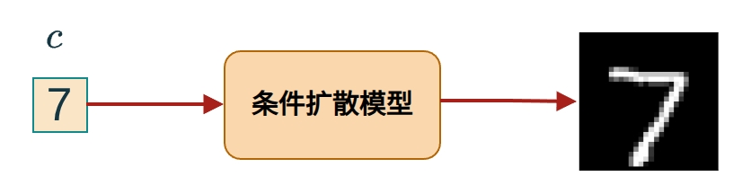
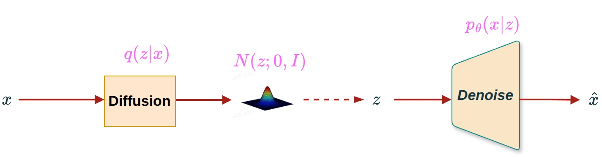
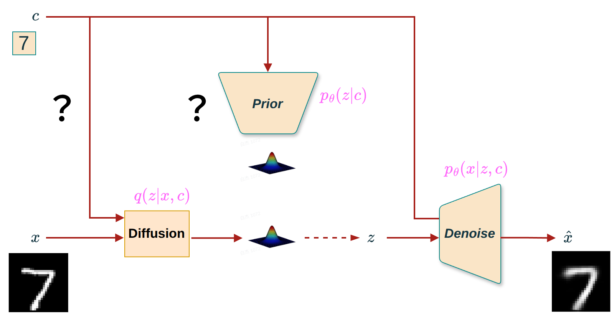
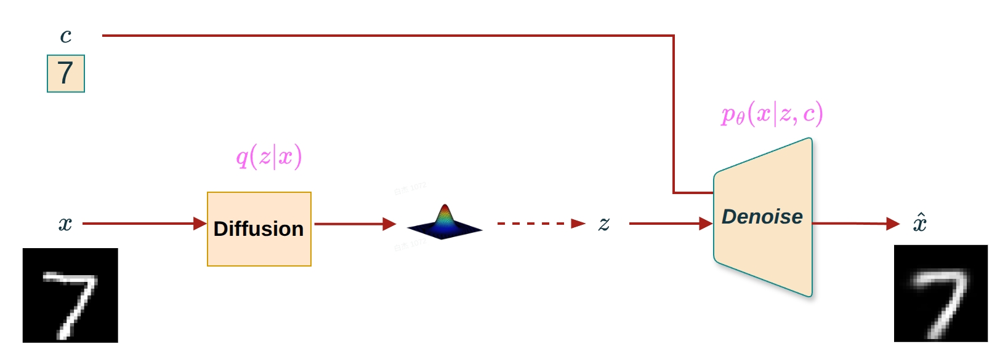
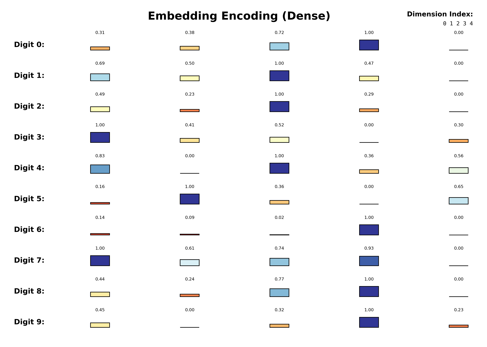
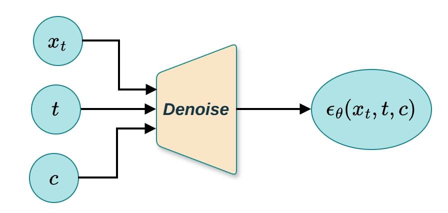
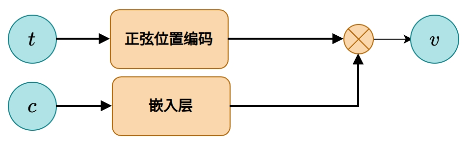

# DM系列篇-05.CDDPM理论篇1: 从"无条件生成"到"条件生成"

## 1. DDPM的问题与CDDPM的引入

### 1.1 DDPM的局限性

去噪扩散概率模型（DDPM）是一种强大的生成模型，它通过学习逐步去噪过程来生成高质量的数据样本。DDPM通过前向扩散过程将数据逐步转换为纯噪声，然后学习反向去噪过程从噪声中恢复数据。在生成新样本时，DDPM从标准正态分布 $\mathcal{N}(0, I)$ 中采样初始噪声 $x_T$，然后通过训练好的去噪网络逐步去噪，最终生成新的数据样本。

然而，传统的DDPM在处理一些需要特定条件控制的生成任务时显得力不从心。具体来说:

**无法控制生成内容**:DDPM从标准正态分布随机采样初始噪声 $x_T$，生成的内容是完全随机的，无法指定生成特定类别的样本

### 1.2 CDDPM的解决方案

在图像生成任务中，我们可能希望根据特定标签（如数字"7"）来生成相应的图像，而不是随机生成一个图像， 如图1所示。

<small>**图1** DDPM（无条件）vs CDDPM（条件生成）:通过指定条件标签，CDDPM可以生成特定类别的图像</small>

为了增强DDPM的灵活性和可控性，提出了**条件去噪扩散概率模型（Conditional Denoising Diffusion Probabilistic Model, CDDPM）**。CDDPM允许我们在生成过程中加入额外的信息（条件），从而实现更加精确和可控的数据生成。

**核心思想**:在DDPM的基础上，引入条件变量 $c$，使得去噪过程依赖于条件信息。比如，可以通过指定条件变量 $c$ 来指导模型生成特定类别的样本。

为了更好地理解DDPM和CDDPM的区别，我们先回顾一下DDPM的架构:

<small>**图2** DDPM架构:前向过程 $q(x_t|x_{t-1})$ 添加噪声，反向过程 $p_\theta(x_{t-1}|x_t)$ 去噪生成</small>

---

## 2. 从CVAE到CDDPM

我们先回顾一下CVAE的推导过程，我们当时提出了三个问题，在CDDPM中我们依旧需要回答这三个问题。

### 2.1 问题1:条件C加在DDPM的哪个部分？

图3展示了条件c应该加在哪个部分的疑问:

<small>**图3** 条件在CDDPM中的位置:条件是否应该加在前向过程和潜变量</small>

不同于CVAE过程，由于CDDPM的前向过程（Diffusion过程）是个确定性过程，所以我们需要考虑条件c有没有必要加在前向过程？结论是**没必要**。以下过程给出了推导:

#### 使用贝叶斯规则推导:前向过程与条件 $c$ 无关

我们使用贝叶斯概率规则和条件概率分解，严格证明:**在扩散模型中，前向过程与条件变量 $c$ 无关**，即:

$$\boxed{q(x_{1:T}|x_0, c) = q(x_{1:T}|x_0)}$$

**设定与目标**

- 数据生成包含条件变量 $c$，联合分布为 $q(c, x_0, x_1, \ldots, x_T)$
- 前向加噪机制是预设的马尔可夫链，满足:
  $$q(x_t|x_{t-1}, c) = q(x_t|x_{t-1}), \quad \forall t \geq 1 \tag{1}$$
  这是扩散模型的基本设计原则:**加噪不依赖 $c$**
- 目标:证明
  $$q(x_{1:T}|x_0, c) = q(x_{1:T}|x_0) \tag{Goal}$$

**贝叶斯视角下的推导**

**步骤 1:写出条件概率定义**

根据条件概率公式:

$$q(x_{1:T}|x_0, c) = \frac{q(x_{1:T}, x_0, c)}{q(x_0, c)} \tag{2}$$

类似地:

$$q(x_{1:T}|x_0) = \frac{q(x_{1:T}, x_0)}{q(x_0)} \tag{3}$$

**步骤 2:展开联合分布 $q(x_{1:T}, x_0, c)$**

利用链式法则:

$$q(x_{1:T}, x_0, c) = q(c) \cdot q(x_0|c) \cdot q(x_{1:T}|x_0, c) \tag{4}$$

由马尔可夫性和假设 (1):

$$q(x_{1:T}|x_0, c) = \prod_{t=1}^T q(x_t|x_{t-1}, c) = \prod_{t=1}^T q(x_t|x_{t-1}) = q(x_{1:T}|x_0)$$

因此，联合分布可写为:

$$q(x_{1:T}, x_0, c) = q(c) \cdot q(x_0|c) \cdot q(x_{1:T}|x_0) \tag{5}$$

**步骤 3:计算分母**

显然:

$$q(x_0, c) = q(c) \cdot q(x_0|c) \tag{6}$$

**步骤 4:代入贝叶斯公式**

将 (5) 和 (6) 代入 (2):

$$q(x_{1:T}|x_0, c) = \frac{q(c) \cdot q(x_0|c) \cdot q(x_{1:T}|x_0)}{q(c) \cdot q(x_0|c)} = q(x_{1:T}|x_0) \tag{7}$$

✅ **得证！**

**结论**

由于前向转移核满足 $q(x_t|x_{t-1}, c) = q(x_t|x_{t-1})$，整个轨迹分布与 $c$ 无关，故:

$$\boxed{q(x_{1:T}|x_0, c) = q(x_{1:T}|x_0)}$$

这意味着:**无论是否引入条件 $c$，前向扩散过程完全相同。条件信息仅用于反向去噪过程。**

上述的证明过程同时说明了条件c与潜变量z是相互独立的，同时也就回答了问题2

因此，在CDDPM中，我们只需要将条件 $c$ 加入到去噪网络 $\epsilon_\theta(x_t, t, c)$ 中，而前向过程 $q(x_t|x_{t-1})$ 保持不变。

所以CDDPM的框架图如图4所示:

<small>**图4** CDDPM框架:条件 $c$ 仅注入到去噪网络 $\epsilon_\theta(x_t, t, c)$，前向过程保持不变</small>

### 2.2 问题2:条件c如何编码？

这个问题我们在CVAE解释过了，可以使用One-Hot编码和Embedding编码，在这里我们仅仅考虑Embedding编码，即

条件变量 $c$ 需要编码成数值向量才能输入神经网络，常见的编码方式有:

**方式2:Embedding编码**
- 方法:使用可学习的嵌入层将类别索引映射为低维向量
- 例如:类别3 → 可学习的N维向量
- 优点:维度可自定义，通常比one-hot更紧凑；可以学习到类别之间的语义关系
- 缺点:需要额外的可学习参数

<small>**图5** 条件编码方式:Embedding编码</small>

### 2.3 问题3:条件c如何注入到去噪网络？

在CDDPM中，我们新增了一个问题:条件c如何注入到去噪网络

不同于CVAE，CDDPM的Denoise过程的输入除了潜变量z，还有参数t, 如图6所示:

<small>**图6** CDDPM去噪网络的输入:除了潜变量 $x_t$，还有时间步 $t$，条件 $c$ 需要注入到网络中</small>

于是我们需要考虑条件c如何注入到去噪网络:

条件 $c$ 编码后需要注入到去噪网络中，常见的注入方式有:

**方式1:条件嵌入与时间嵌入相加**
- 方法:将条件嵌入 $emb(c)$ 与时间嵌入 $emb(t)$ 相加，然后注入到网络的每个卷积块中
- 数学表达:$v = emb(t) + emb(c)$，然后 $v$ 通过MLP后加到特征图
- 优点:实现简单，计算效率高
- 缺点:条件信息和时间信息混合，可能相互干扰

**方式2:条件嵌入与时间嵌入拼接**
- 方法:将条件嵌入和时间嵌入拼接后通过MLP
- 数学表达:$v = MLP([emb(t), emb(c)])$
- 优点:条件信息和时间信息分离，更灵活
- 缺点:需要更多的参数和计算

**方式3:条件嵌入作为额外的输入通道**
- 方法:将条件嵌入广播到图像空间维度，作为额外的输入通道
- 优点:条件信息在空间维度上可见
- 缺点:增加输入维度，计算开销较大

**标准实现**:条件嵌入与时间嵌入相加
- 这是最常用和高效的方式
- 在U-Net的每个卷积块中，条件嵌入和时间嵌入相加后通过MLP，然后加到特征图上

<small>**图7** 条件注入方式:条件嵌入与时间嵌入相加后注入到U-Net的每个卷积块</small>

---

## 3. CDDPM的损失函数推导

### 3.1 CDDPM的条件ELBO推导

在CDDPM中，我们需要最大化条件对数似然 $\log p_\theta(x_0|c)$。与DDPM类似，我们引入变分后验 $q(x_{1:T}|x_0)$ 来近似真实后验。

**条件对数似然**:
$$\log p_\theta(x_0|c) = \log \int p_\theta(x_{0:T}|c) dx_{1:T}$$

**前向过程**（固定，不依赖于条件）:
$$q(x_{1:T}|x_0) = \prod_{t=1}^{T} q(x_t|x_{t-1}) = \prod_{t=1}^{T} \mathcal{N}(x_t; \sqrt{\alpha_t} x_{t-1}, (1-\alpha_t) I)$$

**反向过程**（依赖于条件）:
$$p_\theta(x_{0:T}|c) = p(x_T) \prod_{t=1}^{T} p_\theta(x_{t-1}|x_t, c)$$

其中 $p(x_T) = \mathcal{N}(x_T; 0, I)$。

**ELBO推导**:

与DDPM类似，我们可以推导出条件ELBO:

$$\begin{aligned}
\log p_\theta(x_0|c) &= \log \int \frac{p_\theta(x_{0:T}|c) q(x_{1:T}|x_0)}{q(x_{1:T}|x_0)} dx_{1:T} \\
&\geq \mathbb{E}_{q(x_{1:T}|x_0)} \left[\log \frac{p_\theta(x_{0:T}|c)}{q(x_{1:T}|x_0)}\right]
\end{aligned}$$

展开后得到:

$$\begin{aligned}
\mathcal{L}(x_0, c; \theta) &= \mathbb{E}_{q(x_1|x_0)} [\log p_\theta(x_0|x_1, c)] \\
&\quad - D_{KL}(q(x_T|x_0) \| p(x_T)) \\
&\quad - \sum_{t=2}^{T} \mathbb{E}_{q(x_t|x_0)} [D_{KL}(q(x_{t-1}|x_t, x_0) \| p_\theta(x_{t-1}|x_t, c))]
\end{aligned}$$

**ELBO的组成**:

1. **重构项**:$\mathbb{E}_{q(x_1|x_0)} [\log p_\theta(x_0|x_1, c)]$ - 鼓励模型从 $x_1$ 和条件 $c$ 重构原始输入 $x_0$
2. **先验匹配项**:$D_{KL}(q(x_T|x_0) \| p(x_T))$ - 最终噪声化输入分布与标准高斯先验的匹配（无参数，通常为0）
3. **去噪匹配项**:$\mathbb{E}_{q(x_t|x_0)} [D_{KL}(q(x_{t-1}|x_t, x_0) \| p_\theta(x_{t-1}|x_t, c))]$ - 学习条件去噪转移步骤 $p_\theta(x_{t-1}|x_t, c)$ 匹配真实去噪步骤 $q(x_{t-1}|x_t, x_0)$

### 3.2 简化的损失函数

与DDPM类似，CDDPM的损失函数可以简化为预测噪声的均方误差:

**简化损失函数**:

$$\mathcal{L}_{CDDPM} = \mathbb{E}_{t, x_0, \epsilon, c} \left[ \|\epsilon - \epsilon_\theta(x_t, t, c)\|^2 \right]$$

其中:

- $t \sim \text{Uniform}(1, T)$ - 随机采样时间步
- $x_0 \sim p_{data}(x_0)$ - 从数据分布采样
- $\epsilon \sim \mathcal{N}(0, I)$ - 从标准正态分布采样噪声
- $x_t = \sqrt{\bar{\alpha}_t} x_0 + \sqrt{1 - \bar{\alpha}_t} \epsilon$ - 前向扩散过程
- $c$ - 条件变量（如类别标签）

**关键变化**:

与DDPM相比，CDDPM的损失函数只有一处关键变化:
- **去噪网络**:$\epsilon_\theta(x_t, t, c)$ - 去噪网络依赖于条件 $c$

**训练过程**:

1. 从数据集中采样 $(x_0, c)$
2. 随机采样时间步 $t \sim \text{Uniform}(1, T)$
3. 采样噪声 $\epsilon \sim \mathcal{N}(0, I)$
4. 计算 $x_t = \sqrt{\bar{\alpha}_t} x_0 + \sqrt{1 - \bar{\alpha}_t} \epsilon$
5. 预测噪声 $\hat{\epsilon} = \epsilon_\theta(x_t, t, c)$
6. 计算损失 $L = \|\epsilon - \hat{\epsilon}\|^2$
7. 反向传播并更新参数

### 3.3 条件去噪转移步骤

**真实去噪步骤**（与DDPM相同）:
$$q(x_{t-1}|x_t, x_0) = \mathcal{N}(x_{t-1}; \tilde{\mu}_t(x_t, x_0), \tilde{\beta}_t I)$$

其中:

$$\tilde{\mu}_t(x_t, x_0) = \frac{\sqrt{\bar{\alpha}_{t-1}} \beta_t}{1 - \bar{\alpha}_t} x_0 + \frac{\sqrt{\alpha_t}(1 - \bar{\alpha}_{t-1})}{1 - \bar{\alpha}_t} x_t$$

$$\tilde{\beta}_t = \frac{1 - \bar{\alpha}_{t-1}}{1 - \bar{\alpha}_t} \beta_t$$

**条件去噪步骤**（依赖于条件）:
$$p_\theta(x_{t-1}|x_t, c) = \mathcal{N}(x_{t-1}; \mu_\theta(x_t, t, c), \Sigma_\theta(x_t, t, c))$$

其中均值 $\mu_\theta(x_t, t, c)$ 可以通过预测噪声 $\epsilon_\theta(x_t, t, c)$ 计算:

$$\mu_\theta(x_t, t, c) = \frac{1}{\sqrt{\alpha_t}} \left( x_t - \frac{\beta_t}{\sqrt{1 - \bar{\alpha}_t}} \epsilon_\theta(x_t, t, c) \right)$$

方差 $\Sigma_\theta(x_t, t, c)$ 通常设置为 $\tilde{\beta}_t I$（与DDPM相同）。

---

## 4. Conditional的作用与本质

### 4.1 Conditional的作用

在CDDPM中，条件变量 $c$ 起到以下关键作用:

1. **控制生成内容**:
   - 通过指定不同的条件 $c$，可以生成不同类别的样本
   - 例如:在MNIST上，$c$ 可以是数字标签（0-9），生成对应数字的图像

2. **引导去噪过程**:
   - 条件 $c$ 引导去噪网络 $\epsilon_\theta(x_t, t, c)$ 朝着特定类别的方向去噪
   - 不同条件对应不同的去噪路径，最终生成不同类别的样本

3. **提高生成质量**:
   - 条件信息帮助模型更好地理解去噪目标，提高生成样本的质量和准确性

### 4.2 Conditional的本质:改变去噪路径

**核心思想**:CDDPM中条件 $c$ 的本质作用是**改变去噪路径**。

#### 4.2.1 DDPM中的去噪路径

在DDPM中，去噪网络 $\epsilon_\theta(x_t, t)$ 不依赖于条件，从相同的初始噪声 $x_T$ 开始，总是沿着相同的去噪路径生成样本，无法控制生成的内容。

#### 4.2.2 CDDPM中的去噪路径变化

在CDDPM中，条件 $c$ 改变了去噪路径:

- **不同条件对应不同路径**:条件 $c$ 影响去噪网络 $\epsilon_\theta(x_t, t, c)$ 的预测，使得不同条件引导不同的去噪方向
- **条件引导去噪方向**:在每一步去噪中，条件 $c$ 帮助模型选择正确的去噪方向，朝着目标类别收敛
- **最终生成不同内容**:虽然从相同的初始噪声 $x_T$ 开始，但不同条件引导不同的去噪路径，最终生成不同类别的样本

#### 4.2.3 数学表达

**DDPM**:
$$x_{t-1} = \frac{1}{\sqrt{\alpha_t}} \left( x_t - \frac{\beta_t}{\sqrt{1 - \bar{\alpha}_t}} \epsilon_\theta(x_t, t) \right) + \sigma_t z$$

去噪路径由 $\epsilon_\theta(x_t, t)$ 决定，不依赖于条件。

**CDDPM**:
$$x_{t-1} = \frac{1}{\sqrt{\alpha_t}} \left( x_t - \frac{\beta_t}{\sqrt{1 - \bar{\alpha}_t}} \epsilon_\theta(x_t, t, c) \right) + \sigma_t z$$

去噪路径由 $\epsilon_\theta(x_t, t, c)$ 决定，依赖于条件 $c$，不同条件对应不同的去噪路径。

### 4.3 条件生成过程

**条件生成算法**:

1. **初始化**:从标准正态分布采样 $x_T \sim \mathcal{N}(0, I)$
2. **指定条件**:给定条件 $c$（如类别标签）
3. **迭代去噪**:对于 $t = T, T-1, \ldots, 1$:
   - 预测噪声:$\hat{\epsilon} = \epsilon_\theta(x_t, t, c)$
   - 计算均值:$\mu_t = \frac{1}{\sqrt{\alpha_t}} \left( x_t - \frac{\beta_t}{\sqrt{1 - \bar{\alpha}_t}} \hat{\epsilon} \right)$
   - 采样:$x_{t-1} = \mu_t + \sigma_t z$，其中 $z \sim \mathcal{N}(0, I)$
4. **输出**:$x_0$ 是生成的条件样本

**关键点**:
- 条件 $c$ 在每一步去噪中都参与计算，引导去噪方向
- 从相同的 $x_T$ 开始，不同条件 $c$ 会生成不同的 $x_0$

---

## 📚 参考

- Ho, J., Jain, A., & Abbeel, P. (2020). Denoising diffusion probabilistic models. *Advances in Neural Information Processing Systems*, 33, 6840-6851.
- Dhariwal, P., & Nichol, A. (2021). Diffusion models beat gans on image synthesis. *Advances in Neural Information Processing Systems*, 34, 8780-8794.
- Ho, J., & Salimans, T. (2022). Classifier-free diffusion guidance. *arXiv preprint arXiv:2207.12598*.
- 《深度学习5:生成模型》
- [Understanding Diffusion Models: A Unified Perspective](https://arxiv.org/abs/2208.11970)
- 深度学习入门5：生成模型
