# GAN系列篇-05.GAN的改进1-WGAN

原始 GAN 通过判别器与生成器的极小极大博弈，等价于最小化真实分布与生成分布之间的 JS 散度。当两分布支撑集不重叠时，JS 散度常为常数，导致梯度消失、训练不稳定。WGAN（Wasserstein GAN）用 Wasserstein 距离替代 JS 散度，并引入 Critic（评论家）与权重裁剪或梯度惩罚，使损失具有更好的梯度性质，训练更稳定。本章介绍 WGAN 的动机、理论基础、目标函数与实现要点。

## 1. WGAN 的动机

### 1.1 GAN 的局限性

原始 GAN 的目标函数为:

$$\min_G \max_D \, \mathbb{E}_{x \sim p_{\text{data}}}[\log D(x)] + \mathbb{E}_{z \sim p_z}[\log(1 - D(G(z)))] \tag{1}$$

在最优判别器 $D^*$ 下，该目标等价于最小化真实分布 $p_{\text{data}}$ 与生成分布 $p_g$ 的 **Jensen-Shannon 散度**:

$$\min_G \, 2\cdot\text{JS}(p_{\text{data}} \| p_g) - 2\log 2 \tag{2}$$

**JS 散度的局限**:

1. **支撑集不重叠时梯度消失**:当 $p_{\text{data}}$ 与 $p_g$ 的支撑集在高维空间中不重叠（例如两个低维流形），JS 散度恒为 $\log 2$，对 $G$ 的梯度为 0，生成器无法得到有效更新。
2. **判别器饱和**:判别器很容易将真实与生成样本完全分开（$D(x_{\text{real}}) \approx 1$，$D(G(z)) \approx 0$），此时 $\log(1-D(G(z)))$ 梯度很小，生成器训练困难。
3. **模式崩塌与训练不稳定**:实践中常出现模式崩塌、震荡，难以调参。

因此需要一种**即使分布不重叠仍能提供有效梯度**的度量，并对应更稳定的训练目标。

<div align="center">

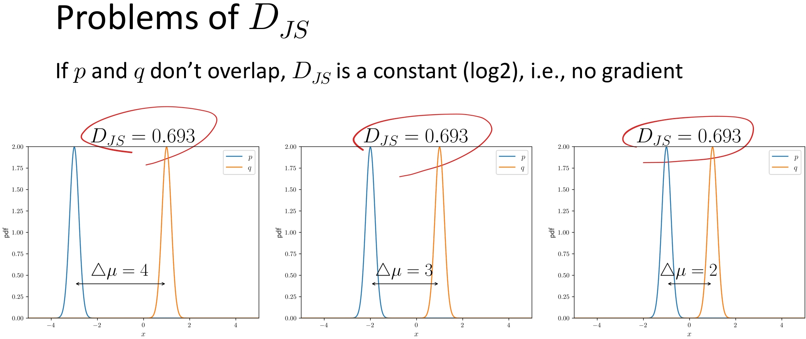

</div>

<small>**图1** 当 $p_{\text{data}}$ 与 $p_g$ 不重叠时，JS 散度恒为 $\log 2$。</small>

<div align="center">

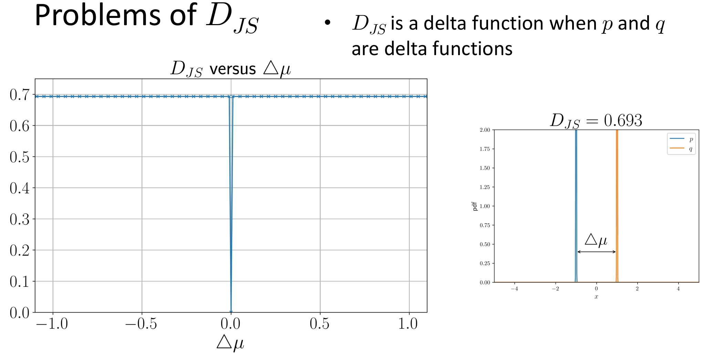

</div>

<small>**图2** 当 $p_{\text{data}}$ 与 $p_g$ 为 delta 函数时，JS 散度的情形。</small>

### 1.2 WGAN 的改进目标

WGAN（Arjovsky et al., 2017）做了以下改进:

- **用 Wasserstein 距离替代 JS 散度**:Wasserstein-1 距离（Earth-Mover 距离）在分布不重叠时仍可提供有效梯度，且与生成质量更相关。
- **用 Critic 替代 Discriminator**:不再输出“真/假”概率，而是输出一个实数分数；在 1-Lipschitz 约束下，$\mathbb{E}[f(x_{\text{real}})] - \mathbb{E}[f(G(z))]$ 近似 Wasserstein 距离。
- **通过权重裁剪（或后续 WGAN-GP 的梯度惩罚）** 近似满足 1-Lipschitz，使训练稳定、损失可解释。

<div align="center">

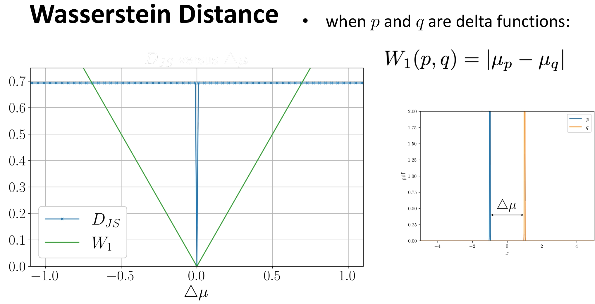

</div>

<small>**图3** JS 散度在支撑集不重叠时恒为常数，导致梯度消失；Wasserstein 距离仍随分布变化而变化，可提供有效梯度。</small>

## 2. WGAN 的理论基础

Wasserstein 距离（Wasserstein Distance），又称**推土机距离**（Earth Mover’s Distance, EMD），是一种衡量两个概率分布之间差异的度量方式。它在最优传输理论（Optimal Transport Theory）中具有核心地位，近年来因其在生成模型（如 WGAN）中的优异表现而广受关注。

### 2.0 一个小故事

想象你有两堆沙子，形状不同，但总质量相同。你想把其中一堆沙子重新堆成另一堆的形状。Wasserstein 距离就是完成这个任务所需的最小“工作量”——即（每单位沙子移动的距离）×（移动的沙子量）的总和。
- 如果两堆沙子很接近，只需轻微挪动 → Wasserstein 距离小。
- 如果两堆沙子相距很远或完全不重叠 → 需要大量搬运 → Wasserstein 距离大。

这比“是否重叠”更精细，因此比 KL 散度、JS 散度更适合处理支撑集不重叠（support disjoint）的分布（这在高维空间中非常常见）。

<div align="center">

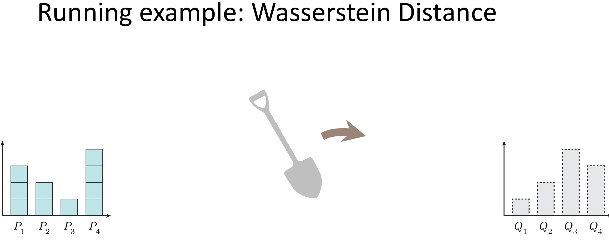

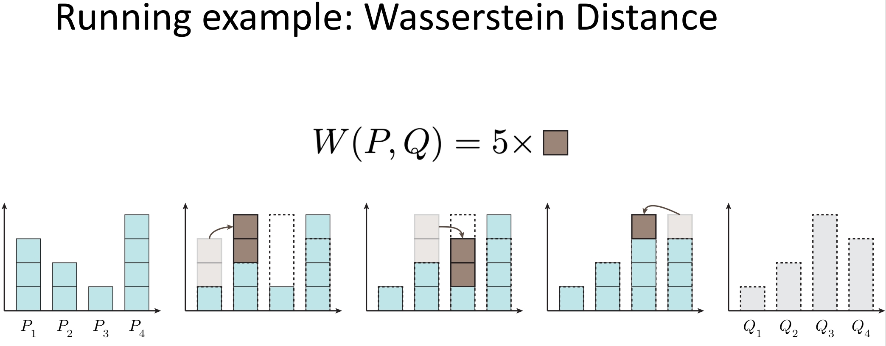

</div>

<small>**图4、图5** 把 P 分布通过“铲子”变成 Q 分布所需要的步骤。</small>

### 2.1 Wasserstein-1 距离

**定义**:对两个概率分布 $p_{\text{data}}$ 与 $p_g$，Wasserstein-1 距离（Kantorovich-Rubinstein 形式）为:

$$W_1(p_{\text{data}}, p_g) = \inf_{\gamma \in \Pi(p_{\text{data}}, p_g)} \mathbb{E}_{(x,y)\sim\gamma}[\|x - y\|] \tag{3}$$

其中 $\Pi(p_{\text{data}}, p_g)$ 为边际分布为 $p_{\text{data}}$ 与 $p_g$ 的所有联合分布。直观上，$W_1$ 表示把 $p_g$ 的“质量”搬到 $p_{\text{data}}$ 所需的最小平均移动距离。

<div align="center">

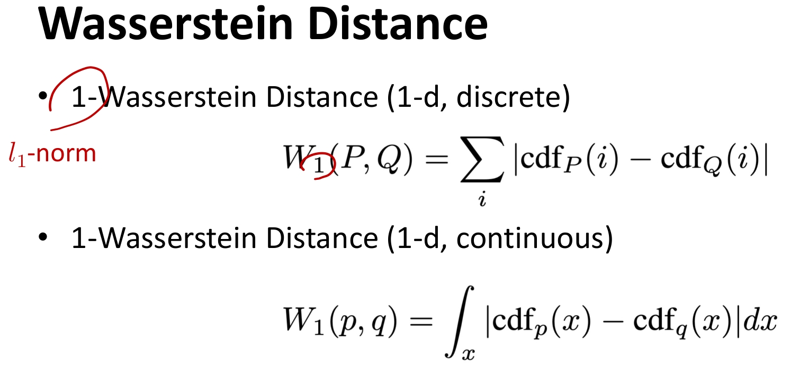

</div>

<small>**图6** 1-D 情况下离散与连续的 Wasserstein-1 距离计算公式。</small>

**对偶形式（Kantorovich-Rubinstein 对偶）**:

$$W_1(p_{\text{data}}, p_g) = \sup_{\|f\|_L \leq 1} \left\{ \mathbb{E}_{x \sim p_{\text{data}}}[f(x)] - \mathbb{E}_{x \sim p_g}[f(x)] \right\} \tag{6}$$

其中 $\|f\|_L \leq 1$ 表示 $f$ 为 **1-Lipschitz**（即 $|f(x)-f(y)| \leq \|x-y\|$）。因此，若我们用神经网络 $f_w$ 近似满足 1-Lipschitz 的 $f$，则:

$$\max_{w:\, f_w \text{ 1-Lipschitz}} \left\{ \mathbb{E}_{x \sim p_{\text{data}}}[f_w(x)] - \mathbb{E}_{z \sim p_z}[f_w(G(z))] \right\} \tag{7}$$

在最优时等于 $W_1(p_{\text{data}}, p_g)$。WGAN 即用该式训练 **Critic** $f_w$，并同时最小化 $W_1$ 来训练生成器 $G$。

<div align="center">

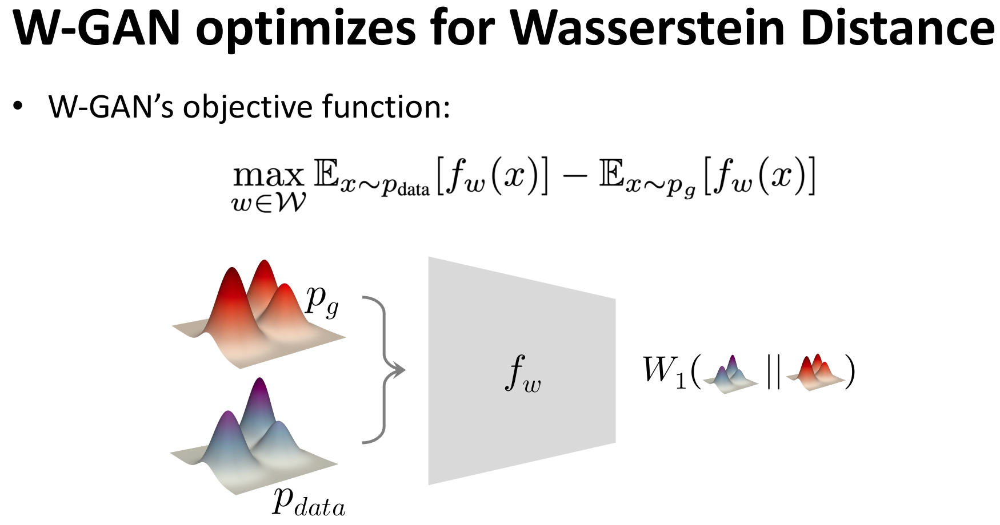

</div>

<small>**图7** 使用神经网络 $f_w$ 近似满足 1-Lipschitz 的 $f$。</small>

### 2.2 Critic 与 1-Lipschitz 约束

- **Discriminator（GAN）**:输出 $D(x) \in [0,1]$，表示“样本为真”的概率，用 sigmoid；目标为二分类交叉熵。
- **Critic（WGAN）**:输出 $f(x) \in \mathbb{R}$，无界标量；在 1-Lipschitz 约束下，$\mathbb{E}[f(x_{\text{real}})] - \mathbb{E}[f(x_{\text{fake}})]$ 近似 $W_1$。

WGAN 论文通过 **权重裁剪** 近似 1-Lipschitz:将 Critic 的权重限制在 $[-w, w]$（如 $w=0.01$）。这样 $f$ 的 Lipschitz 常数被界住，虽非严格为 1，但实践上能稳定训练。

**WGAN-GP（Gradient Penalty）**:Gulrajani et al. (2017) 用 **梯度惩罚** 替代权重裁剪，直接约束 Critic 在样本处的梯度范数接近 1。惩罚项为:

$$\mathcal{L}_{GP} = \lambda \, \mathbb{E}_{\hat{x}}\left[ \left( \|\nabla_{\hat{x}} f(\hat{x})\|_2 - 1 \right)^2 \right] \tag{8}$$

其中 $\hat{x} = \varepsilon x_{\text{real}} + (1-\varepsilon) x_{\text{fake}}$，$\varepsilon \sim U(0,1)$，即真实样本与生成样本的**随机凸插值**。Critic 总损失为:

$$L_c = -\big(\mathbb{E}[f(x_{\text{real}})] - \mathbb{E}[f(x_{\text{fake}})]\big) + \mathcal{L}_{GP} \tag{9}$$

这样无需裁剪权重，Critic 表达能力更强，且 1-Lipschitz 约束更贴近理论；$\lambda$ 常用 10。本项目实现采用 **WGAN-GP**。

<div align="center">

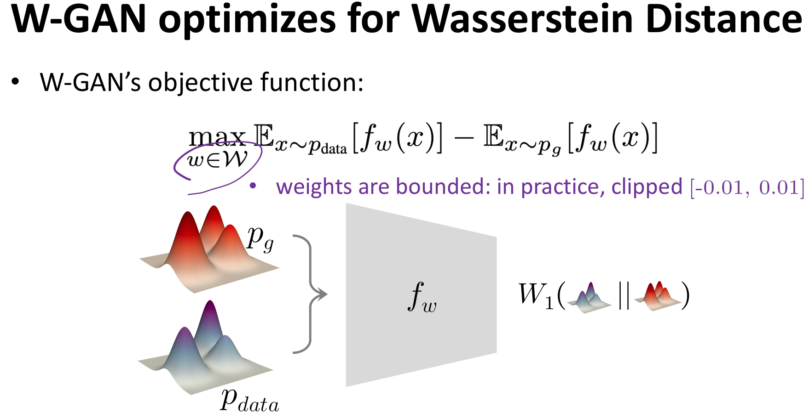

</div>

<small>**图8** 权重裁剪示意:Critic 权重限制在 $[-w, w]$（如 $w=0.01$）。WGAN-GP 则用梯度惩罚替代裁剪。</small>

### 2.3 目标函数小结

| 角色   | 目标（WGAN） |
|--------|----------------|
| **Critic** | 最大化 $\mathbb{E}_{x \sim p_{\text{data}}}[f(x)] - \mathbb{E}_{z \sim p_z}[f(G(z))]$，即估计 $W_1$ |
| **Generator** | 最小化 $W_1$，即最大化 $\mathbb{E}_{z \sim p_z}[f(G(z))]$（让生成样本在 Critic 下得高分） |

因此训练时:
- **Critic**:最小化 $L_c = -\big(\mathbb{E}[f(x_{\text{real}})] - \mathbb{E}[f(G(z))]\big)$；
- **Generator**:最小化 $L_g = -\mathbb{E}[f(G(z))]$。


## 3. WGAN 与 GAN 的对比

<div align="center">

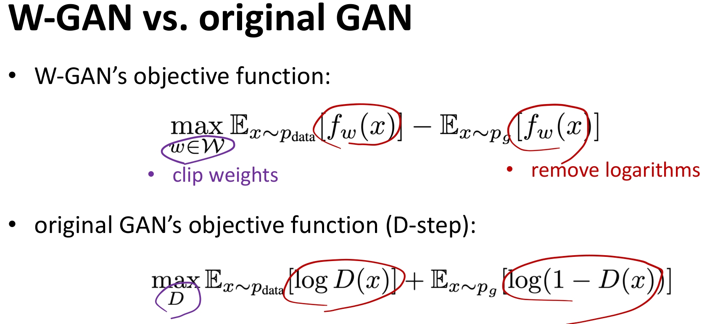

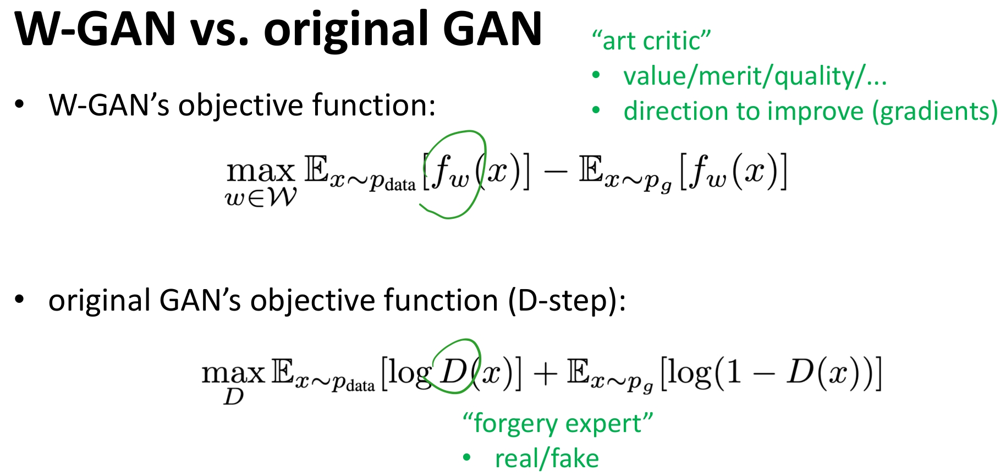

</div>

<small>**图9、图10** WGAN 与原始 GAN 的对比。</small>

主要差异可概括为三点:

1. **约束**:WGAN 增加了权重裁剪（或梯度惩罚）约束，使 Critic 满足 1-Lipschitz，保证梯度有效。
2. **损失形式**:WGAN 在 Loss 中移除了 Log，直接优化 Wasserstein 距离的近似，梯度更平滑。
3. **角色定位**:原始 GAN 的 Discriminator 像是一位**鉴伪专家**（Forgery Expert），只能做“真/假”二分类；WGAN 的 Critic 则更像**艺术评论家**（Art Critic）——不只说“好/坏”，而是给出连续的质量评分；其评分差异（真实样本得分高、生成样本得分低）直接构成优化目标，生成器通过拉高自己的分数来学习，Critic 的梯度则告诉它“往哪个方向改能更像真品”。

| 特性           | GAN                          | WGAN                                |
|----------------|------------------------------|-------------------------------------|
| 度量           | JS 散度                      | Wasserstein-1 距离                  |
| 判别端         | Discriminator，输出概率 $[0,1]$ | Critic，输出标量 $\mathbb{R}$       |
| 最后一层       | Sigmoid                      | 无激活（线性）                      |
| 约束           | 无                           | 1-Lipschitz（权重裁剪或梯度惩罚）   |
| 损失含义       | 二分类交叉熵                 | $W_1$ 的近似，可解释为“距离”        |
| 梯度性质       | 支撑不重叠时易梯度消失       | 仍可提供有效梯度                   |
| 训练稳定性     | 对超参敏感，易模式崩塌       | 相对更稳定，损失可作监控            |
| 典型优化器     | Adam                         | RMSprop（论文推荐）                 |


## 4. 训练流程与实现要点

### 4.1 算法步骤

**WGAN（权重裁剪）**:

1. **Critic 更新**（每步 $n_{\text{critic}}$ 次）:计算 $L_c = -\big(\mathbb{E}[f(x)] - \mathbb{E}[f(\tilde{x})]\big)$，更新后对 Critic 所有权重做 $\theta \leftarrow \text{clip}(\theta, -w, w)$。
2. **Generator 更新**（每步 1 次）:最小化 $L_g = -\mathbb{E}[f(G(z))]$。

**WGAN-GP（梯度惩罚，本项目采用）**:

1. **Critic 更新**（每 batch 1 次）:计算 Wasserstein 项 $-\big(\mathbb{E}[f(x_{\text{real}})] - \mathbb{E}[f(x_{\text{fake}})]\big)$，再在真实与生成样本的**随机插值** $\hat{x}$ 上计算梯度惩罚 $\mathcal{L}_{GP} = \lambda \mathbb{E}[(\|\nabla_{\hat{x}} f(\hat{x})\|_2 - 1)^2]$，总损失 $L_c = L_{W} + \mathcal{L}_{GP}$，反向传播更新 Critic（**无权重裁剪**）。
2. **Generator 更新**:每 $n_{\text{critic}}$ 个 batch 训练 1 次，最小化 $L_g = -\mathbb{E}[f(G(z))]$。

### 4.2 实现细节

- **最后一层无 sigmoid**:Critic 输出层为线性，输出任意实数。
- **WGAN（权重裁剪）**:$w$ 常取 $0.01$；优化器多用 RMSprop，学习率约 $5\times 10^{-5}$。
- **WGAN-GP（梯度惩罚）**:
  - **惩罚项**:在 $\hat{x} = \varepsilon x_{\text{real}} + (1-\varepsilon) x_{\text{fake}}$（$\varepsilon \sim U(0,1)$）上计算 $\|\nabla_{\hat{x}} f(\hat{x})\|_2$，惩罚 $( \|\nabla_{\hat{x}} f\|_2 - 1 )^2$；$\lambda$ 常用 **10**。
  - **优化器**:推荐 **Adam**，$\beta_1=0$、$\beta_2=0.9$，学习率常用 $1\times 10^{-4}$；无需权重裁剪。
- **不要对 Critic 使用 BatchNorm**:会改变每层输入分布，不利于 1-Lipschitz；可用 LayerNorm 或不用归一化。

### 4.3 损失与指标

- **Critic 损失** $L_c$:在训练良好时，$-L_c$（即 $\mathbb{E}[f(x_{\text{real}})] - \mathbb{E}[f(G(z))]$）可视为 $W_1$ 的估计，**可作为训练进度与生成质量的参考**（值越大说明分布越接近或 Critic 越强）。
- 与 GAN 不同:GAN 的判别器输出接近 0.5 表示“无法区分”；WGAN 的 Critic 分数无固定阈值，**分数越高越像真实分布**，且损失曲线更有信息量。


## 5. 代码实现要点

本项目在 `code/dl/gan/wgan/` 下实现了 **WGAN-GP**（梯度惩罚版）:

- **`wgan.py`**:`Generator` 与 GAN 相同；`Critic` 与 Discriminator 结构类似，最后一层为 `nn.Linear(..., 1)`，无 sigmoid。
- **`train_infer.py`**:每个 batch 先更新 Critic 一次（Wasserstein 项 + 梯度惩罚），再按 `n_critic` 每若干 batch 更新 Generator 一次；推理时展示真实/生成样本的 Critic 分数及插值效果。
- **`config.yaml`**:可配置 `n_critic`、`lambda_gp`（梯度惩罚系数，默认 10）、`optimizer`（WGAN-GP 推荐 `adam`）、学习率等；**无** `weight_clip`。

**梯度惩罚计算**:在真实样本与生成样本的随机插值 $\hat{x}$ 上对 Critic 输出求梯度，惩罚梯度范数偏离 1。

```python
def compute_gradient_penalty(critic, real_samples, fake_samples):
    alpha = torch.rand(real_samples.size(0), 1).to(device)
    interpolates = (alpha * real_samples + (1 - alpha) * fake_samples).requires_grad_(True)
    d_interpolates = critic(interpolates)
    gradients = autograd.grad(
        outputs=d_interpolates, inputs=interpolates,
        grad_outputs=torch.ones_like(d_interpolates), create_graph=True, retain_graph=True, only_inputs=True
    )[0]
    gradients = gradients.view(gradients.size(0), -1)
    gradient_penalty = ((gradients.norm(2, dim=1) - 1) ** 2).mean() * lambda_gp
    return gradient_penalty
```

**Critic 与 Generator 更新（WGAN-GP）**:

```python
# Critic:Wasserstein 项 + 梯度惩罚（无权重裁剪）
real_validity = critic(images)
fake_images = generator(noise).detach()
fake_validity = critic(fake_images)
c_loss_w = -torch.mean(real_validity) + torch.mean(fake_validity)
gradient_penalty = compute_gradient_penalty(critic, images, fake_images)
c_loss = c_loss_w + gradient_penalty
c_loss.backward()
c_optimizer.step()

# Generator:每 n_critic 个 batch 更新一次
fake_validity = critic(generator(noise))
g_loss = -torch.mean(fake_validity)
g_loss.backward()
g_optimizer.step()
```

优化器使用 **Adam**，`betas=(0.0, 0.9)`，与 WGAN-GP 论文一致。


## 6. 试验结果

本节基于 `code/dl/gan/wgan/` 的 WGAN-GP 实现，在 MNIST 上训练后的推理与 Critic 评分结果。

### 6.1 生成器:生成新图像

代码中的 `infer` 部分展示 WGAN-GP 的**生成能力**:

```python
# 模型推理 - 生成新图像
if infer:
    generator.eval()
    with torch.no_grad():
        noise = torch.randn(sample_size, noise_dim, device=device)
        fake_images = generator(noise)
        fake_images = fake_images.view(sample_size, 1, 28, 28)
        # 将输出从 [-1, 1] 转换回 [0, 1] 用于显示
        fake_images = (fake_images + 1) / 2
        fake_images = torch.clamp(fake_images, 0.0, 1.0)
```

<div align="center">

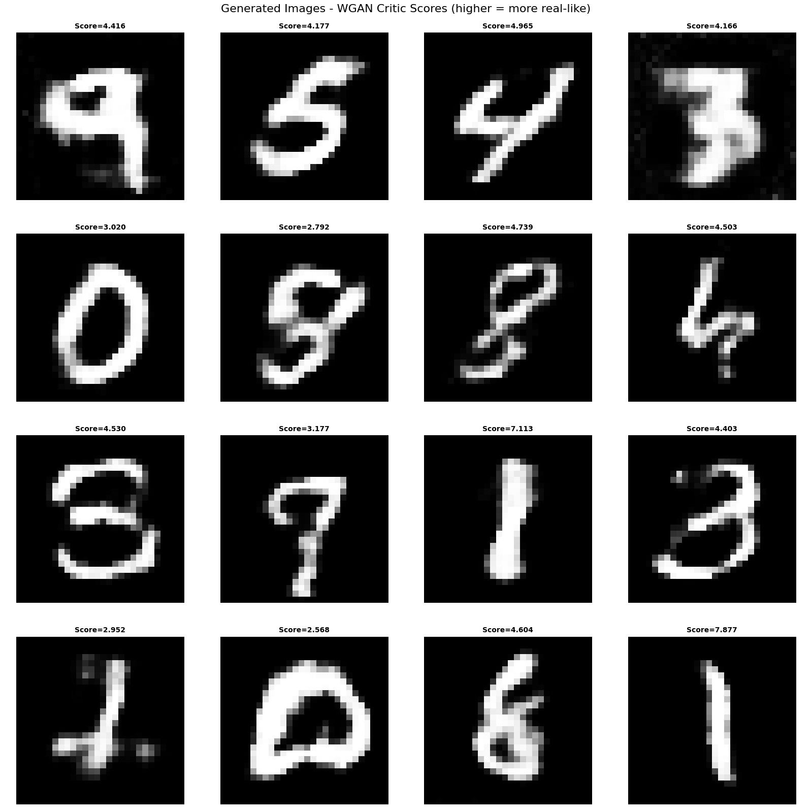

</div>

<small>**图11** WGAN-GP 的生成能力:从随机噪声生成的 MNIST 数字图像及 Critic 分数（分数越高表示 Critic 认为越接近真实分布）。</small>

从生成结果可以观察:

- **生成质量**:在训练充分且 Critic 保持「真实均分 > 生成均分」时，生成器能产出清晰、类 MNIST 的数字图像。
- **多模态**:生成器可覆盖多种数字形态，减轻模式崩塌。

### 6.2 Critic:评分能力

与 GAN 的判别器不同，WGAN 的 Critic 输出**无界标量**，不做 0/1 二分类。代码中通过真实样本与生成样本的 Critic 分数统计评估训练状态:

```python
# 真实样本与生成样本的 Critic 分数
generator.eval()
critic.eval()
with torch.no_grad():
    real_score = critic(real_images).mean().item()
    fake_images = generator(noise)
    fake_score = critic(fake_images).mean().item()
# 统计:真实均分、生成均分、差距（真实 − 生成）
```

<div align="center">

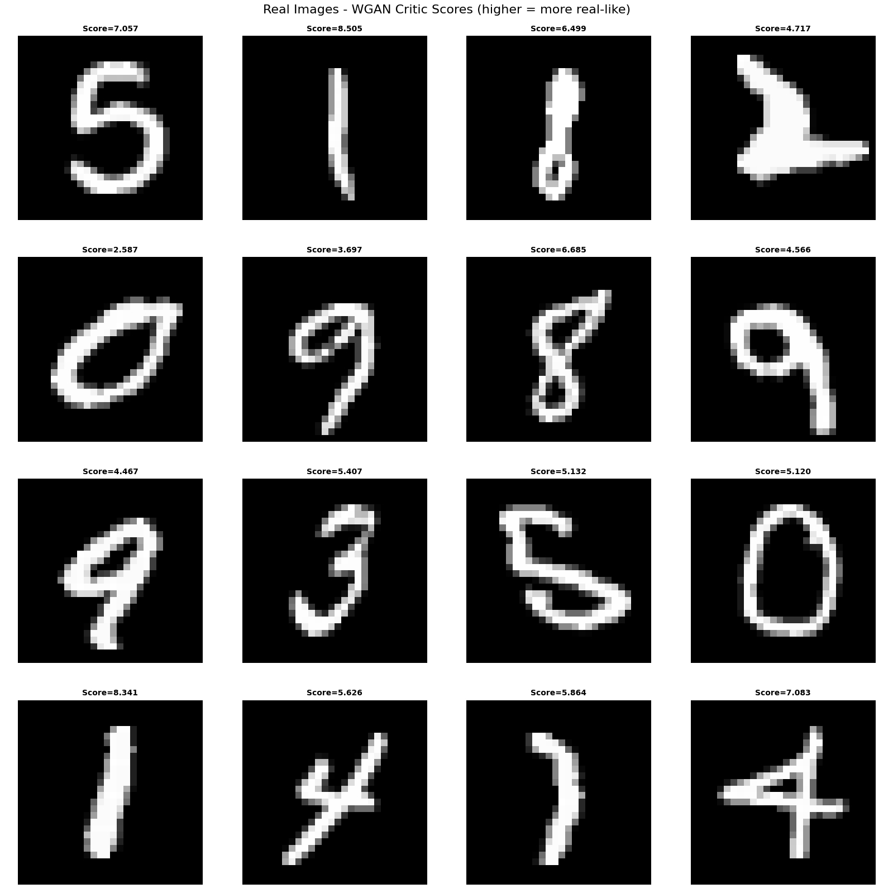

</div>

<small>**图12** 真实图像的 Critic 分数（同一 batch）。</small>

根据真实样本与生成样本的 Critic 分数统计（例如在同一 batch 上）:

- **真实图像**:平均分数记为 $\bar{f}_{\text{real}}$，本例为 **5.7097**；不同真实样本分数有高有低，取决于在 Critic 学到的分布中的「典型程度」。
- **生成图像**:平均分数记为 $\bar{f}_{\text{fake}}$，本例为 **4.3750**。
- **差距**:$\bar{f}_{\text{real}} - \bar{f}_{\text{fake}} = 5.7097 - 4.3750 = 1.3347$。理论期望为 $W_1$ 的近似，应 **> 0**，本例满足，说明 Critic 能有效区分真假、训练状态健康。

从上述统计可得到以下结论:

- **Critic 的评分含义**:
  - Critic 分数**无固定阈值**（不能像 GAN 的 0.5 那样作真假界限）；**分数越高**表示在该 Critic 下越「像真实分布」。
  - 应比较**同一模型、同一 batch**下的**真实均分**与**生成均分**，而非单张对比。

- **WGAN 训练状态评估**:
  - **健康**:$\bar{f}_{\text{real}} > \bar{f}_{\text{fake}}$，且训练过程中差距保持为正，生成质量通常较好。
  - **异常**:$\bar{f}_{\text{fake}} \geq \bar{f}_{\text{real}}$，说明 Critic 未能有效区分真假，可尝试增大 `n_critic`、`lambda_gp` 或训练轮数。
  - 若生成视觉质量差但分数不低，多为 Critic 与生成器尚未对齐或训练不足，需继续训练并监控真实/生成均分。


## 7. 总结

- **动机**:GAN 的 JS 散度在支撑不重叠时梯度消失，训练不稳定；WGAN 改用 Wasserstein 距离，梯度性质更好。
- **理论**:Wasserstein-1 的对偶形式给出 $\max_f \{\mathbb{E}[f(x_{\text{real}})] - \mathbb{E}[f(x_{\text{fake}})]\}$，其中 $f$ 为 1-Lipschitz；可用权重裁剪或梯度惩罚近似该约束。
- **实现**:Critic 无 sigmoid；本项目采用 **WGAN-GP**:在真实/生成样本的随机插值上施加梯度惩罚 $\lambda(\|\nabla_{\hat{x}} f\|_2 - 1)^2$，无需权重裁剪，Critic 表达能力更强；Generator 最小化 $-\mathbb{E}[f(G(z))]$；优化器推荐 Adam $(0, 0.9)$。

---

## 参考文献

1. Arjovsky, M., Chintala, S., & Bottou, L. (2017). Wasserstein generative adversarial networks. *International Conference on Machine Learning* (pp. 214–223).

2. Gulrajani, I., Ahmed, F., Arjovsky, M., Dumoulin, V., & Courville, A. (2017). Improved training of Wasserstein GANs. *Advances in Neural Information Processing Systems*, 30.

3. Arjovsky, M., & Bottou, L. (2017). Towards principled methods for training generative adversarial networks. *International Conference on Learning Representations*.

4. Goodfellow, I., Pouget-Abadie, J., Mirza, M., Xu, B., Warde-Farley, D., Ozair, S., ... & Bengio, Y. (2014). Generative adversarial nets. *Advances in Neural Information Processing Systems*, 27.

5. Kaiming He, Deep Generative Models.