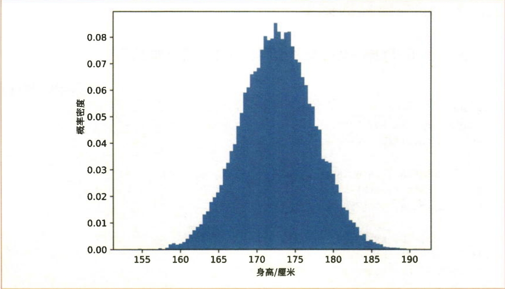
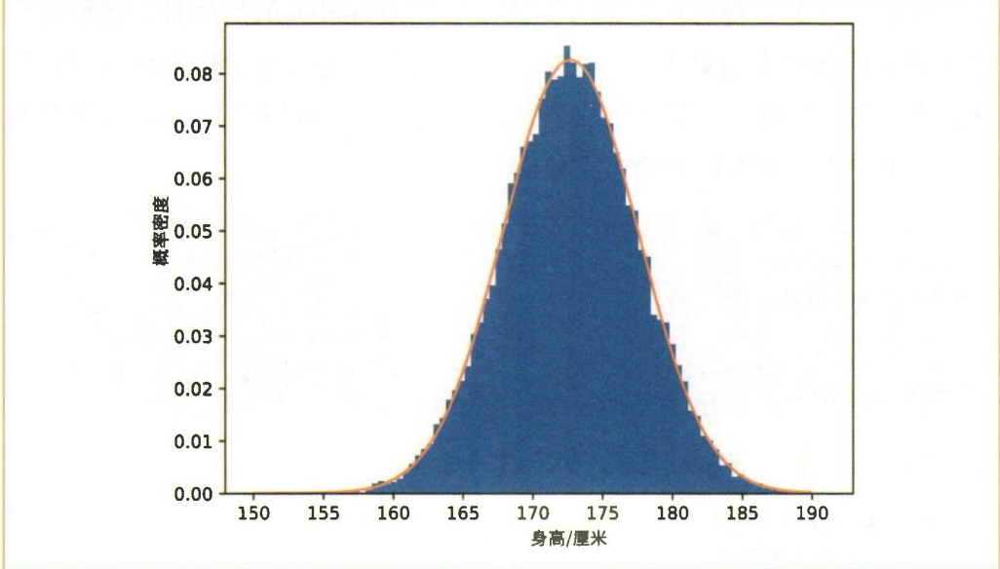
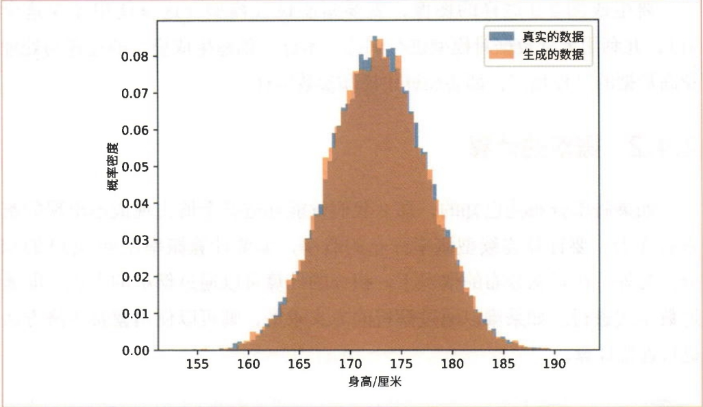

# 机器学习篇-02.最大似然估计

## 1. 基于最大似然估计的生成模型

### 1.1 最大似然估计的基本原理

#### 1.1.1 似然函数

假设有一个概率分布，其形状由参数 $\theta$ 决定。当参数为 $\theta$ 时，获得数据 $x$ 的概率密度为 $p(x; \theta)$。

对于正态分布，可以将参数视为 $\theta = \{\mu, \sigma\}$。

**样本的概率密度**

假设我们有一个样本 $\mathcal{D} = \{x_1, x_2, \ldots, x_N\}$，并且每个数据都是基于概率分布 $p(x; \theta)$ 独立生成的。此时，获得样本 $\mathcal{D}$ 的概率密度的数学式如下所示:

$$p(\mathcal{D}; \theta) = p(x_1; \theta) \cdot p(x_2; \theta) \cdot \ldots \cdot p(x_N; \theta) = \prod_{i=1}^{N} p(x_i; \theta)$$

由于假定每个数据是独立生成的，因此获得 $N$ 个数据的概率密度等于每个数据的概率密度的乘积。$p(\mathcal{D}; \theta)$ 表示当参数为 $\theta$ 时获得样本 $\mathcal{D}$ 的概率密度。

**似然函数**

这个 $p(\mathcal{D}; \theta)$ 也可以被看作以 $\theta$ 为参数的函数，其定义式如下所示:

$$L(\theta) = p(\mathcal{D}; \theta)$$

式子中的 $L(\theta)$ 称为**似然（likelihood）**或**似然函数（likelihood function）**。似然是以参数 $\theta$ 为参数的函数，表示在给定参数 $\theta$ 的情况下，样本 $\mathcal{D}$ 出现的概率密度。

#### 1.1.2 最大似然估计

**最大似然估计**是一种找到使似然 $p(\mathcal{D}; \theta)$ 最大的参数 $\theta$ 的技术。如果使似然最大的参数是 $\hat{\theta}$，那么当参数为 $\hat{\theta}$ 时，观测到样本的概率最大。也就是说，当参数为 $\hat{\theta}$ 时，模型最拟合样本。

**对数似然**

实际上，最大似然估计进行的是**对数似然 $\log p(\mathcal{D}; \theta)$** 的最大化，而不是直接最大化似然。这是因为:

1. 取对数在计算上更方便
2. 对数函数是单调递增函数，因此使 $p(\mathcal{D}; \theta)$ 最大的 $\theta$ 值和使 $\log p(\mathcal{D}; \theta)$ 最大的 $\theta$ 值是相等的
3. 积的对数等于对数的和，简化计算

$$\log(ab) = \log a + \log b$$

因此:

$$\log p(\mathcal{D}; \theta) = \log \left[\prod_{i=1}^{N} p(x_i; \theta)\right] = \sum_{i=1}^{N} \log p(x_i; \theta)$$

#### 1.1.3 利用导数求最大值

在求最大值时，导数非常重要。对于某些函数，最大值不一定在导数为 0 的地方。但对于 $y = ax^2 + bx + c$ 这样的二次函数，如果二次项系数为负值（$a < 0$），那么最大值就在导数为 0 的地方。

因此，通过求解导数为 0 的方程可以求出取最大值的位置。这种方法称为"解析解"或"闭式（closed-form）求解"。

### 1.2 正态分布的最大似然估计

#### 1.2.1 正态分布的概率密度函数

正态分布的概率密度函数为:

$$p(x; \mu, \sigma) = \frac{1}{\sqrt{2\pi} \cdot \sigma} \exp\left(-\frac{(x - \mu)^2}{2\sigma^2}\right)$$

其中:
- $\mu$ 是均值（mean）
- $\sigma$ 是标准差（standard deviation）

#### 1.2.2 正态分布的最大似然估计推导

对于 $N$ 个观测数据 $\{x_1, x_2, \ldots, x_N\}$，对数似然函数为:

$$\begin{aligned}
\log p(\mathcal{D}; \mu, \sigma) &= \sum_{i=1}^{N} \log p(x_i; \mu, \sigma) \\
&= \sum_{i=1}^{N} \log \left[\frac{1}{\sqrt{2\pi} \cdot \sigma} \exp\left(-\frac{(x_i - \mu)^2}{2\sigma^2}\right)\right] \\
&= -N \log(\sqrt{2\pi}) - N \log \sigma - \frac{1}{2\sigma^2} \sum_{i=1}^{N} (x_i - \mu)^2
\end{aligned}$$

**对 $\mu$ 求导并令其等于 0**:

$$\frac{\partial}{\partial \mu} \left[\log p(\mathcal{D}; \mu, \sigma)\right] = \frac{1}{\sigma^2} \sum_{i=1}^{N} (x_i - \mu) = 0$$

解得:

$$\hat{\mu} = \frac{1}{N} \sum_{i=1}^{N} x_i$$

**对 $\sigma$ 求导并令其等于 0**:

$$\frac{\partial}{\partial \sigma} \left[\log p(\mathcal{D}; \mu, \sigma)\right] = -\frac{N}{\sigma} + \frac{1}{\sigma^3} \sum_{i=1}^{N} (x_i - \mu)^2 = 0$$

解得:

$$\hat{\sigma}^2 = \frac{1}{N} \sum_{i=1}^{N} (x_i - \hat{\mu})^2$$

$$\hat{\sigma} = \sqrt{\frac{1}{N} \sum_{i=1}^{N} (x_i - \hat{\mu})^2}$$

#### 1.2.3 结论

对于正态分布，通过最大似然估计可以得到:

- **均值的最大似然估计**:样本均值

  $$\hat{\mu} = \frac{1}{N} \sum_{i=1}^{N} x_i$$

- **标准差的最大似然估计**:样本标准差

  $$\hat{\sigma} = \sqrt{\frac{1}{N} \sum_{i=1}^{N} (x_i - \hat{\mu})^2}$$

这意味着，正态分布的最大似然估计就是样本的均值和标准差。这是一个非常直观的结果！

---

## 2. 实践:使用真实数据实现生成模型

### 2.1 读取身高数据集

本节将使用真实的观测数据来实现生成模型。所使用的数据集是 SOCR Data。该数据集包含了 1993 年中国香港 18 岁青少年的身高数据，共计 25,000 条记录。不过，这些数据本身是基于实际调查结果虚构的。

为了方便使用，我们对这个身高数据集进行了整理，并将整理后的文件放在了code/ml/02文件夹下，文件名为 `height.txt`。

**读取数据的代码示例**:

```python
import os
import numpy as np
import matplotlib.pyplot as plt

path = os.path.join(os.path.dirname(__file__), 'height.txt')
xs = np.loadtxt(path)
print(xs.shape)  # (25000,)

plt.hist(xs, bins='auto', density=True)
plt.xlabel('Height [cm]')
plt.ylabel('Probability Density')
plt.show()
```

通过读取得到的 `xs` 是包含 25,000 个元素的一维数组。如图1所示，观察直方图，我们发现它呈正态分布的形状。我们将身高的概率分布视为正态分布进行建模。



<small>**图1** 身高数据集的直方图</small>

### 2.2 基于正态分布的参数估计

接下来我们实现基于正态分布的生成模型。我们需要执行以下任务:

1. **建模**:假定身高数据呈正态分布。
2. **参数估计**:根据样本估计正态分布的参数。

我们通过这两个任务来创建生成模型。我们已经完成了第一个任务——建模。接下来是第二个任务——参数估计。

**计算样本的均值和标准差**:

根据最大似然估计的理论，我们只需要计算样本的均值和标准差:

```python
mu = np.mean(xs)
sigma = np.std(xs)
print(mu)    # 172.78250853667997
print(sigma) # 4.830167473396299
```

样本数据的均值可以通过 `np.mean()` 求得，标准差可以通过 `np.std()` 求得。上面的运行结果显示均值为 172.7...，标准差为 4.8...。这个均值和标准差是最拟合样本的参数。

**可视化结果**:

下面我们在之前的直方图上再画一张正态分布的图形:

```python
def normal(x, mu=0, sigma=1):
    """正态分布的概率密度函数"""
    y = 1 / (np.sqrt(2 * np.pi) * sigma) * np.exp(-(x - mu)**2 / (2 * sigma**2))
    return y

x = np.linspace(150, 190, 1000)
y = normal(x, mu, sigma)

plt.hist(xs, bins='auto', density=True, alpha=0.7, label='Data')
plt.plot(x, y, 'r-', linewidth=2, label='Fitted Normal Distribution')
plt.xlabel('Height [cm]')
plt.ylabel('Probability Density')
plt.legend()
plt.show()
```

从图2中可以看出，直方图与正态分布是相匹配的。



<small>**图2** 身高数据集的直方图与正态分布</small>

---

## 3. 生成新数据:采样

### 3.1 从正态分布中采样

一旦我们估计出了正态分布的参数（$\hat{\mu}$ 和 $\hat{\sigma}$），就可以使用这些参数来生成新的数据样本。这个过程称为**采样（Sampling）**。

**从正态分布中采样的代码**:

```python
# 生成新的数据样本
n_samples = 1000
new_samples = np.random.normal(mu, sigma, size=n_samples)

# 可视化生成的数据
plt.hist(new_samples, bins='auto', density=True, alpha=0.7, label='Generated Samples')
plt.plot(x, y, 'r-', linewidth=2, label='Fitted Normal Distribution')
plt.xlabel('Height [cm]')
plt.ylabel('Probability Density')
plt.legend()
plt.show()
```

从图3中可以看出，两个分布在大体上是重合的。我们的生成模型能够生成符合观测数据特征的新数据。这些新生成的数据应该具有与原始数据相似的特征，因为它们来自同一个估计的概率分布。



<small>**图3** 身高数据的直方图（蓝色为真实的数据，橙色为生成的数据）</small>

### 3.2 采样的意义

**采样**是生成模型的核心功能之一。通过采样，我们可以:

1. **生成新数据**:创建与训练数据相似但全新的样本
2. **数据增强**:为机器学习任务生成额外的训练数据
3. **探索数据分布**:理解模型学习到的数据分布特征
4. **模拟和预测**:在给定条件下生成可能的数据


