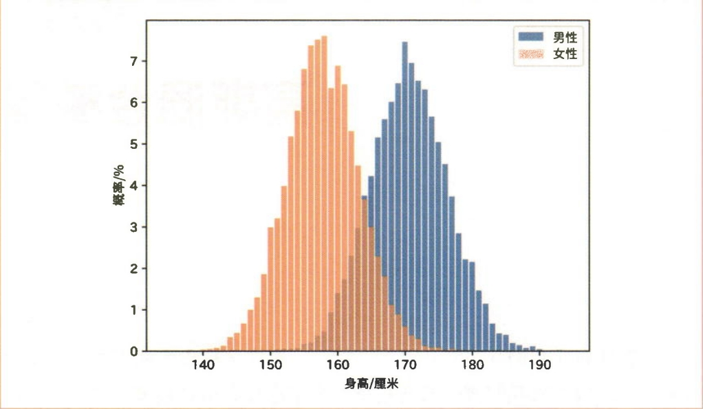
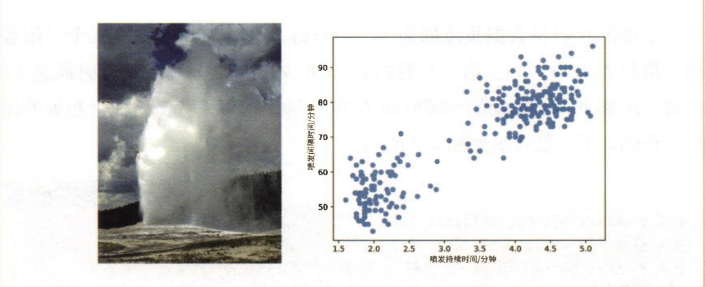
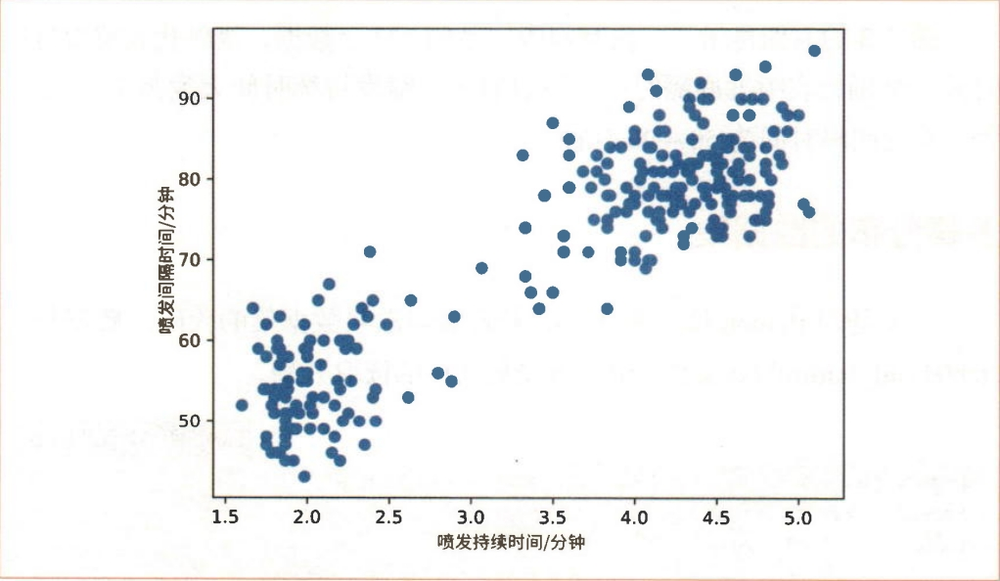
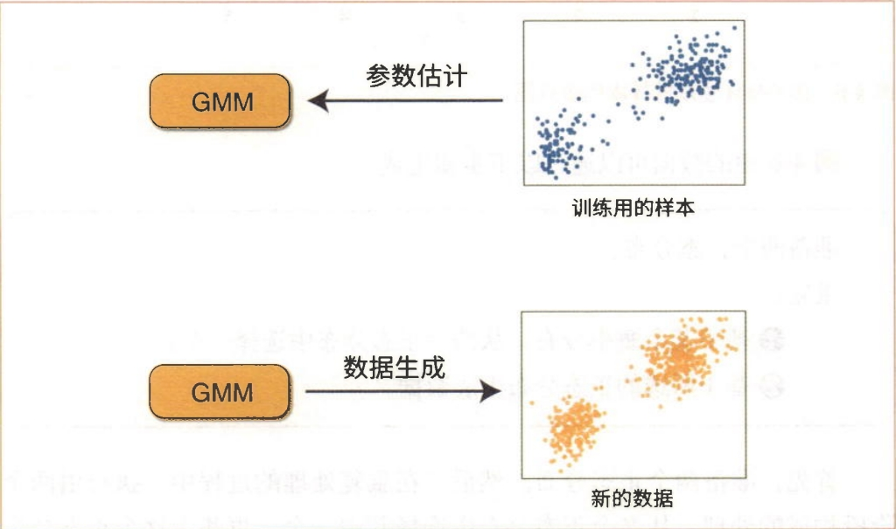
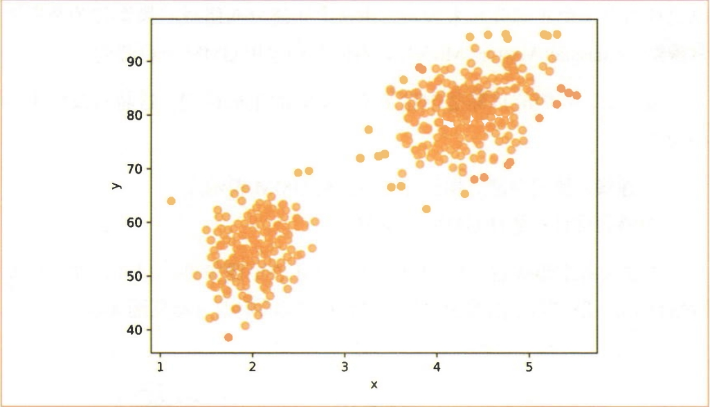
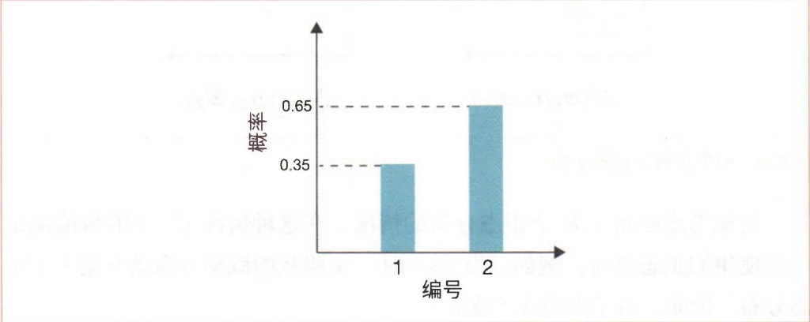
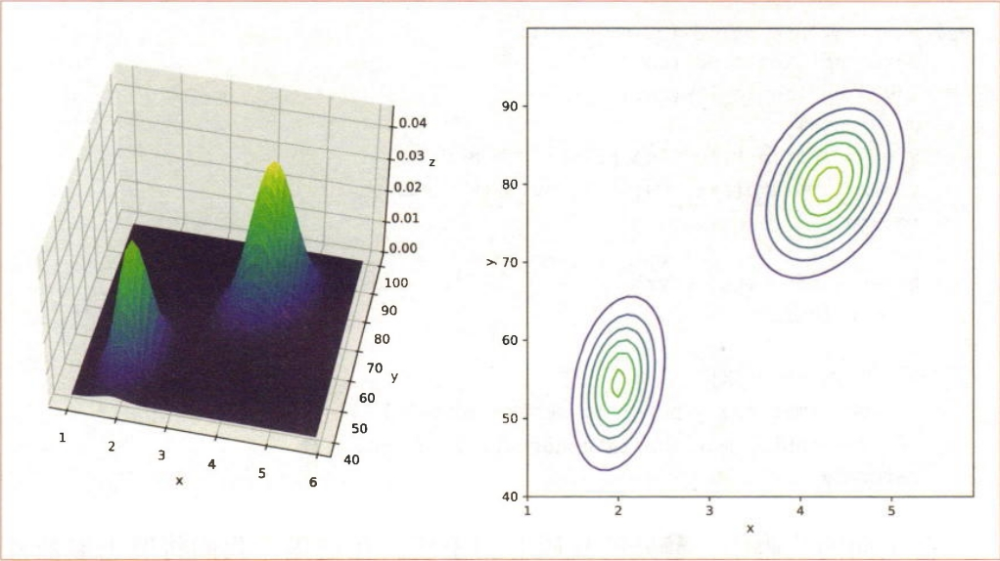
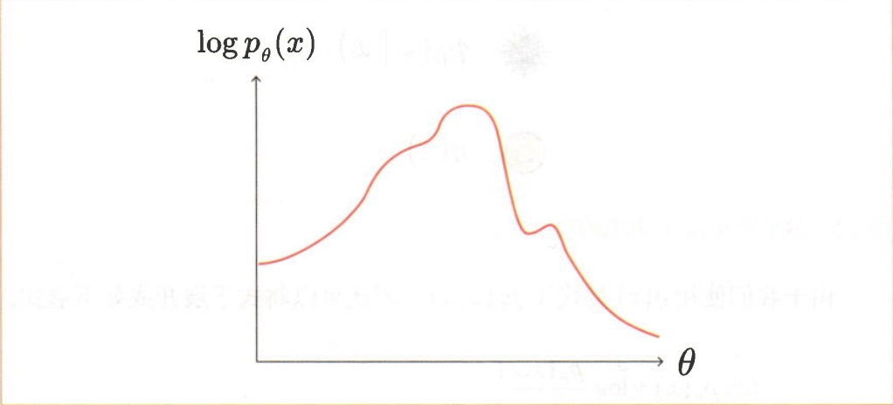

# 机器学习篇————03.潜变量估计


## 1. 高斯混合模型

### 1.1 我们身边的多峰分布

在现实生活中，具有多个峰值的分布颇为常见，这些分布被称为"多峰分布"。本节将介绍我们身边的一些多峰分布的例子。此外，我们还会给出具体的多峰数据集，并通过可视化的方式来展示它们。

#### 1.1.1 混合性别的身高分布

我们知道，对于特定的年龄和性别的人群（比如17岁的男性），他们的身高呈正态分布。那么，在性别不受限制的男女混合的情况下，身高分布又是怎样的呢？图3-1展示了17岁的日本男性和女性的身高分布。从该图可以看出，男性和女性的身高峰值是不同的。对于这个总体，最好将其作为拥有两个峰值的分布进行建模。



<small>*图 3-1：17岁男性和17岁女性的身高分布*</small>

#### 1.1.2 间歇泉喷发

定期喷发热水的温泉叫作"间歇泉"。美国黄石国家公园有一个著名的间歇泉，叫作"老忠实间歇泉"（Old Faithful Geyser）。这个间歇泉的喷发是有规律的，从中也可以观察到多峰分布（参见图3-2）。



<small>*图 3-2：老忠实间歇泉（左）和间歇泉喷发的散点图（右）*</small>

图3-2的右图显示了一段时间内记录的272个数据，横轴代表喷发持续时间，纵轴代表喷发间隔时间。可以看出，喷发持续时间大致为1.5～5分钟，喷发间隔时间为50～90分钟。

**多峰分布的数据集**

下面是用Python读取图3-2的老忠实间歇泉数据集的代码。数据集在 `04/old_faithful.txt` 文件中。首先从文件的读取开始。

```python
import os
import numpy as np
import matplotlib.pyplot as plt

path = os.path.join(os.path.dirname(__file__), 'old_faithful.txt')
xs = np.loadtxt(path)
print(xs.shape)  # (272, 2)

print(xs[0])  # [3.6 79.]
```

上面的代码将数据集读取为 `np.ndarray` 实例，其中包含272个二维数据，形状为 `(272, 2)`。第一个数据是 `[3.6 79.]`，表示喷发持续时间为3.6分钟，距离下一次喷发的间隔时间为79分钟。接下来绘制272个数据的图形。代码如下，散点图如图3-3所示。

```python
plt.scatter(xs[:, 0], xs[:, 1])
plt.xlabel('Eruptions (Min)')  # 喷发持续时间（分钟）
plt.ylabel('Waiting (Min)')    # 喷发间隔时间（分钟）
plt.show()
```



<small>*图 3-3：老忠实间歇泉喷发的散点图*</small>

这样我们就完成了数据集的读取和散点图的绘制。

### 1.2 高斯混合模型的数据生成

在现实生活中，我们可以看到多峰性的数据分布。这种多峰性分布可以通过组合多个正态分布来表示。由多个正态分布组成的模型称为**高斯混合模型（Gaussian Mixture Model）**，有时我们也用**GMM**来称呼它。

接下来，我们的目标是创建基于GMM的生成模型，这将涉及以下两项任务：

1. **建模**：假设观测数据的分布可以用GMM表示。
2. **参数估计**：估计GMM的参数。

通过这两个步骤就可以创建基于GMM的生成模型。另外，在完成参数估计后，还可以应用训练后的GMM生成新的数据（参见图3-4）。



<small>*图 3-4：GMM的参数估计和数据生成*</small>

麻烦的是，GMM的参数估计非常难。它无法通过最大似然估计以解析的方式求解，而必须依赖EM算法这样的复杂算法。我们将在步骤5中详细介绍EM算法。这里先介绍如何使用GMM生成数据。假设GMM的参数估计已经完成，接下来我们将使用参数估计后的GMM生成数据。

#### 1.2.1 利用GMM生成数据

本节将介绍生成图3-5所示数据的过程。

图3-5中的数据可以通过以下步骤生成：

1. 准备两个正态分布。
2. 重复：
   - ①基于某个概率分布，从两个正态分布中选择一个
   - ②基于所选的正态分布生成数据。

首先，准备两个正态分布。然后，在重复处理的过程中，执行由两个阶段构成的处理：从多个正态分布中选择其中一个，再基于这个正态分布生成数据。重复这两个阶段的处理，就可以得到图3-5所示的样本。



<small>*图 3-5：由GMM生成的样本的散点图*</small>

#### 1.2.2 生成数据的代码

生成图3-5中样本的代码如下所示。

```python
import numpy as np

mus = np.array([[2.0, 54.5],
                [4.3, 80.0]])
covs = np.array([[[0.87, 0.44],
                  [0.44, 33.7]],
                 [[0.17, 0.94],
                  [0.94, 36.0]]])
phis = np.array([0.35, 0.65])

def sample():
    z = np.random.choice(2, p=phis)
    mu, cov = mus[z], covs[z]
    x = np.random.multivariate_normal(mu, cov)
    return x
```

在上面的代码中，两个正态分布的参数分别为 `mus` 和 `covs`。均值向量被汇总到 `mus` 中，协方差矩阵被汇总到 `covs` 中。例如，`mus[0]` 和 `covs[0]` 对应于第一个正态分布的参数。此外，`phis` 表示每个正态分布被选中的概率，它的值是 `[0.35, 0.65]`，这意味着第一个正态分布被选中的概率为0.35，第二个正态分布被选中的概率为0.65。然后按以下步骤进行采样：

1. `np.random.choice(2, p=phis)`：根据 `phis` 指定的概率分布对0或1进行采样。`phis` 中每个元素的和必须设为1，否则会出错。
2. `np.random.multivariate_normal(mu, cov)`：从多维正态分布中采样一个数据。

代码中实现的 `sample()` 函数用于对一些数据进行采样。下面是采样500个数据并绘制散点图的代码。

```python
N = 500
xs = np.zeros([N, 2])

for i in range(N):
    xs[i] = sample()

plt.scatter(xs[:, 0], xs[:, 1], c='orange', alpha=0.7)
plt.xlabel('x')
plt.ylabel('y')
plt.show()
```

运行此代码后会得到一张有两个"簇"的散点图（参见图3-5）。

### 1.3 GMM的数学式

在1.2节中，我们通过GMM生成了数据。我们的下一个目标是用数学式来表示GMM。

#### 1.3.1 GMM的数学式

首先回顾一下GMM的内容。GMM通过以下步骤生成数据：

1. 准备 $K$ 个正态分布。
2. 重复：
   - ①基于某个概率分布，从 $K$ 个正态分布中选择其中一个
   - ②基于所选的正态分布生成数据。

①是从多个候选分布中选择一个的行为。这一行为相对应的概率分布是图3-6所示的**分类分布（categorical distribution）**。



<small>*图 3-6：参数为φ＝(0.35, 0.65)的分类分布*</small>

分类分布的数学式如下所示：

$$p(z = k; \phi) = \phi_k \tag{3.1}$$

式3.1中的 $z$ 是离散型随机变量，取1和 $K$ 之间的整数。$\phi$ 读作 `phi`，表示分类分布的参数。具体来说，它有 $K$ 个值，即 $\phi = (\phi_1, \phi_2, \ldots, \phi_K)$，其中 $\phi_k$ 是第 $k$ 个类别出现的概率。例如，两类别的分类分布的参数为 $\phi = (0.35, 0.65)$。

分类分布的参数 $\phi = (\phi_1, \phi_2, \ldots, \phi_K)$ 必须满足以下条件：
- 对于所有 $k$，$\phi_k \geq 0$（所有元素均大于或等于0）
- $\sum_{k=1}^{K} \phi_k = 1$（所有元素之和为1）

接下来是多个正态分布的数学式。这里准备如下所示的 $K$ 个正态分布的参数：

$$\mu = (\mu_1, \mu_2, \ldots, \mu_K)$$

$$\Sigma = (\Sigma_1, \Sigma_2, \ldots, \Sigma_K)$$

这里考虑准备了 $K$ 个正态分布的情况。在这种情况下，$z$ 的取值决定了所使用的正态分布。例如，当 $z = k$ 时，$x$ 服从的概率分布就是第 $k$ 个正态分布。因此，有下面的式子成立：

$$p(x|z = k; \mu_k, \Sigma_k) = \mathcal{N}(x; \mu_k, \Sigma_k) \tag{3.2}$$

生成模型的目标是表示观测数据 $x$ 的概率分布 $p(x)$。对于GMM的情况，通过概率边际化，可以使用 $p(x, z)$ 将 $p(x)$ 表示为以下式子：

$$p(x) = \sum_{k=1}^{K} p(x, z = k)$$

然后将联合概率 $p(x, z = k)$ 表示为以下式子：

$$\begin{aligned}
p(x, z = k) &= p(x|z = k) p(z = k) \quad \text{（乘法定理）} \\
&= \phi_k \mathcal{N}(x; \mu_k, \Sigma_k) \quad \text{（代入式3.1和式3.2）}
\end{aligned}$$

基于以上数学式，可以将 $p(x)$ 表示为以下式子：

$$p(x) = \sum_{k=1}^{K} \phi_k \mathcal{N}(x; \mu_k, \Sigma_k) \tag{3.3}$$

式3.3就是GMM的数学式，即每个正态分布都乘以权重，然后再相加。换言之，它表示的是正态分布的加权和。

在GMM中出现了两个随机变量 $x$ 和 $z$。在参数估计中，$x$ 对应于用于训练的观测数据，而 $z$ 并不在观测数据中。$x$ 是观测值，$z$ 则不是。由于 $z$ 不是观测出来的，因此被称为**潜变量（latent variable）**。

#### 1.3.3 GMM的实现

接下来进行GMM的实现。表示GMM的式3.3可以实现为如下代码。

```python
import numpy as np
import matplotlib.pyplot as plt

mus = np.array([[2.0, 54.5],
                [4.3, 80.0]])
covs = np.array([[[0.87, 0.44],
                  [0.44, 33.7]],
                 [[0.17, 0.94],
                  [0.94, 36.0]]])
phis = np.array([0.35, 0.65])

def multivariate_normal(x, mu, cov):
    det = np.linalg.det(cov)
    inv = np.linalg.inv(cov)
    d = len(x)
    z = 1 / np.sqrt((2 * np.pi) ** d * det)
    y = z * np.exp(-(x - mu).T @ inv @ (x - mu) / 2.0)
    return y

def gmm(x, phis, mus, covs):
    K = len(phis)
    y = 0
    for k in range(K):
        phi, mu, cov = phis[k], mus[k], covs[k]
        y += phi * multivariate_normal(x, mu, cov)
    return y
```

在上面的代码中，①处的代码非常重要。在这里，我们将取出参数并计算正态分布的加权和。以上就是GMM的实现。接下来我们对GMM进行可视化。代码如下所示。

```python
xs = np.arange(1, 6, 0.1)
ys = np.arange(40, 100, 0.1)
X, Y = np.meshgrid(xs, ys)
Z = np.zeros_like(X)

for i in range(X.shape[0]):
    for j in range(X.shape[1]):
        x = np.array([X[i, j], Y[i, j]])
        Z[i, j] = gmm(x, phis, mus, covs)

fig = plt.figure()
ax1 = fig.add_subplot(1, 2, 1, projection='3d')
ax1.set_xlabel('x')
ax1.set_ylabel('y')
ax1.set_zlabel('z')
ax1.plot_surface(X, Y, Z, cmap='viridis')
ax2 = fig.add_subplot(1, 2, 2)
ax2.set_xlabel('x')
ax2.set_ylabel('y')
ax2.contour(X, Y, Z)
plt.show()
```

关于这段代码的说明，可以参见3.3节。运行结果如图3-7所示。



<small>*图 3-7：GMM的热力图（左）及其等高线（右）*</small>

如图3-7所示，我们完成了一个有两个峰值的分布的可视化。需要关注的是 `phis` 的设置值。这里 `phis = [0.35, 0.65]`，这表明峰值之间存在差异。

### 1.4 参数估计中的难点

我们已经学习了GMM。剩下的挑战是GMM的参数估计。但这个问题并不容易解决。本节将使用数学式来说明GMM参数估计的难点所在。

**GMM的参数估计**

GMM的数学式如下所示（这里再次列出式3.3）：

$$p(x) = \sum_{k=1}^{K} \phi_k \mathcal{N}(x; \mu_k, \Sigma_k) \tag{3.3}$$

我们来思考一下获得了样本 $\mathcal{D} = \{x_1, x_2, \ldots, x_N\}$ 的情况。另外，参数 $\{\phi, \mu, \Sigma\}$ 汇总表示为 $\theta$。此时，似然 $p(\mathcal{D}; \theta)$ 的数学式如下所示：

$$p(\mathcal{D}; \theta) = p(x_1; \theta) p(x_2; \theta) \ldots p(x_N; \theta) = \prod_{i=1}^{N} p(x_i; \theta)$$

前面我们在步骤2中学习了最大似然估计。最大似然估计的目标是找到使似然最大的参数 $\theta$。但由于取对数后计算更方便，因此可以考虑将似然 $p(\mathcal{D}; \theta)$ 的最大化问题替换为对数似然 $\log p(\mathcal{D}; \theta)$ 的最大化问题。

$$\log p(\mathcal{D}; \theta) = \log \prod_{i=1}^{N} p(x_i; \theta) = \sum_{i=1}^{N} \log p(x_i; \theta) = \sum_{i=1}^{N} \log \left[\sum_{k=1}^{K} \phi_k \mathcal{N}(x_i; \mu_k, \Sigma_k)\right] \tag{3.4}$$

最大似然估计的目标是找到使 $\log p(\mathcal{D}; \theta)$ 最大的参数 $\theta$。对于简单的问题，可以采用先求出参数的梯度，然后求解梯度为0时的方程的做法。对于这里的问题，可以采用以下方程（这里定义 $L(\theta) = \log p(\mathcal{D}; \theta)$）：

$$\frac{\partial L(\theta)}{\partial \phi_k} = 0, \quad \frac{\partial L(\theta)}{\partial \mu_k} = 0, \quad \frac{\partial L(\theta)}{\partial \Sigma_k} = 0$$

如果能解出这3个方程自然最好，但可惜它们无法通过解析的方式求解。这是因为式3.4是"$\log\sum\ldots$"的形式。这种形式也叫作"$\log$-sum"。

$\log$-sum很难解析，在多数情况下无法通过解析的方式求解。$\sum$-$\log$ 则很容易解析。

如果 $K = 1$（单个正态分布的情况），则式3.4可以通过解析的方式求解。正态分布是 $\exp(\ldots)$ 的形式。如果只有一个正态分布，那么由于 $\log$ 和 $\exp$ 会相互抵消，因此式子就会变为简单的形式（也就可以通过解析的方式求解了）。但是，如果 $\log$ 中存在两个以上的正态分布，那么数学式就会变得复杂，因此也就无法通过解析的方式求解了。

**GMM的参数估计无法通过解析的方式求解。** 

## 2. 一般化的潜变量模型

这里用 $x$ 表示可观测的随机变量，$z$ 表示潜变量，$\theta$ 表示参数。利用概率的边际化，可以将单个数据的对数似然表示为下面的式子：

$$\log p_\theta(x) = \log \sum_z p_\theta(x, z)$$

这里假定潜变量 $z$ 是离散型的，对于连续型的变量，只需将 $\sum$ 变为 $\int$ 即可，之后的探讨是相同的。同样，这里假定 $x$、$z$ 和 $\theta$ 都是标量，但即使它们是向量，后面的探讨也是相同的。

接下来思考获得了样本 $\mathcal{D} = \{x_1, x_2, \ldots, x_N\}$ 的情况。获得该样本时的对数似然的数学式如下所示：

$$\begin{aligned}
\log p_\theta(\mathcal{D}) &= \log [p_\theta(x_1) p_\theta(x_2) \ldots p_\theta(x_N)] \\
&= \sum_{i=1}^{N} \log p_\theta(x_i) \\
&= \sum_{i=1}^{N} \log \sum_z p_\theta(x_i, z)
\end{aligned}$$

我们想将这个对数似然最大化，但由于现在式子是 $\log$-$\sum$ 的形式，无法通过解析的方式求解。EM算法通过将其转换为 $\sum$-$\log$ 的形式来解决这个问题。

下面我们探讨单个数据 $x$ 的对数似然 $\log p_\theta(x)$。$\log p_\theta(x)$ 的图形具有复杂的形状，如图3-8所示。



<small>*图 3-8：$\log p_\theta(x)$ 的图形的示意图*</small>

$\log p_\theta(x)$ 的形状之所以复杂，是因为它是下面这样的 $\log$-$\sum$ 的形式：

$$\log p_\theta(x) = \log \sum_z p_\theta(x, z)$$

为了解决 $\log$-$\sum$ 问题，我们首先使用概率的乘法定理来表示它：

$$\log p_\theta(x) = \log \sum_z p_\theta(x|z) p_\theta(z)$$

乍一看似乎解决了 $\log$-$\sum$ 问题，但条件概率 $p_\theta(z|x)$ 仍是"棘手的问题"。这是因为根据贝叶斯定理，$p_\theta(z|x)$ 可以表示为下面的式子：

$$p_\theta(z|x) = \frac{p_\theta(x|z) p_\theta(z)}{\sum_z p_\theta(x|z) p_\theta(z)}$$

由于 $\sum$（sum）出现在了上式的分母中，因此最终 $\log p_\theta(x)$ 仍然是 $\log$-$\sum$ 的形式。

