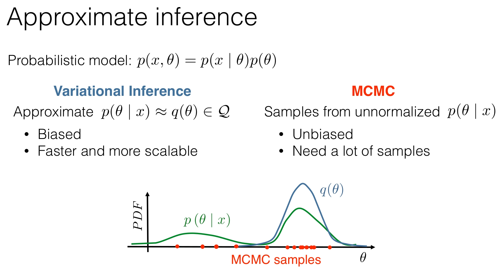
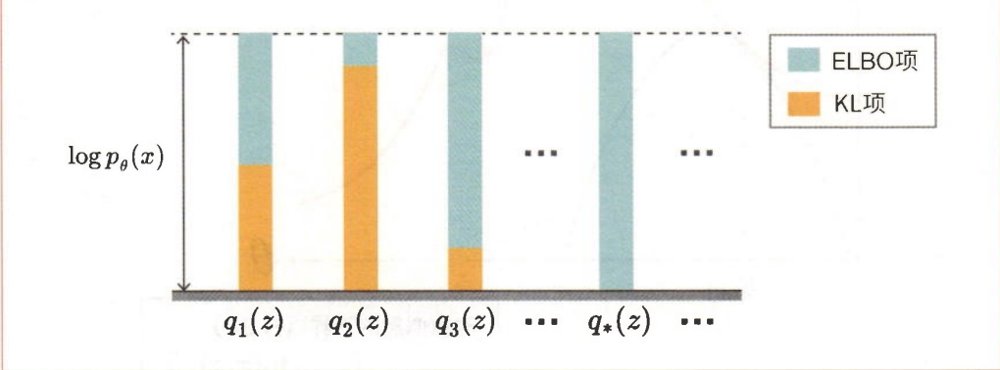
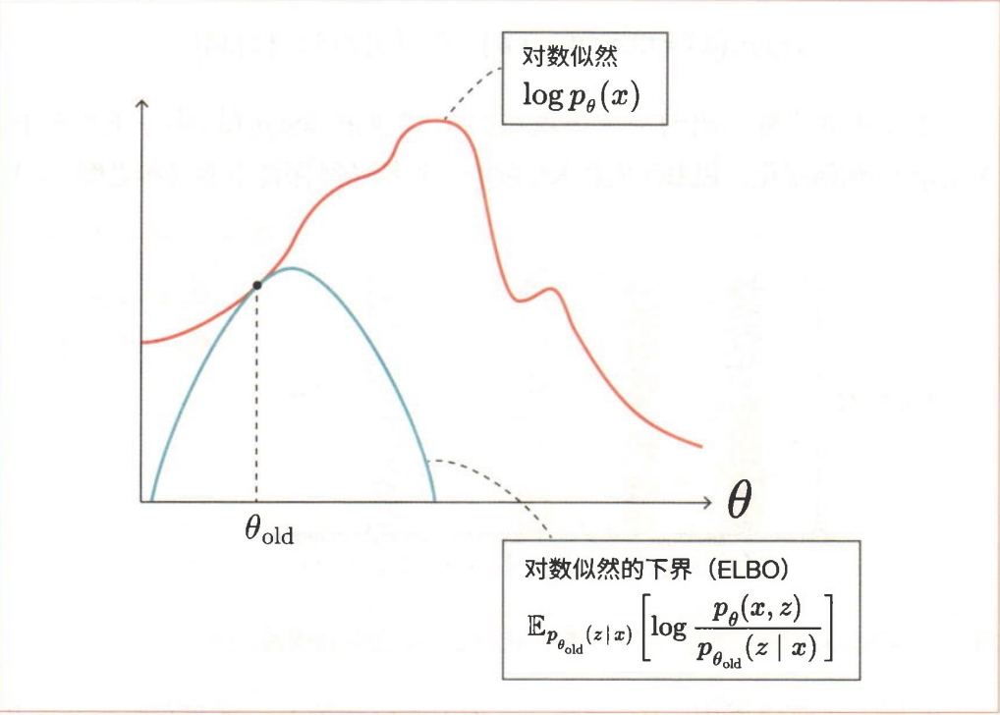
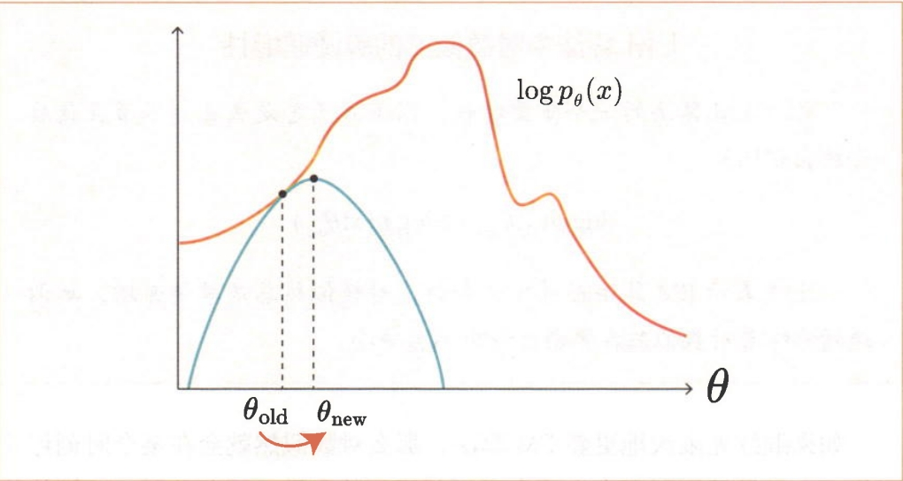
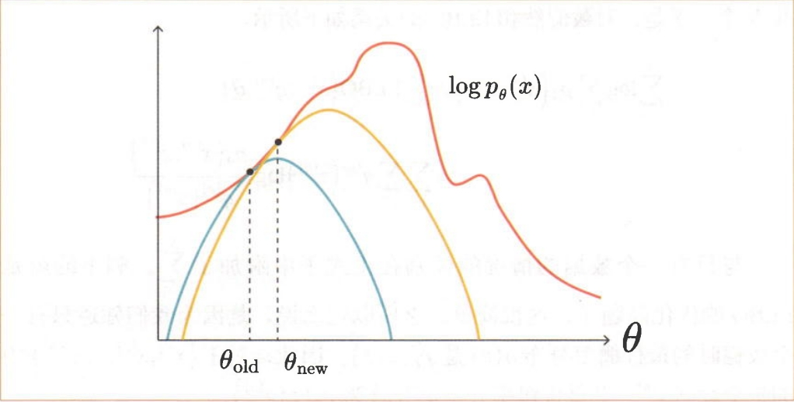
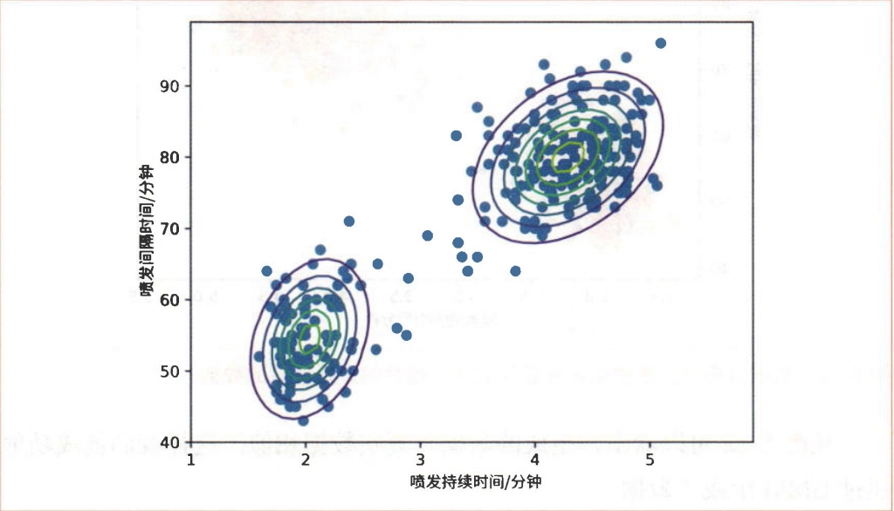
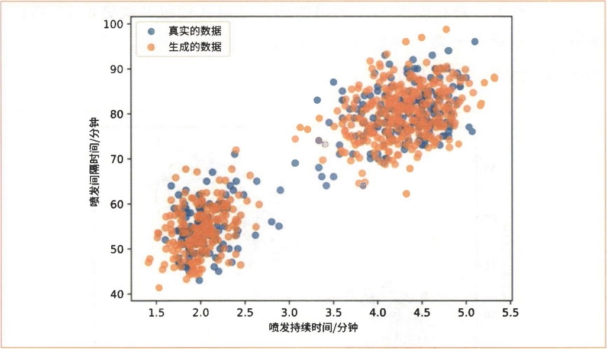

# 机器学习篇-04.变分推断

## 1. 近似推断方法

### 1.1 两种主要方法

对于概率模型 $p(x, \theta) = p(x | \theta) p(\theta)$，有两种主要的近似推断方法:

#### 1.1.1 变分推断 (Variational Inference, VI)

**方法**:近似 $p(\theta | x) \approx q(\theta) \in Q$

**特点**:
- **有偏的 (Biased)**:近似可能不准确
- **更快且可扩展**:计算效率高
- 使用参数化分布族 $Q$ 来近似后验

#### 1.1.2 马尔可夫链蒙特卡洛 (MCMC)

**方法**:从非归一化的 $p(\theta | x)$ 中采样

**特点**:
- **无偏的 (Unbiased)**:理论上可以精确
- **需要大量样本**:计算成本高
- 通过采样来近似后验分布

可视化对比如图1所示。



<small>**图1** 变分推断 & 蒙特卡洛采样对比</small>

---

## 2. 变分推断的基本思想

### 2.1 核心问题

**目标**:找到后验分布的近似 $p(\theta | x) \approx q(\theta) \in Q$

**优化准则**:

$$F(q) := \text{KL}(q(\theta) \| p(\theta | x)) \to \min_{q(\theta) \in Q} \tag{4.1}$$

其中 $\text{KL}(q \| p)$ 是 Kullback-Leibler 散度，用于衡量两个分布之间的不匹配程度。

### 2.2 面临的挑战

1. **我们无法计算后验**:如果后验可计算，就不需要近似了
2. **如何对分布进行优化**:需要将分布优化问题转化为可处理的形式

---

## 3. KL散度

### 3.1 定义

Kullback-Leibler 散度是衡量同一域上两个分布之间不匹配程度的良好度量:

$$\text{KL}(q(\theta) \| p(\theta | x)) = \int q(\theta) \log \frac{q(\theta)}{p(\theta | x)} d\theta \tag{4.2}$$

### 3.2 性质

1. **非负性**:$\text{KL}(q \| p) \geq 0$，当且仅当 $q = p$ 时等号成立
2. **非对称性**:$\text{KL}(q \| p) \neq \text{KL}(p \| q)$
3. **零散度**:$\text{KL}(q \| p) = 0$ 当且仅当 $q = p$

### 3.3 两种KL散度的区别

- **$\text{KL}(q \| p)$**（反向KL）:倾向于"模式寻找"（mode-seeking）
  - 当 $q$ 试图覆盖 $p$ 的主要模式时使用
  - 可能导致 $q$ 过于集中

- **$\text{KL}(p \| q)$**（前向KL）:倾向于"均值匹配"（mean-matching）
  - 当 $q$ 试图覆盖 $p$ 的整个支撑集时使用
  - 可能导致 $q$ 过于分散

在变分推断中，我们使用 $\text{KL}(q \| p)$，因为它更容易优化（不需要从真实后验采样）。

---

## 4. 证据下界 (ELBO) 的推导

### 4.1 数学技巧

我们从证据（边际似然）开始:

$$\log p(x) = \int q(\theta) \log p(x) d\theta$$

由于 $p(x)$ 不依赖于 $\theta$，我们可以将其移到积分内。然后使用贝叶斯定理:

$$\log p(x) = \int q(\theta) \log \frac{p(x, \theta)}{p(\theta | x)} d\theta$$

重新组织项:

$$\log p(x) = \int q(\theta) \log \frac{p(x, \theta) q(\theta)}{p(\theta | x) q(\theta)} d\theta$$

$$= \int q(\theta) \log \frac{p(x, \theta)}{q(\theta)} d\theta + \int q(\theta) \log \frac{q(\theta)}{p(\theta | x)} d\theta$$

$$= \mathcal{L}(q(\theta)) + \text{KL}(q(\theta) \| p(\theta | x)) \tag{4.3}$$

### 4.2 ELBO 的定义

**证据下界 (Evidence Lower Bound, ELBO)**:

$$\mathcal{L}(q(\theta)) = \int q(\theta) \log \frac{p(x, \theta)}{q(\theta)} d\theta \tag{4.4}$$

**关键关系**:

$$\log p(x) = \mathcal{L}(q(\theta)) + \text{KL}(q(\theta) \| p(\theta | x)) \tag{4.5}$$

### 4.3 ELBO 的含义

1. **证据 (Evidence)** $p(x)$:
   - 概率模型的证据表示观察到数据的总概率
   - 在贝叶斯定理中:$p(\theta | x) = \frac{p(x | \theta) p(\theta)}{p(x)} = \frac{\text{似然} \times \text{先验}}{\text{证据}}$

2. **下界 (Lower Bound)**:
   - 由于 KL 散度非负:$\text{KL}(q(\theta) \| p(\theta | x)) \geq 0$
   - 因此:$\log p(x) \geq \mathcal{L}(q(\theta))$
   - ELBO 是证据的下界

3. **优化等价性**:
   - 最大化 ELBO 等价于最小化 KL 散度
   - 当 $q(\theta) = p(\theta | x)$ 时，ELBO 达到上界 $\log p(x)$

---

## 5. 变分推断的优化问题

### 5.1 原始问题

$$\text{KL}(q(\theta) \| p(\theta | x)) \to \min_{q(\theta) \in Q} \tag{4.6}$$

### 5.2 等价问题

使用我们的"魔法"关系:

$$\log p(x) = \mathcal{L}(q(\theta)) + \text{KL}(q(\theta) \| p(\theta | x)) \tag{4.7}$$

注意到:
- $\log p(x)$ **不依赖于** $q$
- $\text{KL}(q(\theta) \| p(\theta | x))$ **依赖于** $q$
- $\mathcal{L}(q(\theta))$ **依赖于** $q$

因此:

$$\text{KL}(q(\theta) \| p(\theta | x)) \to \min_{q(\theta) \in Q} \quad \Leftrightarrow \quad \mathcal{L}(q(\theta)) \to \max_{q(\theta) \in Q} \tag{4.8}$$

### 5.3 最终优化问题

$$\mathcal{L}(q(\theta)) = \int q(\theta) \log \frac{p(x, \theta)}{q(\theta)} d\theta = \int q(\theta) \log \frac{p(x | \theta) p(\theta)}{q(\theta)} d\theta \to \max_{q(\theta) \in Q} \tag{4.9}$$

### 5.4 ELBO 的两种解释

#### 5.4.1 解释 1:分解形式

$$\mathcal{L}(q(\theta)) = \int q(\theta) \log p(x | \theta) d\theta + \int q(\theta) \log \frac{p(\theta)}{q(\theta)} d\theta \tag{4.10}$$

$$= \mathbb{E}_{q(\theta)}[\log p(x | \theta)] - \text{KL}(q(\theta) \| p(\theta)) \tag{4.11}$$

#### 5.4.2 解释 2:数据项和正则化项

- **数据项**:$\mathbb{E}_{q(\theta)}[\log p(x | \theta)]$
  - 鼓励 $q(\theta)$ 将概率质量放在能够很好解释数据的参数值上
  - 最大化数据的对数似然期望

- **正则化项**:$-\text{KL}(q(\theta) \| p(\theta))$
  - 鼓励 $q(\theta)$ 接近先验 $p(\theta)$
  - 防止过拟合，提供正则化

**平衡**:ELBO 在拟合数据和保持接近先验之间进行权衡。

---

## 6. EM算法

### 6.1 进入EM算法

式4.4中的$\text{ELBO}(x; q, \theta)$有两个参数$q(z)$和$\theta$。这两个参数需要优化（找出使ELBO最大的两个参数）。然而，同时优化$q(z)$和$\theta$并不容易，因此需要重复进行固定一个参数并优化另一个参数的过程。具体来说就是重复进行固定$\theta$并更新$q(z)$，然后固定$q(z)$并更新$\theta$的过程。通过重复进行这一过程，我们可以逐渐接近最优解。

首先将$\theta$固定为当前值（假设此时$\theta = \theta_{\text{old}}$），然后考虑对$q(z)$进行优化。$q(z)$表示关于$z$的任意概率分布。无论$q(z)$是什么样的概率分布，$\log p_\theta(x) = \text{ELBO}(x; q, \theta) + \text{KL}(q(z) \| p_\theta(z|x))$都成立。然而，不同的$q(z)$的分布使得$\text{ELBO}(x; q, \theta)$与$\log p_\theta(x)$的接近程度有所不同。当然，我们希望$\text{ELBO}(x; q, \theta)$尽可能地接近$\log p_\theta(x)$。为此，下面的式子可作为提示:

$$\log p_\theta(x) = \text{ELBO}(x; q, \theta) + \text{KL}(q(z) \| p_\theta(z|x)) \tag{4.12}$$

需要注意的是，$q(z)$并未出现在式4.12左侧的$\log p_\theta(x)$中。重点在于，无论$q(z)$如何变化，ELBO项和KL项的总和都始终保持不变（参见图2）。



<small>**图2** 无论$q(z)$如何变化，ELBO项和KL项的总和都始终保持不变</small>

从图2可以看出，KL项越小，ELBO项就越大。当两个概率分布相同时，KL散度取最小值0。因此，当$q(z) = p_\theta(z|x)$时，KL项为0，此时ELBO项最大。由于KL项实际上是0，因此$\log p_\theta(x) = \text{ELBO}(x; q, \theta)$。

基于以上信息，$q(z)$的更新式可以表示为$q(z) = p_\theta(z|x)$。更准确地说，由于$\theta$固定为$\theta = \theta_{\text{old}}$，因此更新式是$q(z) = p_{\theta_{\text{old}}}(z|x)$。这种由$q(z) = p_\theta(z|x)$进行的更新是EM算法的"E步骤"。E来源于"Expectation Value"（期望值）中的E。之所以称为"期望值"，是因为$q(z) = p_\theta(z|x)$时的ELBO可以表示为以下式子所示的期望值:

$$\text{ELBO}(x; q = p_\theta(z|x), \theta) = \sum_z p_\theta(z|x) \log p_\theta(x, z) - \sum_z p_\theta(z|x) \log p_\theta(z|x) \tag{4.13}$$

图3是E步骤更新的可视化图形。重要的一点是，当$q(z) = p_\theta(z|x)$时，ELBO和对数似然是相等的。



<small>**图3** E步骤中对数似然与ELBO的关系</small>

接下来是关于$\theta$的优化，这个过程很简单。由于ELBO是sum-log的形式，因此可以用解析的方式求出。具体来说，可以通过求式4.13关于$\theta$的导数，并解出其为0的方程的做法来求出。这项任务是EM算法的"M步骤"。M是"Maximization"（最大化）的首字母，意思是使ELBO相对于$\theta$"最大化"（参见图4）。



<small>**图4** M步骤使ELBO相对于$\theta$最大化</small>

在E步骤中，通过更新$q(z)$可以使ELBO更接近（等于）$\log p(x; \theta)$。而在M步骤中，通过更新$\theta$可以增大ELBO的值，从而间接增大$\log p(x; \theta)$的值。这就导致在E步骤中相等的$\log p(x; \theta)$和ELBO的值相互远离。因此，我们需要再次执行E步骤，如此反复进行。通过这样交替执行E步骤和M步骤，就能使$\log p(x; \theta)$逐渐增大（参见图5）。



<small>**图5** 重复E步骤和M步骤</small>

**EM算法中对数似然的单调递增性**

作为EM算法的一个重要特性，以下式子总是成立（本节在最后会给出证明）:

$$\log p(x; \theta_{\text{new}}) \geq \log p(x; \theta_{\text{old}}) \tag{4.14}$$

上式表示EM算法在每次更新时，对数似然总是单调递增。单调递增意味着对数似然在更新过程中不会减小。

如果继续无限次地更新EM算法，那么对数似然就会在某个时刻停止变化。由于继续更新下去也不会再更新模型的参数，因此此时EM算法的更新应该停止。在实践中，我们会设定一个阈值，当对数似然变化的绝对值低于设定的阈值时，更新的循环将终止。

### 6.2 扩展到多个数据

接下来，考虑将EM算法扩展到$N$个观测数据$\{x^{(1)}, x^{(2)}, \ldots, x^{(N)}\}$的情况。这里，我们为每个数据准备一个对应的概率分布，即$\{q^{(1)}, q^{(2)}, \ldots, q^{(N)}\}$，共$N$个。于是，对数似然和ELBO的关系如下所示:

$$\frac{1}{N} \sum_{n=1}^{N} \log p_\theta(x^{(n)}) \geq \frac{1}{N} \sum_{n=1}^{N} \text{ELBO}(x^{(n)}; q^{(n)}, \theta) \tag{4.15}$$

与只有一个数据的情况的区别在于式子中附加了$\sum_{n=1}^{N}$。剩下的就是ELBO的优化问题了，这很简单。之所以这么说，是因为我们知道只有一个数据时的最优概率分布$q(z)$是$p_\theta(z|x)$。因此，对于$\{x^{(1)}, x^{(2)}, \ldots, x^{(N)}\}$中的每个数据$x^{(n)}$，其最优概率分布$q^{(n)}(z)$为$p_\theta(z|x^{(n)})$。

另外，在有$N$个数据的情况下，下面式子中所表示的"对数似然的均值"可用作判断更新循环是否结束的对数似然:

$$\frac{1}{N} \sum_{n=1}^{N} \log p_\theta(x^{(n)}) \tag{4.16}$$

汇总以上信息，EM算法可以归纳如下:

1. **E步骤**:$\{q^{(1)}, q^{(2)}, \ldots, q^{(N)}\}$的更新（$\theta$是固定的）。
   - 对于每个$n$，有$q^{(n)}(z) = p_\theta(z|x^{(n)})$。

2. **M步骤**:$\theta$的更新（$\{q^{(1)}, q^{(2)}, \ldots, q^{(N)}\}$是固定的）
   - 通过解析的方式求使$\sum_{n=1}^{N} \text{ELBO}(x^{(n)}; q^{(n)}, \theta)$最大的$\theta$。

3. **终止判断**:计算对数似然的均值，并与之前的对数似然进行比较。

### 6.3 $\log p(x; \theta_{\text{new}}) \geq \log p(x; \theta_{\text{old}})$ 的证明★

最后进行$\log p(x; \theta_{\text{new}}) \geq \log p(x; \theta_{\text{old}})$的证明。首先，在E步骤中，当使用$q_{\text{old}}(z) = p_{\theta_{\text{old}}}(z|x)$进行更新时，由于对数似然和ELBO相同，因此有以下式子成立:

$$\log p(x; \theta_{\text{old}}) = \text{ELBO}(x; q_{\text{old}}, \theta_{\text{old}}) \tag{4.17}$$

在M步骤中，通过最大化上式的右边得到$\theta_{\text{new}}$，因此有以下式子成立:

$$\text{ELBO}(x; q_{\text{old}}, \theta_{\text{new}}) \geq \text{ELBO}(x; q_{\text{old}}, \theta_{\text{old}}) \tag{4.18}$$

在下一个E步骤中，通过$q_{\text{new}}(z) = p_{\theta_{\text{new}}}(z|x)$进行更新。此时有以下式子成立:

$$\log p(x; \theta_{\text{new}}) = \text{ELBO}(x; q_{\text{new}}, \theta_{\text{new}}) \geq \text{ELBO}(x; q_{\text{old}}, \theta_{\text{new}}) \tag{4.19}$$

综合以上式子，可以得到下面的式子:

$$\log p(x; \theta_{\text{new}}) \geq \text{ELBO}(x; q_{\text{old}}, \theta_{\text{new}}) \geq \text{ELBO}(x; q_{\text{old}}, \theta_{\text{old}}) = \log p(x; \theta_{\text{old}}) \tag{4.20}$$

这样我们就完成了$\log p(x; \theta_{\text{new}}) \geq \log p(x; \theta_{\text{old}})$的证明。

---

## 7. GMM和EM算法★

在6节中，我们推导出了拥有潜变量的模型的EM算法。本节将对GMM这个具体的模型应用EM算法。

### 7.1 EM算法的E步骤★

我们先来复习一下GMM。假设$x$是观测变量，$z$是潜变量，并且$z$是一个取值范围从1到$K$的离散型随机变量。然后，我们将GMM的参数表示为$\theta = \{\phi, \mu, \Sigma\}$（为简化数学式，将3个参数汇总为$\theta$）。这些参数都拥有$K$个元素，如下所示:

$$\phi = \{\phi_1, \phi_2, \ldots, \phi_K\} \tag{4.21}$$

$$\mu = \{\mu_1, \mu_2, \ldots, \mu_K\} \tag{4.22}$$

$$\Sigma = \{\Sigma_1, \Sigma_2, \ldots, \Sigma_K\} \tag{4.23}$$

此时的似然$p(x; \theta)$如以下式子所示:

$$p(x; \theta) = \sum_{j=1}^{K} p(z = j; \theta) p(x|z = j; \theta) = \sum_{j=1}^{K} \phi_j \mathcal{N}(x; \mu_j, \Sigma_j) \tag{4.24}$$

考虑到后续的式子展开，这里使用符号$j$来替代$k$。

现在，假设我们获得了$N$个观测数据$\{x^{(1)}, x^{(2)}, \ldots, x^{(N)}\}$。在这种情况下，每个数据的对数似然的均值如以下式子所示。该值将用于判断EM算法的更新是否终止:

$$\frac{1}{N} \sum_{n=1}^{N} \log p(x^{(n)}; \theta) = \frac{1}{N} \sum_{n=1}^{N} \log \sum_{j=1}^{K} \phi_j \mathcal{N}(x^{(n)}; \mu_j, \Sigma_j) \tag{4.25}$$

接下来从E步骤开始应用EM算法。在E步骤中，固定$\{\phi, \mu, \Sigma\}$，然后更新概率分布$q(z)$。$q^{(n)}(z = k)$是在给定$x^{(n)}$的条件下求得的条件概率。$q^{(n)}(z = k)$的数学式如下所示:

$$q^{(n)}(z = k) = p(z = k|x^{(n)}; \theta) = \frac{p(x^{(n)}|z = k; \theta) p(z = k; \theta)}{p(x^{(n)}; \theta)} = \frac{\phi_k \mathcal{N}(x^{(n)}; \mu_k, \Sigma_k)}{\sum_{j=1}^{K} \phi_j \mathcal{N}(x^{(n)}; \mu_j, \Sigma_j)} \tag{4.26}$$

为了简化表示，后续我们将使用$q^{(n)}(k)$来代替$q^{(n)}(z = k)$。这样我们就成功地用数学式表示了E步骤及其终止判断。以下是数学式的汇总:

**E步骤**

对于每个$(n, k)$，计算下面的值:

$$q^{(n)}(k) = \frac{\phi_k \mathcal{N}(x^{(n)}; \mu_k, \Sigma_k)}{\sum_{j=1}^{K} \phi_j \mathcal{N}(x^{(n)}; \mu_j, \Sigma_j)} \tag{4.27}$$

**M步骤**

（详见7.2节）

**终止判断**

计算下一个对数似然，并将其与上一个对数似然进行比较:

$$\frac{1}{N} \sum_{n=1}^{N} \log \sum_{j=1}^{K} \phi_j \mathcal{N}(x^{(n)}; \mu_j, \Sigma_j) \tag{4.28}$$

### 7.2 EM算法的M步骤★

剩下的就是M步骤了。在M步骤中，固定$q$，更新$\theta = \{\phi, \mu, \Sigma\}$。具体来说，就是求出使ELBO最大的参数。ELBO的数学式如下所示:

$$\text{ELBO}(\{x^{(n)}\}; \{q^{(n)}\}, \theta) = \sum_{n=1}^{N} \sum_{k=1}^{K} q^{(n)}(k) \log p_\theta(x^{(n)}, z = k) - \sum_{n=1}^{N} \sum_{k=1}^{K} q^{(n)}(k) \log q^{(n)}(k) \tag{4.29}$$

$$= \sum_{n=1}^{N} \sum_{k=1}^{K} q^{(n)}(k) \log [\phi_k \mathcal{N}(x^{(n)}; \mu_k, \Sigma_k)] - \sum_{n=1}^{N} \sum_{k=1}^{K} q^{(n)}(k) \log q^{(n)}(k) \tag{4.30}$$

值得注意的是，第二项不包含参数$\{\phi, \mu, \Sigma\}$。由于M步骤的目标是找到使ELBO最大的$\{\phi, \mu, \Sigma\}$，因此第二项可以忽略。所以，目标函数（最大化的对象）可以表示为$J(\phi, \mu, \Sigma)$，其数学式如下所示:

$$J(\phi, \mu, \Sigma) = \sum_{n=1}^{N} \sum_{k=1}^{K} q^{(n)}(k) \log [\phi_k \mathcal{N}(x^{(n)}; \mu_k, \Sigma_k)] = \sum_{n=1}^{N} \sum_{k=1}^{K} q^{(n)}(k) [\log \phi_k + \log \mathcal{N}(x^{(n)}; \mu_k, \Sigma_k)] \tag{4.31}$$

下面来求使$J(\phi, \mu, \Sigma)$最大的参数。GMM有3个参数$\{\phi, \mu, \Sigma\}$。首先从$\mu$开始。

GMM的参数$\mu$由$K$个数据$\{\mu_1, \mu_2, \ldots, \mu_K\}$构成。这里求关于第$k$个数据$\mu_k$的偏导数（梯度）。式子展开如下所示:

$$\frac{\partial J}{\partial \mu_k} = \frac{\partial}{\partial \mu_k} \sum_{n=1}^{N} \sum_{j=1}^{K} q^{(n)}(j) \log \mathcal{N}(x^{(n)}; \mu_j, \Sigma_j) = \sum_{n=1}^{N} q^{(n)}(k) \frac{\partial}{\partial \mu_k} \log \mathcal{N}(x^{(n)}; \mu_k, \Sigma_k) \tag{4.32}$$

对于不包含$\mu_k$的项，关于$\mu_k$的偏导数为0。

式4.32中出现的$\frac{\partial}{\partial \mu_k} \log \mathcal{N}(x^{(n)}; \mu_k, \Sigma_k)$是关于多维正态分布的均值向量的偏导数。推导过程中用到了下面的式A.6:

$$\frac{\partial}{\partial \mu} \log \mathcal{N}(x; \mu, \Sigma) = \Sigma^{-1}(x - \mu) \tag{A.6}$$

利用这个式子，继续展开如下:

$$\frac{\partial J}{\partial \mu_k} = \sum_{n=1}^{N} q^{(n)}(k) \Sigma_k^{-1}(x^{(n)} - \mu_k) \tag{4.33}$$

然后令$\frac{\partial J}{\partial \mu_k} = 0$，得到下面的式子:

$$\sum_{n=1}^{N} q^{(n)}(k) \Sigma_k^{-1}(x^{(n)} - \mu_k) = 0$$

$$\sum_{n=1}^{N} q^{(n)}(k) (x^{(n)} - \mu_k) = 0$$

$$\sum_{n=1}^{N} q^{(n)}(k) x^{(n)} = \sum_{n=1}^{N} q^{(n)}(k) \mu_k = \mu_k \sum_{n=1}^{N} q^{(n)}(k)$$

$$\mu_k = \frac{\sum_{n=1}^{N} q^{(n)}(k) x^{(n)}}{\sum_{n=1}^{N} q^{(n)}(k)} \tag{4.34}$$

这个式4.34就是$\mu_k$的更新式，从$k = 1$开始计算到$K$。

接下来是协方差矩阵$\Sigma$。$\Sigma_k$的求解方法与$\mu_k$相同（使用式A.15）。这里只展示结果:

$$\Sigma_k = \frac{\sum_{n=1}^{N} q^{(n)}(k) (x^{(n)} - \mu_k)(x^{(n)} - \mu_k)^T}{\sum_{n=1}^{N} q^{(n)}(k)} \tag{4.35}$$

需要注意的是，式4.35中的$\mu_k$是通过式4.34更新后的值。

最后是$\phi = \{\phi_1, \phi_2, \ldots, \phi_K\}$。在目标函数的式4.31中，与$\phi$相关的项如下所示:

$$\sum_{n=1}^{N} \sum_{k=1}^{K} q^{(n)}(k) \log \phi_k \tag{4.36}$$

不过，与$\mu$不同的是，$\phi$的优化受到限制。$\phi$必须满足以下约束条件:

$$\sum_{k=1}^{K} \phi_k = 1 \tag{4.37}$$

对于这种有约束的优化，可以使用拉格朗日乘子法（Lagrange Multiplier Method）来求解。

**拉格朗日乘子法**

拉格朗日乘子法可以用来解决"在$g(x) = 0$的条件下最大化$f(x)$"这样的问题。为此，定义以下式子:

$$L = f(x) - \beta g(x) \tag{4.38}$$

其中$L$是拉格朗日函数，$\beta$是被称为拉格朗日乘子的变量。在这种情况下，表示极值的$x$满足下面的式子:

$$\frac{\partial L}{\partial x} = 0, \quad \frac{\partial L}{\partial \beta} = 0 \tag{4.39}$$

现在有两个变量$x$和$\beta$。通过求解上面两个联立方程，可知$x$的极值。

将拉格朗日乘子法应用于本问题时，拉格朗日函数$L$的数学式如下所示:

$$L = \sum_{n=1}^{N} \sum_{k=1}^{K} q^{(n)}(k) \log \phi_k + \beta \left(\sum_{k=1}^{K} \phi_k - 1\right) \tag{4.40}$$

此时$L$关于$\phi_k$的偏导数可以表示为下面的式子:

$$\frac{\partial L}{\partial \phi_k} = \sum_{n=1}^{N} q^{(n)}(k) \frac{1}{\phi_k} + \beta = \frac{\sum_{n=1}^{N} q^{(n)}(k)}{\phi_k} + \beta \tag{4.41}$$

令这个式子等于0，即可得到以下解:

$$\phi_k = -\frac{\sum_{n=1}^{N} q^{(n)}(k)}{\beta} \tag{4.42}$$

然后向式4.42中代入约束条件$\sum_{k=1}^{K} \phi_k = 1$:

$$\sum_{k=1}^{K} \phi_k = -\frac{1}{\beta} \sum_{k=1}^{K} \sum_{n=1}^{N} q^{(n)}(k) = 1$$

$$-\beta = \sum_{k=1}^{K} \sum_{n=1}^{N} q^{(n)}(k) = \sum_{n=1}^{N} \sum_{k=1}^{K} q^{(n)}(k) = N \tag{4.43}$$

这里再对式4.43做一下补充说明。$q^{(n)}(z)$是$z$的概率分布，且与$z$有关的概率之和为1。由于$z$取1到$K$的整数，因此有$\sum_{k=1}^{K} q^{(n)}(z = k) = 1$成立。

最后，将$-\beta = N$代入式4.42，可以得到下面的式子。这就是$\phi_k$的解:

$$\phi_k = \frac{1}{N} \sum_{n=1}^{N} q^{(n)}(k) \tag{4.44}$$

这样我们就完成了GMM模型的EM算法的推导。以下是数学式的汇总:

**E步骤**

对于每个$(n, k)$，计算下面的值:

$$q^{(n)}(k) = \frac{\phi_k \mathcal{N}(x^{(n)}; \mu_k, \Sigma_k)}{\sum_{j=1}^{K} \phi_j \mathcal{N}(x^{(n)}; \mu_j, \Sigma_j)} \tag{4.45}$$

**M步骤**

对于每个$k$，计算下面的值:

$$\phi_k = \frac{1}{N} \sum_{n=1}^{N} q^{(n)}(k) \tag{4.46}$$

$$\mu_k = \frac{\sum_{n=1}^{N} q^{(n)}(k) x^{(n)}}{\sum_{n=1}^{N} q^{(n)}(k)} \tag{4.47}$$

$$\Sigma_k = \frac{\sum_{n=1}^{N} q^{(n)}(k) (x^{(n)} - \mu_k)(x^{(n)} - \mu_k)^T}{\sum_{n=1}^{N} q^{(n)}(k)} \tag{4.48}$$

**终止判断**

计算下一个对数似然，并将其与上一个对数似然进行比较:

$$\frac{1}{N} \sum_{n=1}^{N} \log \sum_{j=1}^{K} \phi_j \mathcal{N}(x^{(n)}; \mu_j, \Sigma_j) \tag{4.49}$$

---

## 8. EM算法的实现

本节将实现EM算法。使用的数据集是"老忠实间歇泉"数据集。

### 8.1 数据集与GMM的代码

首先读取数据集并设置GMM的参数的初始值。代码如下所示:

```python
import os
import numpy as np

path = os.path.join(os.path.dirname(__file__), 'old_faithful.txt')
xs = np.loadtxt(path)
print(xs.shape)  # (272, 2)

phis = np.array([0.5, 0.5])
mus = np.array([[0.0, 50.0],
                [0.0, 80.0]])
covs = np.array([np.eye(2), np.eye(2)])  # 单位矩阵

K = len(phis)  # 2
N = len(xs)  # 272

MAX_ITERS = 100
THRESHOLD = 1e-4
```

`xs`的形状是(272, 2)，意味着有272个二维数据。然后准备`phis`、`mus`和`covs`作为GMM的参数。变量`K`是高斯分布的个数，这里的值是2；`N`是数据的个数；`MAX_ITERS`是EM算法的最大迭代次数；`THRESHOLD`是停止EM算法更新的阈值。如果参数更新后对数似然之间的差的绝对值低于`THRESHOLD`，则终止更新。

接下来是多变量正态分布、GMM和计算对数似然的代码:

```python
def multivariate_normal(x, mu, cov):
    det = np.linalg.det(cov)
    inv = np.linalg.inv(cov)
    d = len(x)
    z = 1 / np.sqrt((2 * np.pi) ** d * det)
    y = z * np.exp(-(x - mu).T @ inv @ (x - mu) / 2.0)
    return y

def gmm(x, phis, mus, covs):
    K = len(phis)
    y = 0
    for k in range(K):
        phi, mu, cov = phis[k], mus[k], covs[k]
        y += phi * multivariate_normal(x, mu, cov)
    return y

def likelihood(xs, phis, mus, covs):
    eps = 1e-8  # 避免log(0)的错误
    L = 0
    N = len(xs)
    for x in xs:
        y = gmm(x, phis, mus, covs)
        L += np.log(y + eps)
    return L / N
```

前两个函数与步骤4中实现的代码相同。最后的`likelihood()`是用于计算对数似然的函数，它是下面的数学式的代码实现:

$$\frac{1}{N} \sum_{n=1}^{N} \log \sum_{j=1}^{K} \phi_j \mathcal{N}(x^{(n)}; \mu_j, \Sigma_j) \tag{4.50}$$

在`likelihood()`函数中，如果计算`np.log(0)`，则会发生错误。为了避免这种情况出现，需要给函数添加一个微小值`eps`。接下来，我们将继续实现EM算法的E步骤和M步骤。

### 8.2 E步骤和M步骤的实现

首先从E步骤开始。E步骤的数学式如下所示:

**E步骤**

对于每个$(n, k)$，计算下面的值:

$$q^{(n)}(k) = \frac{\phi_k \mathcal{N}(x^{(n)}; \mu_k, \Sigma_k)}{\sum_{j=1}^{K} \phi_j \mathcal{N}(x^{(n)}; \mu_j, \Sigma_j)} \tag{4.51}$$

这个数学式的代码实现如下所示:

```python
for iter in range(MAX_ITERS):
    # E-step
    qs = np.zeros([N, K])
    for n in range(N):
        x = xs[n]
        for k in range(K):
            phi, mu, cov = phis[k], mus[k], covs[k]
            qs[n, k] = phi * multivariate_normal(x, mu, cov)
        qs[n] /= gmm(x, phis, mus, covs)
    
    # M-step
    # [后面马上会给出代码，此处省略]
    
    # 终止判断
    # [后面马上会给出代码，此处省略]
```

在这里，我们在`for`语句中编写了E步骤的代码。这段代码首先准备一个形状为`(N, K)`的`qs`，然后计算它的元素。结合数学式和代码来看会更容易理解。

接下来是M步骤。首先是M步骤的数学式:

**M步骤**

对于每个$k$，计算下面的值:

$$\phi_k = \frac{1}{N} \sum_{n=1}^{N} q^{(n)}(k) \tag{4.52}$$

$$\mu_k = \frac{\sum_{n=1}^{N} q^{(n)}(k) x^{(n)}}{\sum_{n=1}^{N} q^{(n)}(k)} \tag{4.53}$$

$$\Sigma_k = \frac{\sum_{n=1}^{N} q^{(n)}(k) (x^{(n)} - \mu_k)(x^{(n)} - \mu_k)^T}{\sum_{n=1}^{N} q^{(n)}(k)} \tag{4.54}$$

下面给出代码实现:

```python
for iter in range(MAX_ITERS):
    # E-step
    # [前面已给出代码，此处省略]
    
    # M-step
    qs_sum = qs.sum(axis=0)
    
    for k in range(K):
        # 1. phis
        phis[k] = qs_sum[k] / N
        
        # 2. mus
        c = 0
        for n in range(N):
            c += qs[n, k] * xs[n]
        mus[k] = c / qs_sum[k]
        
        # 3. covs
        c = 0
        for n in range(N):
            z = xs[n] - mus[k]
            z = z[:, np.newaxis]  # 为了与数学式保持一致，将其转换为列向量
            c += qs[n, k] * z @ z.T
        covs[k] = c / qs_sum[k]
```

数学式中$\sum_{n=1}^{N} q^{(n)}(k)$的计算出现在了3个地方。因此，在代码中，我们首先通过`qs_sum = qs.sum(axis=0)`进行计算。之后，只需实现与数学式相对应的代码即可。

最后是终止判断的代码:

```python
current_likelihood = likelihood(xs, phis, mus, covs)
for iter in range(MAX_ITERS):
    # E-step
    # [前面已给出代码，此处省略]
    
    # M-step
    # [前面已给出代码，此处省略]
    
    # 终止判断
    print(f'{current_likelihood:.3f}')  # 输出对数似然（显示到小数点后3位）
    
    next_likelihood = likelihood(xs, phis, mus, covs)
    diff = np.abs(next_likelihood - current_likelihood)  # 差的绝对值
    
    if diff < THRESHOLD:
        break
    
    current_likelihood = next_likelihood
```

这样我们就完成了EM算法的实现。接下来，我们运行代码来看一下。对数似然的变化情况如以下输出所示:

```
-16.538
-4.415
-4.357
-4.382
-4.245
-4.288
-4.164
-4.156
-4.155
```

可以看出，对数似然是单调递增的。这里在经过9次更新后达到了阈值。下面对由更新后的参数组成的GMM进行可视化。结果如图6所示。



<small>**图6** GMM的可视化</small>

从图6可以看出，两个"簇"分别拟合了各自的正态分布。

### 8.3 数据生成

接下来，使用训练后的GMM生成数据。代码如下所示:

```python
N = 500

new_xs = np.zeros([N, 2])
for n in range(N):
    k = np.random.choice(2, p=phis)
    mu, cov = mus[k], covs[k]
    new_xs[n] = np.random.multivariate_normal(mu, cov)
```

`np.random.choice(2, p=phis)`可以基于`phis`的概率分布随机选择0或1，然后基于所选值从相应的高斯分布生成数据。这样就生成了新数据。对生成的数据`new_xs`进行可视化，结果如图7所示。



<small>**图7** 数据分布（蓝色的点是真实的数据，橙色的点是生成的数据）</small>

从图7可以看出，生成的数据与真实数据相似。这样我们就成功地通过GMM生成了数据。

---
