# 补充系列篇-00.导读

本篇将 **AE、DM、GAN、AR** 系列篇的内容串联起来，帮助读者建立整体框架，并了解各系列之间的逻辑关系与推荐阅读顺序。行文按 **建模 → 训练 → 采样 → 改进** 这条主线展开，读者可依自身基础按需跳读或顺序阅读。

---

## 1. 生成模型是什么？

### 1.1 核心概念

生成模型是一种**学习并逼近真实数据背后概率分布**的模型。其核心思路是: 从有限样本中估计 $ p_{\text{data}}(x) $，构建可学习的模型分布 $ p_\theta(x) $，从而能够**采样生成**新的、看似合理的数据（如图像、文本、蛋白质结构等）。

**带概率建模的生成模型**（Generative Models with Probabilistic Modeling）的典型流程:

> 原始数据 → 真实数据分布 → 估计的数据分布 → 从估计分布中采样生成新数据

各步骤含义如下:

| 步骤 | 含义 |
|------|------|
| **原始数据** | 观测到的有限样本（如一批猫的图片） |
| **→ 真实数据分布** | 用这些样本推断背后的真实概率分布 $ p_{\text{data}}(x) $（我们并不知道它的形式） |
| **→ 估计的数据分布** | 用模型学出一个近似分布 $ p_\theta(x) $ 去逼近真实分布 |
| **→ 从估计分布中采样生成新数据** | 从学到的 $ p_\theta(x) $ 中采样，得到新的、类似真实数据但从未出现过的样本（如新的猫的图片） |

简言之: **观测数据 → 推断分布 → 学习近似分布 → 利用近似分布生成新数据**，这就是概率生成模型的核心逻辑。

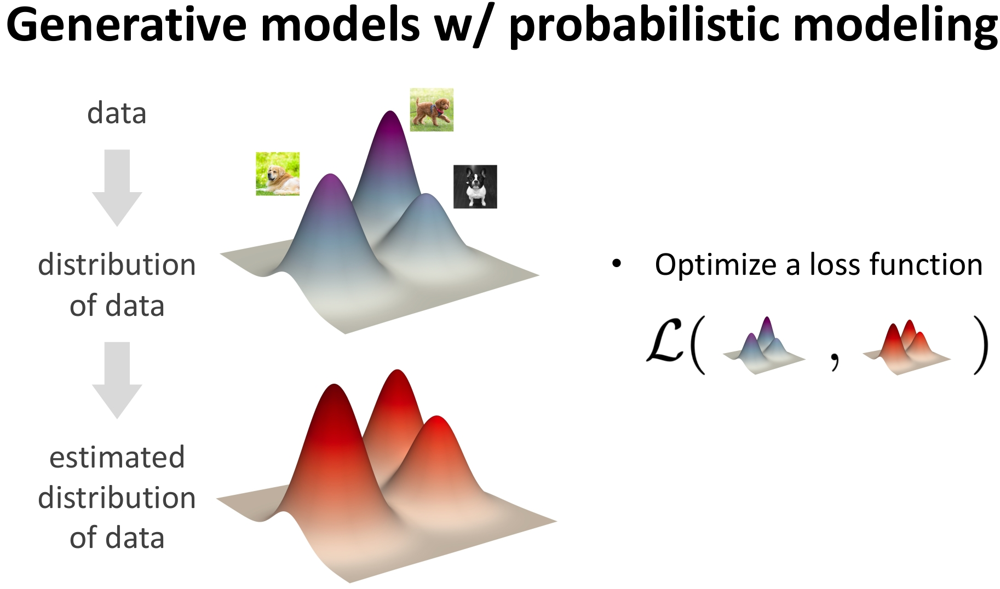  
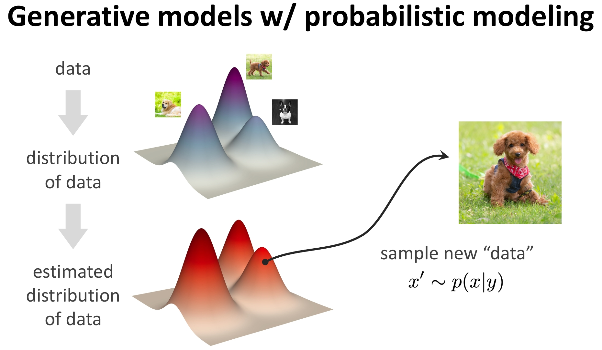

**图1**: 学习过程——通过优化使 $ p_\theta(x) $ 与 $ p_{\text{data}}(x) $ 的误差更小  
**图2**: 采样过程——从 $ p_\theta(x) $ 中采样得到新样本

### 1.2 完整流程: 建模 → 训练 → 推理

一个深度生成模型系统通常包含以下四个阶段:

| 阶段 | 英文 | 作用 |
|------|------|------|
| **建模** | Formulation | 将现实问题转化为 $ p(x \mid y) $；将复杂分布分解为可处理的子问题（如扩散过程、自回归因子分解） |
| **表示** | Representation | 用深度网络（Transformer、UNet、MLP）参数化映射或条件分布 |
| **训练** | Objective + Optimization | 定义目标函数（ELBO、对抗损失、去噪得分匹配等）衡量分布差距；用梯度下降优化网络参数 |
| **推理** | Inference | **Sampler**: 从模型中采样生成新样本 |

简要展开:

1. **收集观测数据**: 我们无法直接获知 $ p_{\text{data}}(x) $，只能通过有限样本（图像、文本、蛋白质结构等）来近似它。
2. **构建可学习分布**: 用参数化模型（如神经网络）拟合真实分布，最小化 $ p_\theta(x) $ 与 $ p_{\text{data}}(x) $ 之间的某种“距离”（如 KL 散度、Wasserstein 距离等）。
3. **生成新样本**: 训练完成后，从 $ p_\theta(x) $ 中采样，生成新的、看似合理的数据。

### 1.3 深度生成模型: 两个层面的学习

**核心思想**: 深度学习 = 表征学习（Representation Learning）

| 层面 | 内容 | 典型应用 |
|------|------|----------|
| **实例表征** (instance-level) | 将原始数据 $ x $ 映射到特征空间（如 CNN 提取图像特征） | 判别任务（分类），最小化预测误差 |
| **分布表征** (distribution-level) | 将简单先验 $ z \sim \mathcal{N}(0,I) $ 经神经网络变换为复杂数据分布 $ x = G(z) $ | 生成任务，最小化 $ p_\theta(x) $ 与 $ p_{\text{data}}(x) $ 的差异；典型代表: VAE、GAN、Diffusion Models、自回归模型 |

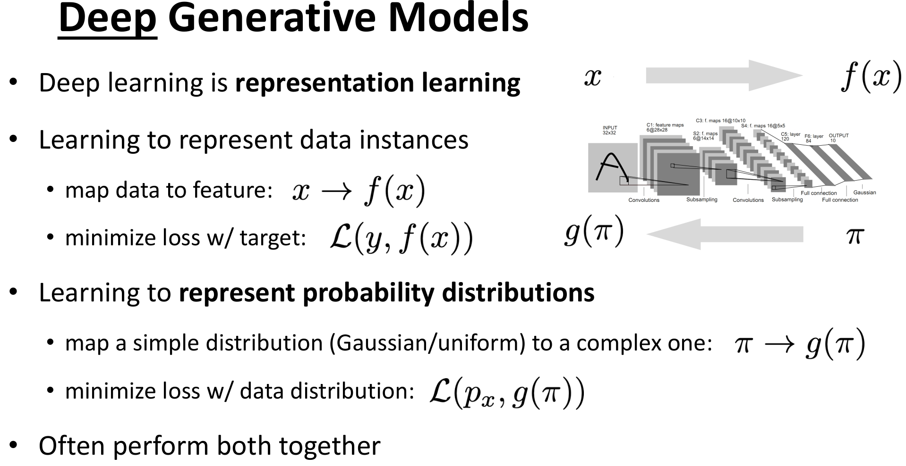

**图3**: 深度生成模型的表征学习——实例表征与分布表征的对比

### 1.4 条件建模: $ p(x \mid y) $ 视角

前述从 $ p_\theta(x) $ 采样得到的生成是**随机的**，我们往往还需要**有条件的生成**——即根据用户意图（如文本提示、类别标签、属性约束等）来控制生成内容。这便引入了条件建模的视角。

生成模型的本质是建模**条件分布** $ p(x \mid y) $:

| 变量 | 含义 | 示例 |
|------|------|------|
| **y**（条件/意图） | 更抽象、信息量更少的输入 | 文本提示（prompt）、约束（如蛋白质对称性）、标签（如“红狐狸”）、属性（如“微笑”“戴眼镜”） |
| **x**（生成对象） | 更具体、信息量更丰富的输出 | 图像、视频、3D 模型、蛋白质序列、传感器读数、实验数据等 |

**典型应用场景**:

| 任务 | y（条件） | x（生成结果） |
|------|-----------|---------------|
| 文生图 | “泰迪熊在讲课” | 图像 |
| 蛋白质设计 | 对称性约束 | 3D 蛋白质结构 |
| 图像分类（生成视角） | 输入图像 | 类别概率 $ p(\text{cat} \mid x) $ |
| 机器人控制 | 视觉观测 | 动作策略 $ p(a \mid s) $ |
| 图像描述 | 输入图像 | 自然语言句子 |

## 2. 从概率建模开始: 两条主线

首先需要具备**概率论与生成模型的基础**，建议先阅读 [机器学习篇-01.生成模型基础](机器学习篇-01.生成模型基础.md)。

对联合分布 $ p(x) $ 的建模有两条经典路径:

| 分解方式 | 数学形式 | 对应模型 |
|----------|----------|----------|
| **条件概率分解** | $ p(x) = p(x_1, x_2) = p(x_1)\,p(x_2 \mid x_1) $ | **自回归模型（AR）** |
| **边缘概率分解** | $ p(x) = \int p(x, z)\,dz = \int p(x \mid z)\,p(z)\,dz $ | **潜变量模型（Latent Variable Model）** |

因此，从建模形式上看，生成模型可大致分为: **自回归模型** 与 **潜变量模型**。下面主要沿**潜变量模型**这条线展开；沿**自回归模型**这条线可参阅 [AR系列篇-01.AR理论篇](AR系列篇-01.AR理论篇.md)。

### 2.1 潜变量模型中的两个核心问题

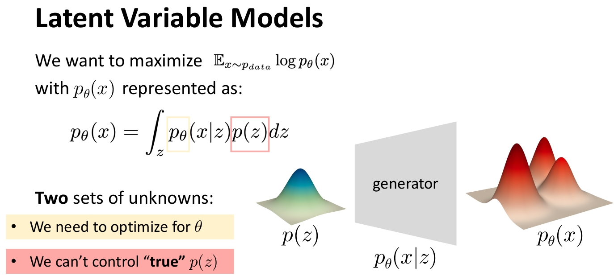

**图4**: 潜变量模型的基本框架。我们面临两个核心问题: ① 真实潜变量分布 $ p(z) $ 不可控、难以直接利用；② 需要优化模型参数 $ \theta $ 以拟合数据。

针对这些问题，可采取三种不同的思路，对应 AE/VAE、GAN、DM 三条分支。

### 2.2 方案一: 引入提议分布与 ELBO → VAE

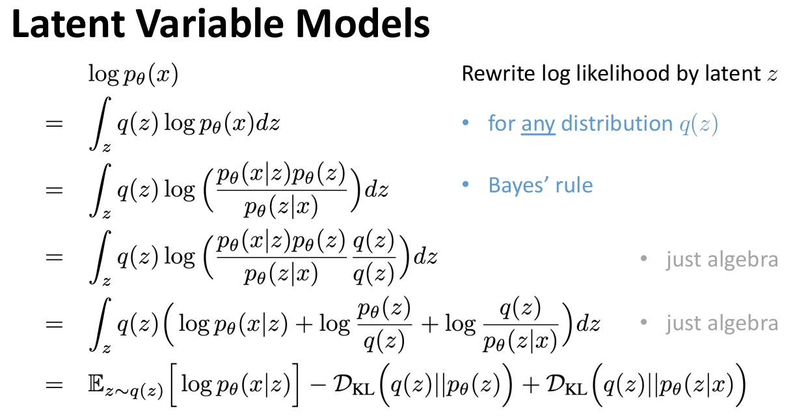

**图5**: 引入**提议分布** $ q(z) $（由编码器参数化），通过变分推断推导出 **ELBO**（Evidence Lower Bound），在优化 ELBO 的过程中同时学习生成与推断，得到 **VAE** 模型。

**建议阅读顺序**:

- [机器学习篇-03.潜变量估计](机器学习篇-03.潜变量估计.md)
- [机器学习篇-04.变分推断](机器学习篇-04.变分推断.md)
- [AE系列篇-01.AE](AE系列篇-01.AE.md)
- [AE系列篇-02.VAE理论篇](AE系列篇-02.VAE理论篇.md)

### 2.3 方案二: 引入判别器 → GAN

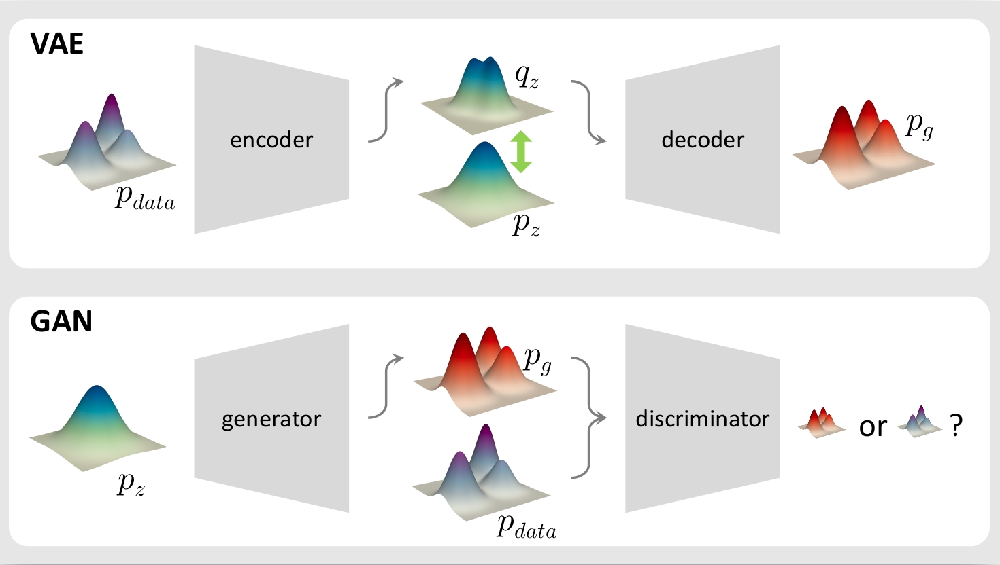

**图6**: 不依赖显式的数据集潜变量分布 $ p(z) $，而是在**生成端**引入一个**判别模型** $ D $，通过生成器与判别器的对抗训练，隐式学习数据分布，得到 **GAN**。

**建议阅读**: [GAN系列篇-01.GAN理论篇](GAN系列篇-01.GAN理论篇.md)

- [补充系列篇-04.生成模型与判别模型](补充系列篇-04.生成模型与判别模型.md)

### 2.4 方案三: 自回归 + 潜变量 → 扩散模型（DM）

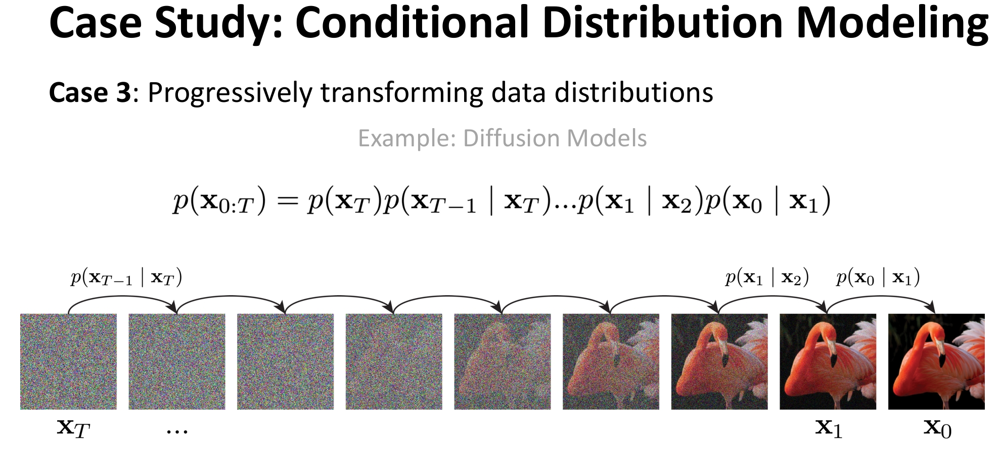

**图7**: 从**条件概率**的链式分解或**分层 VAE** 的角度，均可推导出**扩散模型（DPM/DDPM）**: 前向加噪对应潜变量结构，逆向去噪对应生成过程。

**建议阅读**:

- [DM系列篇-01.DPM](DM系列篇-01.DPM.md)
- [DM系列篇-02.不同形式的DPM](DM系列篇-02.不同形式的DPM.md)

## 3. 训练: 从重构误差到正则化

VAE、GAN、DDPM 的目标函数可以统一理解为: 在**重构误差**的基础上，施加不同形式的**正则化**（或等价的变体）。下图概括了三者的差异。

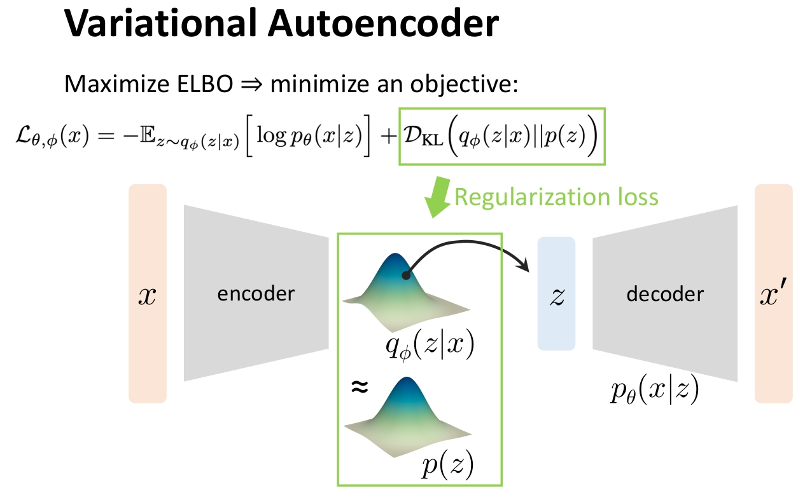

**图8 VAE**: 在 AE 的**重构误差**之上，增加对潜变量的**KL 正则化**（使 $ q(z \mid x) $ 接近先验 $ p(z) $）。

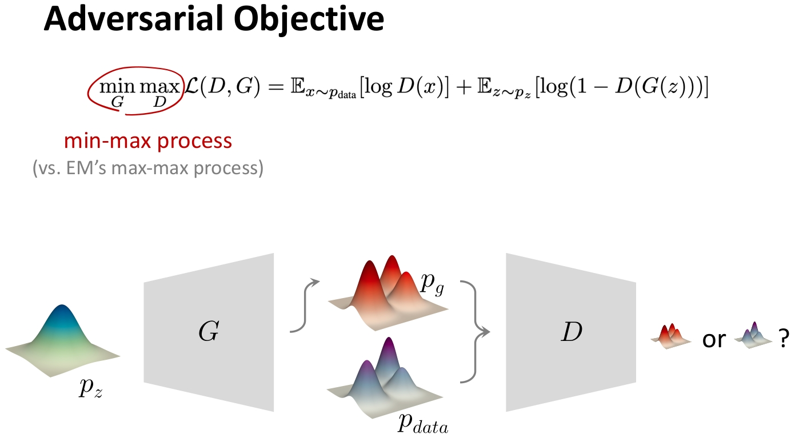

**图9 GAN**: 不用显式像素重构，而是用**判别器**提供“真假”信号，可视为一种**博弈式正则化**。

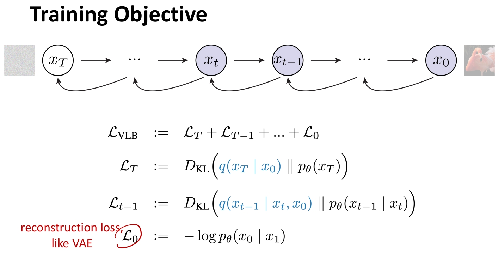

**图10 DDPM**: 经噪声过程的推导，损失形式等价于多步**去噪重建**，不显式出现潜变量 KL 项。

若想深入理解“为什么 KL 散度的方向不能反”“为什么潜变量常取正态分布”等，可参阅:

- [机器学习篇-02.最大似然估计](机器学习篇-02.最大似然估计.md)
- [补充系列篇-01.Mode](补充系列篇-01.Mode.md)
- [补充系列篇-02.Why正态分布](补充系列篇-02.Why正态分布.md)
- [补充系列篇-03.潜变量的可解释性](补充系列篇-03.潜变量的可解释性.md)

## 4. 采样: 从无条件到条件生成

有了前面的理论铺垫，若希望**动手实现**并验证算法，可依次阅读各系列的代码篇（建议先读对应理论篇）:

- [AE系列篇-03.VAE代码篇](AE系列篇-03.VAE代码篇.md)
- [DM系列篇-03.DDPM实现](DM系列篇-03.DDPM实现.md)
- [DM系列篇-04.DPM三种实现对比](DM系列篇-04.DPM三种实现对比.md)
- [GAN系列篇-02.GAN代码篇](GAN系列篇-02.GAN代码篇.md)
- [AR系列篇-01.AR理论篇](AR系列篇-01.AR理论篇.md)、[AR系列篇-02.AR代码篇](AR系列篇-02.AR代码篇.md)

实现后会发现:**无条件**生成的结果是随机的，无法按“类别”“文本”等条件控制输出。下一步自然过渡到**条件生成**: 从 Vanilla 版本扩展到 Conditional 版本。

**条件生成相关阅读**:

- [AE系列篇-04.CVAE理论篇](AE系列篇-04.CVAE理论篇.md)
- [AE系列篇-05.CVAE代码篇](AE系列篇-05.CVAE代码篇.md)
- [DM系列篇-05.CDDPM理论篇1](DM系列篇-05.CDDPM理论篇1.md)、[DM系列篇-06.CDDPM理论篇2](DM系列篇-06.CDDPM理论篇2.md)
- [DM系列篇-07.CDDPM实现篇1](DM系列篇-07.CDDPM实现篇1.md)、[DM系列篇-08.CDDPM实现篇2](DM系列篇-08.CDDPM实现篇2.md)
- [GAN系列篇-03.CGAN理论篇](GAN系列篇-03.CGAN理论篇.md)
- [GAN系列篇-04.CGAN代码篇](GAN系列篇-04.CGAN代码篇.md)
- [AR系列篇-03.CAR](AR系列篇-03.CAR.md)

至此，你已经建立起**生成模型的基础知识体系**。

## 5. 生成模型的改进与进阶

基础算法在实际中往往存在局限，需要针对性地改进:

- **VAE**（连续潜变量难以表达离散、多模态）→ 离散化与矢量量化: [AE系列篇-06.VAE的改进篇1-VQ-VAE](AE系列篇-06.VAE的改进篇1-VQ-VAE.md)
- **DDPM**（采样步数多、速度慢）→ 确定性采样与步数压缩: [DM系列篇-09.DDPM的改进1-DDIM](DM系列篇-09.DDPM的改进1-DDIM.md)
- **GAN**（训练不稳定、梯度消失）→ 用 Wasserstein 距离替代 JS 散度: [GAN系列篇-05.GAN的改进1-WGAN](GAN系列篇-05.GAN的改进1-WGAN.md)

在此基础上，可进一步过渡到近年广泛使用的**条件扩散与潜空间扩散**（如 LDM、CFG，也是 Stable Diffusion 等模型的基础）:

- [DM系列篇-06.CDDPM理论篇2](DM系列篇-06.CDDPM理论篇2.md)
- [DM系列篇-07.CDDPM实现篇1](DM系列篇-07.CDDPM实现篇1.md)、[DM系列篇-08.CDDPM实现篇2](DM系列篇-08.CDDPM实现篇2.md)
- [DM系列篇-10.DDPM的改进2-LDM](DM系列篇-10.DDPM的改进2-LDM.md)

我们对上述内容做一总结: **图11** 概括了生成模型从基础到进阶的完整学习路径，便于读者按图索骥、按需选读。

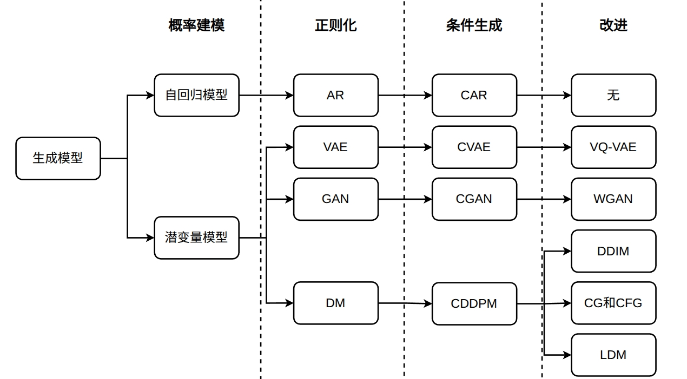

---

**至此，你已经入门生成模型的主干内容。** 后续可继续学习 **FM（Flow Matching）** 等扩展方向。
