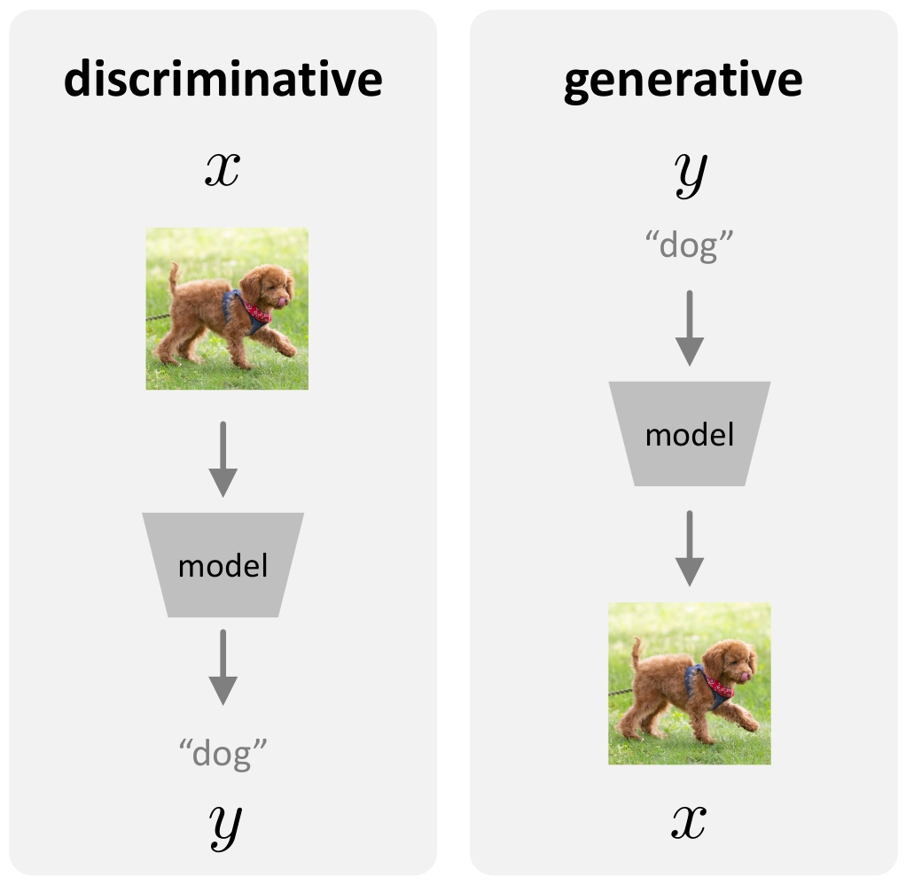
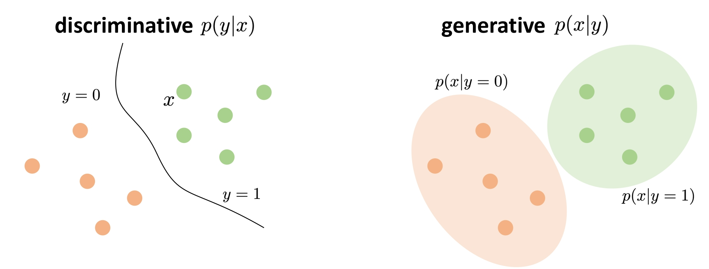
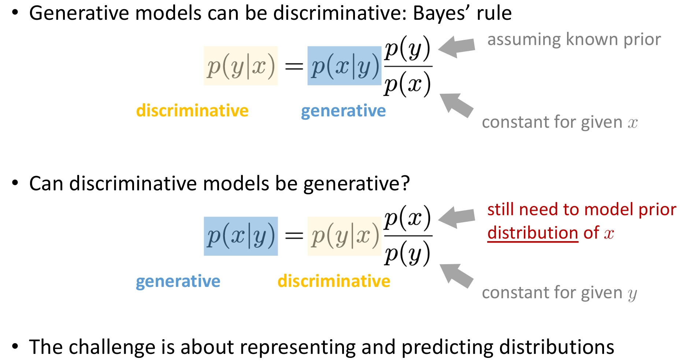
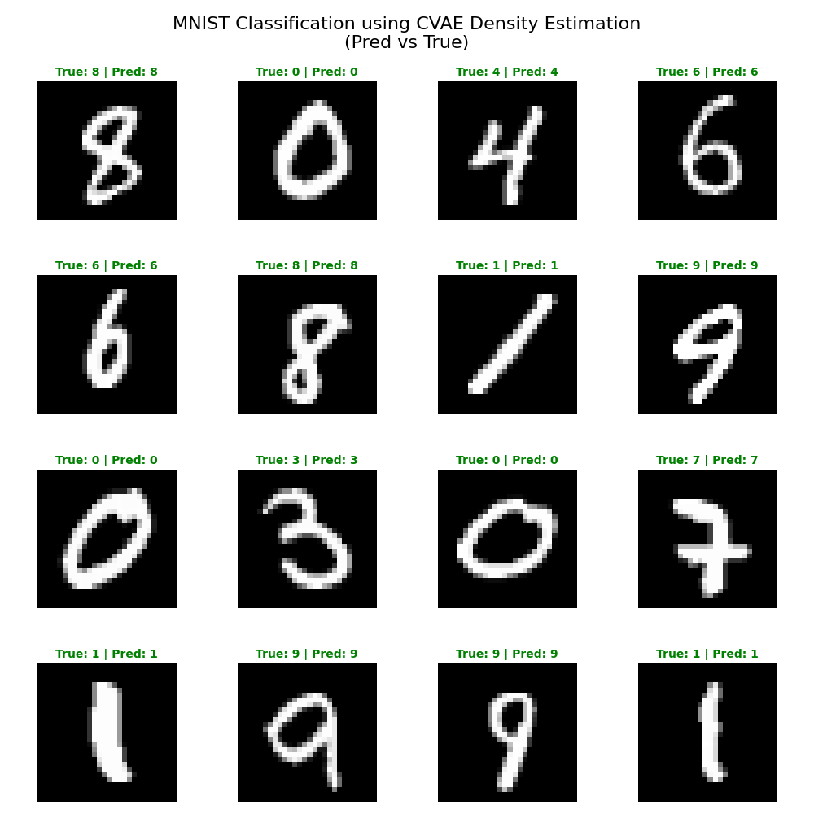

# 补充系列篇-04. 生成模型与判别模型

在机器学习中，我们通常将模型分为两类：**生成模型 (Generative Model)** 和 **判别模型 (Discriminative Model)**。

## 1. 生成模型 vs 判别模型

### 判别模型 (Discriminative Model)
*   **目标**：学习条件概率分布 **$P(Y|X)$**。
*   **直观理解**：给定输入 $X$（如图片），直接预测标签 $Y$（如数字）。
*   **流程**：样本 $x \rightarrow$ 标签 $y$。
*   **性质**：**单一确定输出**。对于特定输入，期望得到一个确定的正确标签。

### 生成模型 (Generative Model)
*   **目标**：学习条件概率分布 **$P(X|Y)$**。
*   **直观理解**：学习每个类别 $Y$ 下，数据 $X$ 的分布形态。
*   **流程**：标签 $y \rightarrow$ 样本 $x$。
*   **性质**：**多可能输出**。对于一个标签（如"猫"），可生成无数种不同的猫图。生成模型建模的是分布，而非单一值。

如图 1、图 2 所示：

<div align="center">

</div>

<small>**图1** 生成模型与判别模型的定义：判别模型输入样本 $x$ 输出标签 $y$；生成模型输入标签 $y$ 输出样本 $x$</small>

<div align="center">

</div>

<small>**图2** 生成模型与判别模型的概率描述：$P(Y|X)$ 与 $P(X|Y)$ 的直观对比</small>

---

## 2. 它们之间的转换关系

### 生成模型可以是判别模型吗？
**答案：可以。**
这正是本文的核心。利用 **贝叶斯公式 (Bayes' Rule)**，我们可以将生成模型学到的 $P(x|y)$ 转化为判别所需的 $P(y|x)$：

$$ \underset{\text{判别}}{P(y|x)} = \underset{\text{生成}}{P(x|y)} \cdot \frac{\overset{\text{先验}}{P(y)}}{\underset{\text{常数}}{P(x)}} $$

*   $P(y|x)$：**判别 (discriminative)**
*   $P(x|y)$：**生成 (generative)**
*   $P(y)$：**假设已知的先验 (assuming known prior)**，通常各类别的频率是已知的。
*   $P(x)$：**给定的常数 (constant for given x)**，在分类时对所有类别 $y$ 是一样的，可以忽略。

因此，**生成模型天生就可以用来做判别任务**。

### 判别模型可以是生成模型吗？
**答案：通常很难。**
让我们尝试反转贝叶斯公式：

$$ \underset{\text{生成}}{P(x|y)} = \underset{\text{判别}}{P(y|x)} \cdot \frac{\overset{\text{需建模分布}}{P(x)}}{\underset{\text{常数}}{P(y)}} $$

*   $P(x|y)$：**生成 (generative)**
*   $P(y|x)$：**判别 (discriminative)**
*   $P(y)$：**给定的常数 (constant for given y)**。
*   $P(x)$：**需建模的数据边缘分布**，即什么样的 $x$ 是真实的（什么样的图片是真实图片）。这是最大的挑战——判别模型只学习了决策边界 $P(y|x)$，完全丢弃了关于 $P(x)$ 的信息，因此无法直接通过公式反推生成样本。

**核心挑战**：
无论是生成还是判别，核心挑战都在于**如何表示和预测分布 (Representing and Predicting Distributions)**。
*   判别模型预测标签的分布 $P(Y|X)$（通常很简单，是一个离散分布）。
*   生成模型预测数据的分布 $P(X|Y)$（通常很复杂，是高维空间中的连续分布）。

如图 3 所示：

<div align="center">

</div>

<small>**图3** 生成模型与判别模型的转换关系：贝叶斯公式连接 $P(y|x)$ 与 $P(x|y)$</small>

---

## 3. 实际应用：利用 CVAE 进行分类

通过上述理论，我们可以利用 CVAE 的生成能力进行分类。

分类决策规则可以写为：

$$ \hat{y} = \arg\max_{y} P(y|x) = \arg\max_{y} \frac{P(x|y)P(y)}{P(x)} $$

忽略常数分母 $P(x)$：

$$ \hat{y} = \arg\max_{y} \underbrace{P(x|y)}_{\text{CVAE Generation}} \cdot \underbrace{P(y)}_{\text{Class Prior}} $$

**结论**：如果我们能计算出图片 $x$ 在每个类别 $y$ 下的生成概率（似然度），我们就能分类！

> **注意：关于先验概率 $P(y)$ 的说明**
> 
> 在上述公式中，我们似乎只关注了 $P(x|y)$ 而忽略了 $P(y)$。
> 这是因为在 MNIST 等均衡数据集中，每个类别出现的概率是大致相等的（$P(y=0) = P(y=1) = \cdots = P(y=9) \approx 0.1$）。
> 
> 当 $P(y)$ 为常数时，$\arg\max_y P(x|y)P(y)$ 等价于 $\arg\max_y P(x|y)$。
> 
> **如果数据集类别不平衡**（例如类别 A 占 90%，类别 B 占 10%），则必须显式地乘上先验概率 $P(y)$，否则模型会忽略类别分布的偏差。
> 在对数域计算时，公式变为：$\text{Score}_y = \log P(x|y) + \log P(y)$。

---

## 4. CVAE 如何计算 $P(x|c)$？

CVAE（条件变分自编码器）训练的目标是最大化对数似然的下界（ELBO）。这意味着 CVAE 本身就是一个密度估计器。

在 CVAE 中，条件 $c$ 就是标签 $y$。我们需要计算 $\log P(x|c)$。

### 重要性采样 (Importance Sampling)（精确估计）

ELBO 只是下界，为了更精确地估计 $\log P(x|c)$，我们可以使用重要性采样（类似于 IWAE 的做法）：

$$ P(x|c) = \int P(x|z,c)P(z|c) dz = \mathbb{E}_{z \sim q(z|x,c)} \left[ \frac{P(x|z,c)P(z|c)}{q(z|x,c)} \right] $$

在对数域中计算（Log-Sum-Exp 技巧）：

$$ \log P(x|c) \approx \log \left( \frac{1}{K} \sum_{k=1}^K \frac{P(x|z_k,c)P(z_k|c)}{q(z_k|x,c)} \right) $$

其中 $z_k$ 是从编码器 $q(z|x,c)$ 中采样的 $K$ 个样本。

我们在代码 `cvae_estimate_prob_density.py` 中正是使用了这种方法：
1.  对于一张未知的数字图片 $x$。
2.  假设它是 "0"，计算 Score_0 = $\log P(x|c=0)$。
3.  假设它是 "1"，计算 Score_1 = $\log P(x|c=1)$。
4.  ...
5.  选择 Score 最高的类别。

**核心代码**（`cvae_estimate_prob_density.py`）：

`estimate_log_probability` —— 用重要性采样估计 $\log P(x|c)$：

```python
def estimate_log_probability(model, x, c_label, n_samples=100):
    """log p(x|c) ≈ log(1/K * Σ [p(x|z,c)p(z)/q(z|x,c)])"""
    model.eval()
    with torch.no_grad():
        # 编码 q(z|x,c)，采样 z ~ q(z|x,c) 共 K 次
        mu_q, sigma_q = model.encoder(torch.cat((x, c), dim=1))
        mu_q, sigma_q = mu_q.expand(n_samples, -1, -1), sigma_q.expand(n_samples, -1, -1)
        epsilon = torch.randn_like(mu_q)
        z = mu_q + epsilon * sigma_q
        
        # log p(x|z,c) 解码器似然 | log p(z) 标准正态先验 | log q(z|x,c)
        z_c = torch.cat((z, c.expand(n_samples, -1, -1)), dim=-1)
        x_hat = model.decoder(z_c)
        log_p_x_z = -torch.sum((x - x_hat) ** 2, dim=-1)
        log_p_z = -0.5 * torch.sum(z ** 2, dim=-1)
        log_q_z = -0.5 * torch.sum(2*torch.log(sigma_q) + epsilon**2, dim=-1)
        
        log_w = log_p_x_z + log_p_z - log_q_z
        return (torch.logsumexp(log_w, dim=0) - np.log(n_samples)).item()
```

`classify_sample` —— 分类决策 $\hat{y} = \arg\max_c \log P(x|c)$：

```python
def classify_sample(model, x, num_classes):
    log_probs = [estimate_log_probability(model, x, c) for c in range(num_classes)]
    return np.argmax(log_probs)
```

---

## 5. 实验结果分析

如图 4 所示：

<div align="center">

</div>

<small>**图4** CVAE 密度估计分类 MNIST 结果：每张图显示真实标签与预测标签，绿色表示正确、红色表示错误</small>

在我们的 MNIST 实验中，CVAE 作为分类器表现相当不错。

*   **直观解释**：当你告诉模型“这是一张 7”并输入一张 7 的图片时，模型觉得“很合理”，重构误差低，概率密度高。
*   **反之**：当你告诉模型“这是一张 0”却输入一张 7 的图片时，模型会试图强行把 7 编码成 0 的潜在空间，或者解码器试图用 0 的模式去解释 7，导致巨大的重构误差或极低的概率密度。


## 6. 总结

将 CVAE 用于分类，本质上是在做 **假设检验**：
“假设它是类别 A，这个数据的出现概率是多少？假设它是类别 B，概率又是多少？”

这展示了生成模型最迷人的特性：**它不仅仅是为了创造新的图片，更是为了理解数据的本质结构和分布。**

**推理 (Inference)** 时，生成模型通常包含两类组件：
*   **采样器 (Sampler)**：用于生成新样本，如从 $P(x|y)$ 中采样得到新的 $x$。
*   **概率密度估计器 (Density Estimator)**（可选）：用于计算某个样本 $x$ 的概率密度，如在 VAE、Flow 等模型中估计 $\log P(x|c)$。

本文以 CVAE 为例，聚焦后者——如何用生成模型进行概率密度估计并用于分类。相关代码见 `code/dl/ae/cvae/cvae_estimate_prob_density.py`。


## 参考文献

1. He, K. Deep Generative Models. [课程讲义/ slides]
2. Ng, A. Y., & Jordan, M. I. (2002). On discriminative vs. generative classifiers: A comparison of logistic regression and naive Bayes. *Advances in Neural Information Processing Systems*, 14.
3. Kingma, D. P., & Welling, M. (2014). Auto-encoding variational Bayes. *ICLR*.
4. Sohn, K., Lee, H., & Yan, X. (2015). Learning structured output representation using deep conditional generative models. *Advances in Neural Information Processing Systems*, 28.
5. Burda, Y., Grosse, R. B., & Salakhutdinov, R. (2016). Importance weighted autoencoders. *ICLR*.